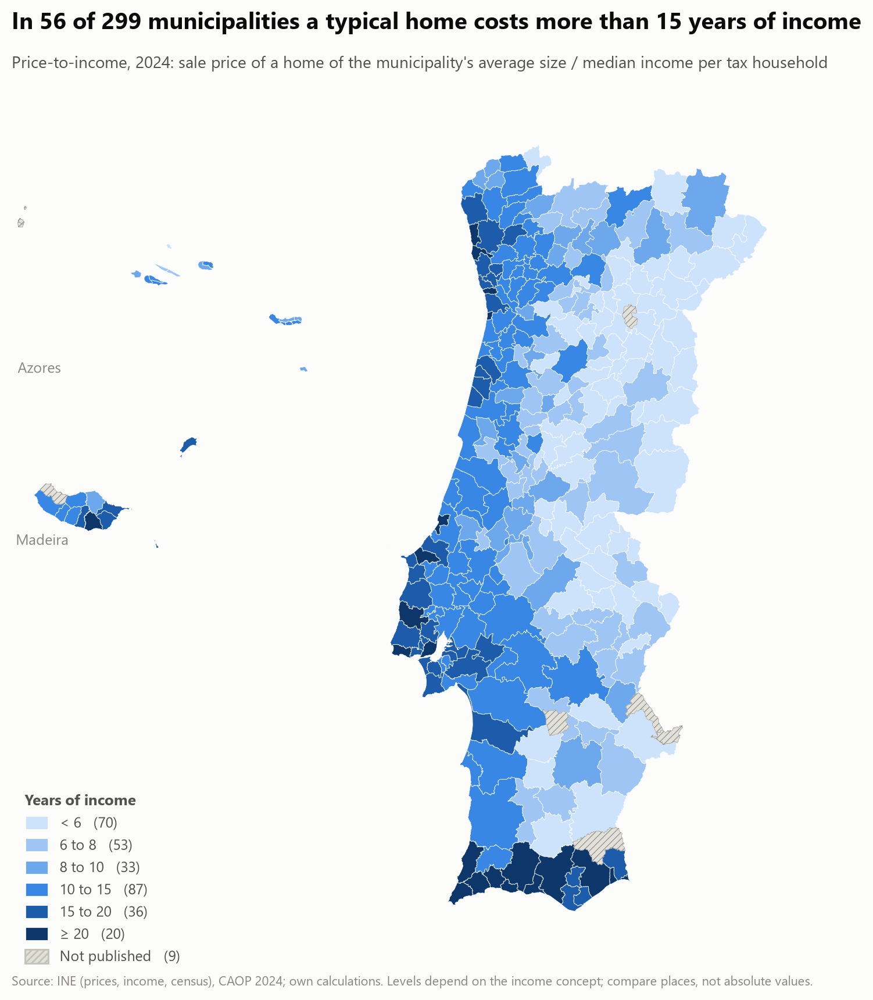

# Portugal's Housing Crisis

An evidence-based look at why housing affordability in Portugal has deteriorated over the past three
decades, what role supply, demographics, tourism and regional dynamics play, whether specific housing
policies have worked, and what alternative interventions could achieve — and cost.

> **Status:** all four phases are done: evidence ([report](reports/p1_evidence.md)), explanation ([report](reports/p2_explain.md)), one policy test ([report](reports/p3_policy.md)) and forecasts with a scenario simulator ([report](reports/p4_forecast.md)). The dashboard has five pages: landing, geographic map, trends, explanatory and simulator. Research questions and their status: [docs/research_questions.md](docs/research_questions.md).



## What it found
**Evidence (phase 1)**
- Real house prices have more than doubled since 2013; Portugal's nominal index rose 3.0 times against 1.7 for the EU27.
- The median municipality needs 9.5 years of income to buy a home (8.0 in 2016); the 90th percentile needs 18 (12 in 2016).
- The mortgage rate explains most of the recent jump in the burden: the median payment burden went from 28% to 45% of income, and would be 33% had rates stayed at their 2016 level.
- Pressure is concentrated in the Lisboa area and the Algarve; interior districts stayed near 5 years of income.

**Explanation (phase 2)**
- Geography accounts for most of where affordability worsened: district, coast and density explain 53% of the variation in the 2016-2024 change of price-to-income across mainland municipalities; demand, supply, tourism and second homes add under two points.
- Of 18 associations with the rise in price-to-income followed through added controls, only four hold at every step (foreign residents, completions, Brazilian and Lusophone African residents, all in the panel and all halved or more by region-year effects), and none rests on a design that passes its own test: the IMI event study fails its pre-trend test and credit growth follows prices; the project reports adjusted associations and bounds, not causal effects.
- Since 2013 real prices rose 129% against 27% for real wages; wages and falling rates account for the 2013-2021 rise, but not 2021-2025, when about 50 log points of the price rise are left over.
- That rise was not borrowed: real housing credit fell 27% from 2013 to 2024 while real prices rose 98%, and credit growth follows price growth rather than leading it.
- Credit standards tightened while prices rose: the mean term of new housing loans fell from 33.4 to 31.0 years and high-risk loans from about 32% to 3% (2018-2024); the longest legal term (40 years) adds at most 29% to what a payment carries, against real prices +100% since 2013. The State guarantee for borrowers up to 35 brings the cash needed for a median home from 2.5 years of income to 0.6, but the payment on a full loan stays above the 50% debt-service cap in half of municipalities.
- Building collapsed from 93,000 dwellings a year (1995-2004) to 16,000 (2015-2025); since 2021 implied new households far exceed completions.
- Foreign residents go with rising price-to-income within municipalities, mainly Brazilians and Lusophone Africans, and the pattern is largely a marker of where they settled.
- Between the 2011 and 2021 censuses households grew only at one and two persons (+266,000) while larger ones fell by 161,000, yet 68% of the dwellings completed had three or more bedrooms; the mismatch is widest in cheap rural municipalities, not where prices are highest.
- Vacant homes could on paper house the shortfall where it arises (425,000 above a 5% frictional level against 195,000 implied missing homes in 2021-2023), but only 41% of it if a quarter are usable; the biggest shortfalls are in the suburbs of Lisboa and Porto, where vacancy is lowest.
- Building did not get much dearer: the cost of building new homes rose 50% in 2013-2025 (materials 38%, labour 66%, in line with wages) against 183% for nominal house prices, and licensing followed prices, not costs; land, planning rules and licensing times are not in the data.
- Foreign buyers paid 69% more per m2 than domestic buyers at the end of 2019 and 35% at the end of 2025, mostly because they buy in dearer places (25% to 18% inside a municipality); where they buy often, domestic buyers' prices are higher but did not rise more within the same district. No investment flow is available, only prices.
- Renovation is small and in the wrong places: licences for works on existing family-housing buildings are about 3,800 a year (8,400 in 2002) against 16,300 for new buildings, and they are most common in rural municipalities (34% of completed works against 16% in urban ones) and unrelated to where homes are short; at today's pace, renovating a quarter of the excess vacant homes would take 48 years at one home per building (16 at three).
- Most of the new households are smaller households: 2011-2021 households grew 2.6% on a population that grew 0.4%, and 79% of the 105,000 added come from the fall in persons per household (2.61 to 2.55), one-person households rising from 21% to 25%; in the interior households grew while 239 of 308 municipalities lost residents, and the one-person share does not go with where prices rose.

**Policy (phase 3)**
- Cuts in the municipal property-tax rate (IMI): the effect on prices cannot be told from zero or from full capitalisation, and the design fails its pre-trend test, so the result is inconclusive, not causal.
- The money at stake is municipal: IMT revenue (property transfer tax) is up 377% in real terms since 2013 while IMI revenue (annual property tax) is down 12% since 2019 against prices up 86%, and 199 of 300 councils already sit at the 0.30% legal floor, so only about 8% of the IMI bill can be cut without a change of the law.
- A tripled IMI on the 425,000 excess vacant homes would bring 55 to 221 million euros a year (3% to 13% of IMI) but costs an owner only about 5% of a year's rent, so it would not push many to let. Spent on building, that revenue would lower the 2035 price-to-income by only 0.06 to 0.24 years against a baseline rise of 4.6 (modelled); cancelling that rise by building alone would take about 5.3 billion euros a year, 3.3 times today's housing spending, an arithmetic extrapolation far beyond the packages tested.
- The State spends 0.55% of GDP on housing development and allowances (1,615 million euros in 2024, up from 0.32% in 2016); Portugal had the largest price rise of six peers since 2015 (+124%) with property tax and housing support both below their median.
- Targeted tax exemptions cost very different amounts (the youth first-home exemption 146 million euros a year for 60,000 buyers, an IMT exemption on new homes 280, a renovation IMI exemption 5.5, against 294 for a one-point cut of the transfer tax), and in the simulator they raise price-to-income as much as a broad cut of the same cost; only the one aimed at new homes comes near paying for itself in affordability, and only if completions respond to prices as an association (not causal) suggests.
- A cut in the property tax goes mostly to owners in the dearest places: of an IMI cut within the legal floor, 51% reaches owners who live in the home, 18% landlords and 26% second or empty homes, tenants nothing directly, and 87% falls in the third of municipalities with the highest price-to-income.
- Rent rules cap the yearly rise of existing leases, not the rent of new ones: a lease signed at the 2020 median could rise 9.5% by 2024 (consumer prices +16.7%), so a sitting tenant's real rent fell 6.1% while the median rent of new leases rose 46.9%; a new lease costs 32% more than that updated rent in the median municipality, and roughly nine in ten let homes are not repriced in a year. The gap is arithmetic from the rules, not an estimate of their effect, and nothing here says what they did to rental supply.

**Forecasts and scenarios (phase 4)** — exponential smoothing beats naive baselines on rolling-origin validation; random-fold validation overstates skill. In the simulator, 5,000 to 10,000 extra homes a year lower the 2035 price-to-income ratio by only 1% to 3%.

All results are associations or conditional scenarios with stated limits (short municipal history, one national mortgage rate, assumed loan terms); each report has a limitations section.

## Questions
1. **Evidence** — How have prices, rents and affordability evolved nationally and by municipality, in real terms?
2. **Explanation** — Which factors (income, population, immigration, construction, tourism, interest rates) are most strongly associated with deteriorating affordability, and do pressures spill over between municipalities?
3. **Policy** — Did a specific housing policy measurably change affordability, and how confident can we be?
4. **Scenarios** — How might affordability evolve under different demographic, economic and policy scenarios, and at what fiscal cost?

## Approach
| Phase | Methods | Output |
|---|---|---|
| 1. Establish the evidence | Data harmonisation, inflation adjustment, affordability indicators, choropleths | [report](reports/p1_evidence.md) |
| 2. Explain the trends | Two-way fixed-effects panel regression, Moran's I / LISA / Gi*, segmentation | [report](reports/p2_explain.md) |
| 3. Evaluate a policy | Difference-in-differences / event study, pre-trend and placebo tests | [report](reports/p3_policy.md) |
| 4. Forecast and simulate | Naïve/ETS/ARIMA with rolling-origin validation, scenario simulator, regional outlook | [report](reports/p4_forecast.md) |

Interactive dashboards (Streamlit, `uv run streamlit run app/Home.py`): a **geographic** explorer (municipality map of any indicator, level or change between two years, with rankings), **trends** (national price index and rates, a municipality against all others, group medians), **explanatory** (what accounts for where affordability worsened, the policy test, and the money at stake in property taxes and housing spending) and the forecast & policy **simulator**. They read only the committed processed data and report tables.

## Data
Public Portuguese and European sources (INE, Banco de Portugal, Eurostat, BIS, OECD, Autoridade Tributária, Turismo de Portugal RNAL, DGT CAOP, AIMA). Full registry: [docs/data_catalog.md](docs/data_catalog.md).

## Reproduce
```bash
uv sync
uv run python scripts/run_pipeline.py   # downloads sources, builds interim tables and the processed panels
uv run pytest
```
Requires Python 3.14 and [uv](https://docs.astral.sh/uv/). Notebooks are [jupytext](https://jupytext.readthedocs.io/) pairs (`.py` is the source, `.ipynb` carries the rendered outputs).

## Repository layout
```
config/      dataset sources and scenario assumptions
data/        raw → interim → processed (raw/interim not committed)
docs/        brief, research questions, data catalog, methodology, decisions
src/pthousing/  all analysis code (data, features, analysis, simulation, viz)
notebooks/   one folder per phase, thin notebooks calling src
app/         Streamlit dashboards
reports/     phase write-ups, figures, tables
tests/       unit tests
```
