# Phase 1 — Establish the evidence

How have prices, rents and affordability evolved, and where? Descriptive evidence only: nothing here is a causal
claim. Figures: `reports/figures/p1/`, tables: `reports/tables/p1/`, notebooks: `notebooks/p1_evidence/`
(`p1_01` to `p1_08`). Definitions: [methodology](../docs/methodology.md).

## Key findings

1. **House prices have more than doubled in real terms since 2013.** Deflated with the CPI, the national index
   fell until 2013 and is now 2.6 times its low. Nominally Portugal's index is 3.0 times its 2015 level against 1.7
   for the EU27; the next highest are Ireland and Spain, at about 2.0.
2. **Prices per m² rose 68% in real terms in the median municipality between 2016 and 2025** (645 to 1,083 euros,
   constant 2024 euros). In 213 of 302 municipalities they rose more than 50%. Lisboa is at 4.4 times the median.
3. **Rents have risen as fast as prices, and faster lately.** On a fixed set of 187 municipalities, real prices and
   real rents both rose about 24% between 2020 and 2024; over the last two years rents rose 18% and prices 11%.
4. **The mortgage rate explains most of the recent jump in the burden of buying.** Rates on new loans fell to 0.6% in
   2021 and rose to 4.8%; a loan of 100,000 euros costs 73% more a month at the peak than at the trough. The median
   burden went from 28% to 45% of income (2016 to 2024); with the rate held at its 2016 level it would be 33%.
5. **Affordability worsened in three quarters of municipalities, and the gap between places widened.** The median
   municipality needs 9.5 years of income to buy (8.0 in 2016), the 90th percentile 18 (12 in 2016). Municipalities
   above 15 years went from 5% to 19% of the total; price-to-income worsened in 222 of 296 and improved in 74.
6. **The pressure is concentrated.** In 2024, 56 of 299 municipalities are above 15 years of income, 14 of the 15 in
   Faro and 10 of the 16 around Lisboa. The largest deteriorations are in Cascais (+13 years), Lagos (+12), Aljezur
   (+12), Porto (+11) and Vila do Bispo (+10); by district, Setúbal (+7.2) and Lisboa (+6.8). Interior districts such
   as Bragança and Guarda stayed near 5 years, and 70 municipalities are below 6.

7. **Over thirty years, prices are at a record and the ratio to income is the highest in the series.** After inflation,
   national house prices peaked in 2001, fell 33% to 2013 and passed that peak again in 2020; in 2025 they are 2.3 times
   the 2013 low. The OECD price-to-income index (2015 = 100) was 142 in 1995, fell to 97 in 2013 and is 167 in 2025,
   33% above its long-term average. Real rents barely moved between 1995 and 2015 and are 11% higher in 2025 than in
   2015: the rise is in the price of buying, not of renting (section *Thirty years*).
8. **Migration, not births, decides whether the population grows.** Deaths have outnumbered births every year since 2009
   (-34,000 in 2025). Over 1995-2025 net migration added 1.56 million people and natural change took away 350,000; in
   2022-2023 net migration was 307,000 to 371,000 a year, enough to make 248 of 308 municipalities grow despite a
   natural decline, after a 2012-2019 in which 186 lost people on both counts (section *Population change*).
9. **The premium of new homes has halved and flats now cost more than villas.** Among 118 municipalities, new homes cost
   a median 24.5% more per m² than existing ones in 2019 and 12.3% in 2025 (existing prices rose faster after inflation:
   +61% against +50%). Appraised flats were 6% cheaper than villas per m² in 2011 and are 17% dearer in 2025 (section
   *Kinds of home and kinds of price*).

## Prices and rents

Tables: `real_growth_by_municipality.csv`, `price_sqm_real_by_district_2016_2025.csv`,
`rent_sqm_real_by_district_2020_2024.csv`.

## Thirty years

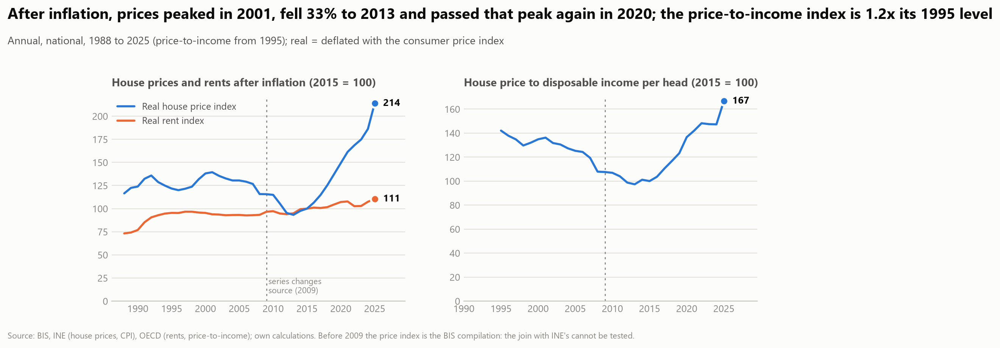

Two sources extend the national view back (`p1_03`). The BIS residential property price index starts in 1988; from 2009 it
**is** INE's index (the ratio is constant to four decimals over 69 quarters), and before 2009 it is a BIS compilation of
national sources. The OECD analytical indicators add the rent index (from 1959) and the price-to-income ratio (from 1995,
nominal price over nominal disposable income per head). Real values use the project's CPI deflator, as the BIS's real
series does (the OECD's own real series deflates differently, up to 4% apart).

- **Cycles.** Real prices rose in the early 1990s, peaked in 2001 (139 on 2015 = 100), fell 33% to 2013 (93), passed the
  old peak in 2020 (149) and stood at 214 in 2025. The price-to-income index fell from 142 (1995) to 97 (2013) and then
  rose to 167: 17% above 1995 and, against the OECD's long-term average, 33% above it.
- **Prices against rents.** Real rents rose from 73 (1988) to about 95 by 1995 and stayed within 93 to 97 until 2012;
  they are 111 in 2025. The price-to-rent index is 193 (2015 = 100), 42% above its long-term average.
- **The median municipality understates the typical buyer's experience.** From 2016 to 2024 the national price-to-income
  index rose 42%, the median municipality's 19%, and municipalities weighted by their 2024 sales 49% (mean) to 53%
  (median). The national index follows transactions, which are in cities and on the coast (urban municipalities are
  32 of 271 but 46% of sales); the median municipality is a typical inland one. The two ratios use different incomes
  (per head against per tax household), so only changes are compared (`national_vs_municipal_pti.csv`).

Tables: `long_run_summary.csv`, `national_vs_municipal_pti.csv`.

## Mortgage rates

## Affordability indicators

## Where

| Price-to-income, 2024 | Change in price-to-income, 2016 to 2024 |
|---|---|
| 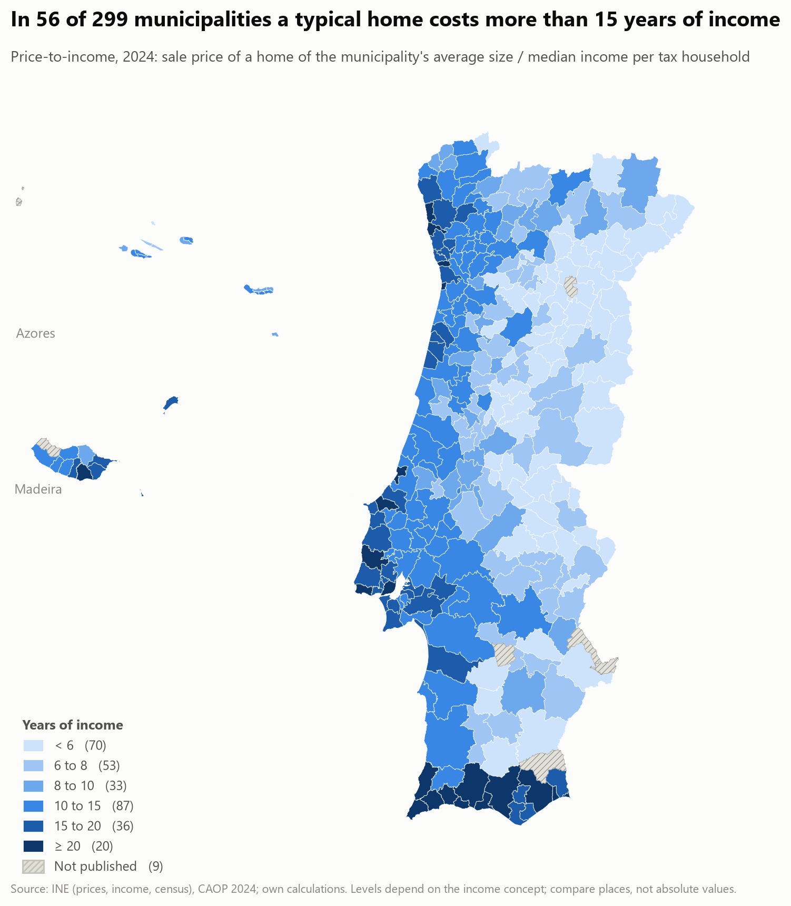 |  |

| Rent-to-income, 2024 | Mortgage burden, 2024 |
|---|---|
|  |  |

Tables: `affordability_by_municipality_2024.csv`, `pti_by_district_2016_2024.csv`,
`pti_change_by_municipality_2016_2024.csv`.

## Renting or buying? (RQ1.6)

A year of owning costs the interest on the loan, the return forgone on the deposit, property tax (IMI), upkeep and the
one-off costs of buying spread over ten years: **5.9% of the price in 2024** (median municipality), against a rent yield
(twelve rents over the price) of 5.6%. The difference is the **break-even appreciation**, the yearly price growth at which
owning costs the same as renting. Only the mortgage rate and the IMI rate are observed; the loan (80%), the 3% return on
the deposit, 1% upkeep, 6% buying costs, ten years and IMI on 60% of the price are assumptions (`config.py`), so the
levels carry about a point of doubt and the **changes** are the finding (sensitivity below).

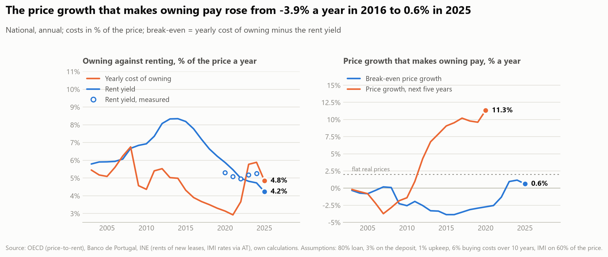

- **The rate decides, not the price.** The cost of owning fell from 5.5% of the price in 2012 to 2.9% in 2021 and went
  back to 5.9% in 2024 as the mortgage rate went from 3.9% to 0.7% to 4.4%. The rent yield moved much less (5.5% in the
  median municipality in both 2020 and 2024). The break-even went from -3.9% a year in 2016 (owning was cheaper even if
  prices fell 4% a year) to +1.2% in 2024 and +0.6% in 2025. In the median municipality the owner's cash bill
  (payments including principal, IMI, upkeep) went from 0.77 of the rent in 2020 to 1.09 in 2024.
- **At flat real prices owning has been cheaper in every year since 2003** (break-even below 2%), and by hindsight it paid in
  15 of 18 years (2003-2020), not in 2006-2008, when the next five years brought falling prices. That says what happened,
  not what to expect: rents of new leases are used, existing leases follow inflation and are cheaper to hold.
- **Not every place.** In 2024 owning is cheaper than renting with no price gain in 86 of the 212 municipalities with a
  rent (41%), and dearer even at 2% growth in 8, all tourist or coastal (Algarve, Madeira, Nazaré). Break-even is
  0.8 pp in urban and -0.4 pp in rural municipalities, 1.0 on the coast and -0.3 inland: renting is relatively cheaper where
  prices are high.

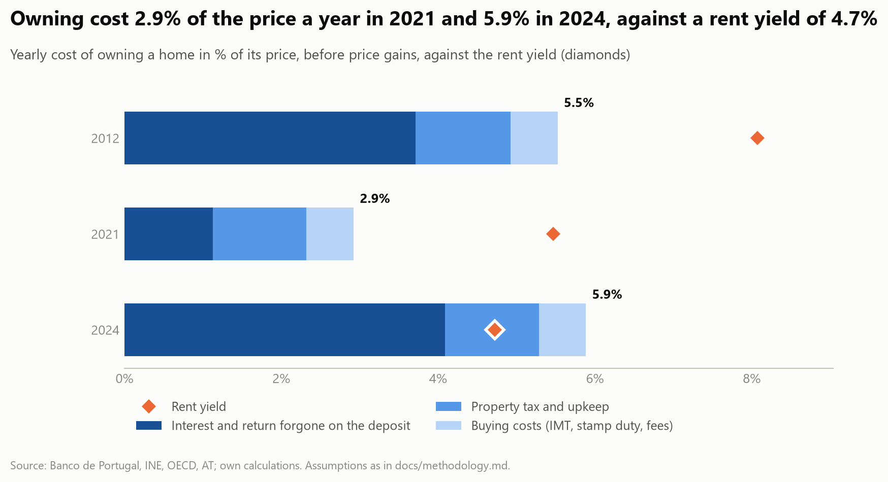

| Break-even price growth, 2024 | Cash needed on the day, 2024 |
|---|---|
| 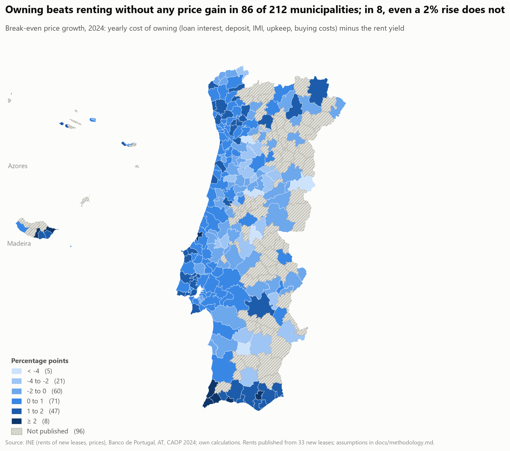 | 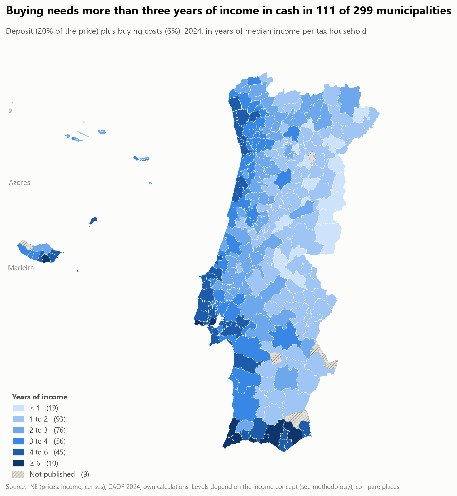 |

- **The barrier is cash, not the yearly cost.** The deposit plus buying costs are a median 2.5 years of income (10th to
  90th percentile 1.2 to 4.8), above three years in 111 of 299 municipalities and above six in the Algarve, Madeira and
  Lisbon's coast. A household that cannot save that, or that cannot get an 80% loan at a burden of 45% of income
  (`p1_02`), is renting whatever the yearly arithmetic says; this analysis compares costs, not access.
- **Sensitivity (2024, median municipality):** the break-even of 0.3 pp moves between -0.3 (no return forgone on the deposit)
  and 1.3 (2% upkeep); with 2% upkeep owning is cheaper at flat real prices in 74% of municipalities instead of 96%. The
  sign of the change since 2021 does not depend on any assumption, since only the rate moves.

Tables: `rent_vs_buy_trend_2020_2024.csv`, `rent_vs_buy_by_municipality_2024.csv`, `rent_vs_buy_by_type_2024.csv`,
`rent_vs_buy_sensitivity_2024.csv`, `rent_vs_buy_anchor_check.csv`.

## Population change: births, deaths and migration (RQ3.1)

Population change is natural change (births minus deaths) plus net migration. Nationally Eurostat gives both from 1960
(INE data); at municipal level INE has them only for 2011-2023. Net migration is the residual of the estimate, so it also
holds statistical adjustments. INE's post-census revision of 2020-2021 (+201,000 persons) is not a flow: it is drawn
apart (grey bars) and the municipal comparison uses 2012-2019 and 2022-2023.

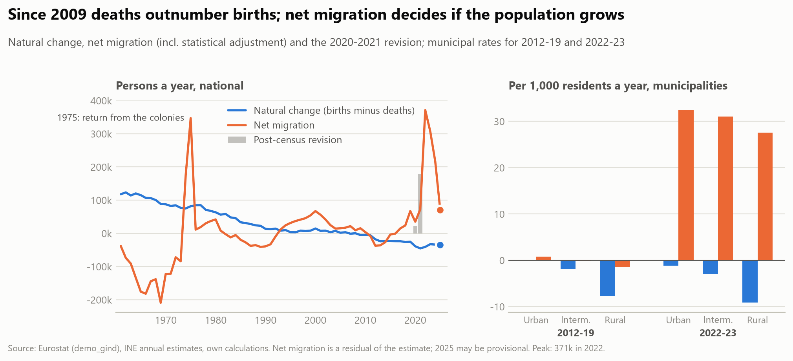

- **Since 2009 deaths outnumber births, every year.** Natural change was +118,000 a year in 1961 and fell steadily to
  about zero in the 2000s; it is negative in all 17 years 2009-2025 and between -33,000 and -45,000 a year since 2020
  (-34,000 in 2025).
- **Migration decides the population.** Over 1995-2025 the population grew by 1.42 million: natural change contributed
  -350,000, net migration +1.56 million and the census revision +201,000. Migration moves in much bigger swings: -1.58
  million in 1961-1973 (emigration), +0.63 million in 1974-1985 (returns from the colonies, a spike of +347,000 in 1975),
  -108,000 in the crisis years 2011-2014 and +966,000 in 2022-2025, 242,000 a year. The peak is 371,000 in 2022; the
  provisional figure for 2025 is 71,000.
- **The population fell until 2018, then the surge came.** In 2011-2019 it fell by about 197,000 and net migration was
  negative until 2016; it was +67,000 in 2019 and +307,000 to +371,000 in 2022-2023. The surge falls in the years of the
  steepest price rises reported above (an association in time, not a test of cause: that is phase 2).
- **Where: stagnation, then growth almost everywhere.** In 2012-2019, 186 of 308 municipalities (38% of the population)
  lost people on both counts and 60 more could not offset their natural decline; only 39 grew. In 2022-2023, 248 (81% of
  the population) grew only because migrants offset a natural decline, 14 grew on both counts and 5 lost both.
- **Rural and inland places.** In 2012-2019 rural municipalities lost 165,000 people (natural -7.7 and migration -1.5
  per 1,000 residents a year) and inland ones 210,000, while the coast gained 7,000. In 2022-2023 net migration is 28 to
  32 per 1,000 a year in every density class (urban 32, intermediate 31, rural 28), 35 on the coast, 41 on the estuaries
  and 25 inland: it covers the rural natural decline (-9 per 1,000), so rural municipalities grew too (+79,000), but
  rural places depend most on migrants.

Tables: `population_change_by_period.csv`, `population_components_by_density.csv`,
`population_components_by_coast.csv`, `population_growth_regimes.csv`.

## Foreign residents: how many, who, where (RQ3.2)

Foreign nationals with a residence title on 31 December (INE, from AIMA/SEF), 2014 to 2023. This is a stock of titles, not
the foreign-born population: people who took Portuguese nationality are not counted, and the count can move with
administrative processing.

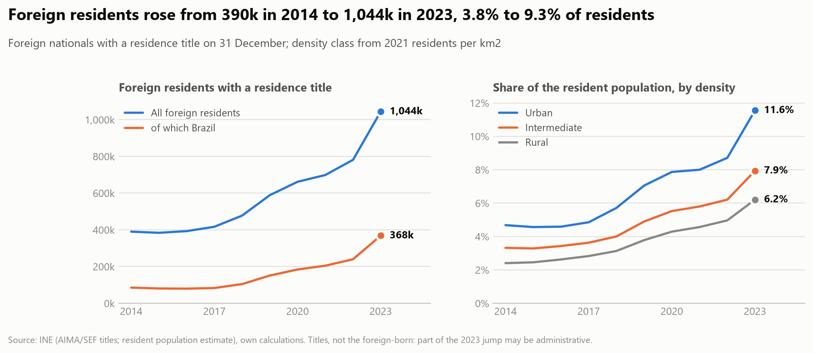

- **A 2.7-fold rise.** 390,000 in 2014, 589,000 in 2019, 781,000 in 2022 and 1,044,000 in 2023: from 3.8% to 9.3% of the
  resident population. Between 2014 and 2019 the resident population fell by 20,000 while the number of titles rose by
  199,000; in 2019-2023 the population grew by 829,000 and the titles by 455,000 (55%), so titles grew while the population
  did not, and account for over half of the recent growth (natural change and emigration are not split here).
- **The 2023 jump is everywhere.** The count rose 34% in the median municipality and by more than 20% in 222 of 308, so it
  is a national movement (probably processing of titles, see data quality), not local. Read 2023 levels with that in mind.
- **Brazil is the story.** Brazilians went from 85,000 to 368,000 (4.3 times, 35% of the 2023 total); the "other" group
  (all nationalities not listed, 37%) grew 3.8 times. Ukrainians, Romanians and Moldovans fell by a third or more since 2014,
  Cabo Verde grew 20% and Guinea-Bissau 83%.
- **Concentrated.** The 10 municipalities with most foreign residents hold 45% of them and 24% of the population; Lisboa
  alone holds 15.5% (162,000, 24.8% of its residents). The district of Lisboa has 41% of all foreign residents (17% of its
  population), Faro 12% (22% of its population). Urban municipalities host 59% of foreign residents (47% of the population);
  rural ones 13% (19%).
- **The highest shares are in the south-west and the Algarve.** Vila do Bispo (38%), Aljezur and Lagos (34%), Odemira and
  Albufeira (31%) and Tavira, Loulé and Lisboa (25%); the share rose since 2019 in 302 of 308 municipalities, by more than
  4 points in 41.
- **Nationalities settle differently.** 70% of Guineans, 60% of Cabo Verdeans and 54% of Angolans live in the district of
  Lisboa (and a further 11-21% in Setúbal), 49% of British residents live in Faro and only 21% in Lisboa, and Brazilians
  are spread (33% Lisboa, 7% Faro, 47% elsewhere).

| Share of residents, 2023 | Change in the share, 2019 to 2023 |
|---|---|
| 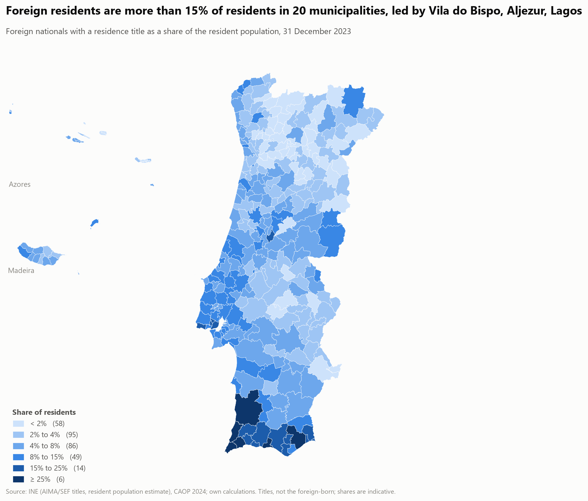 | 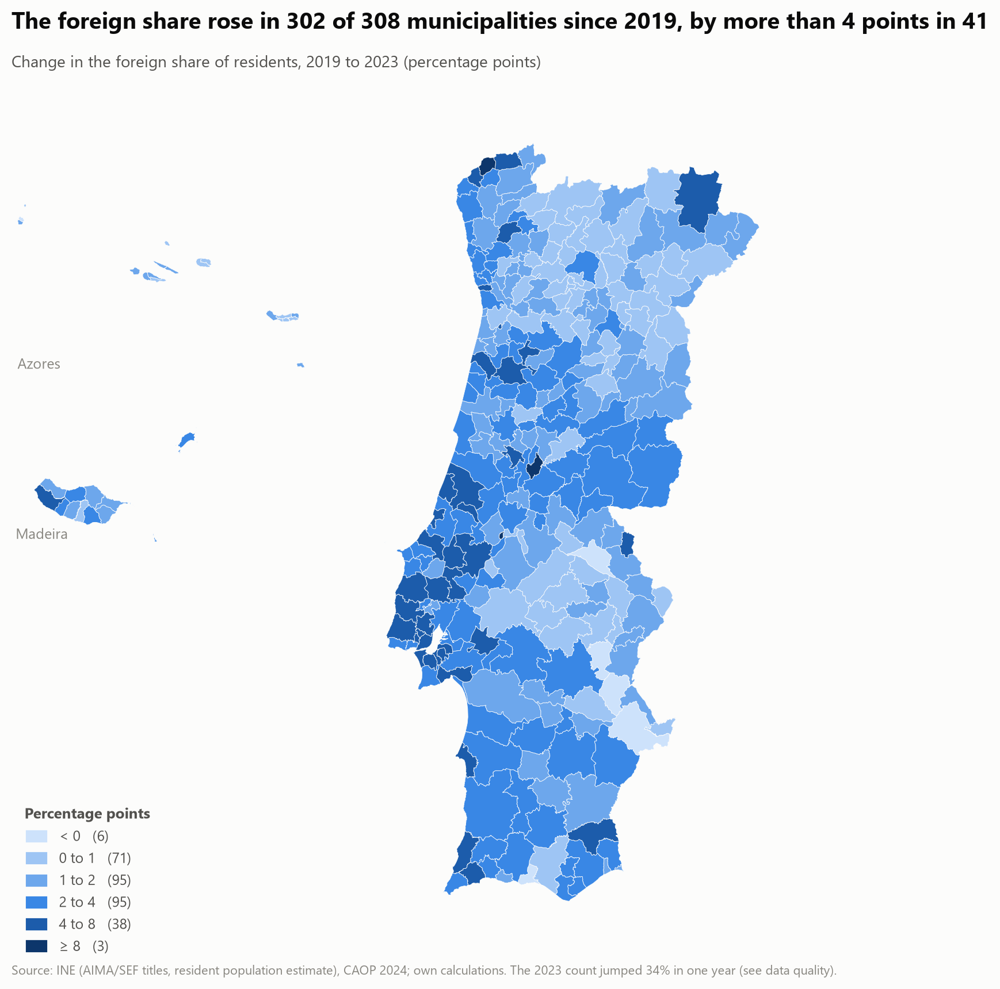 |

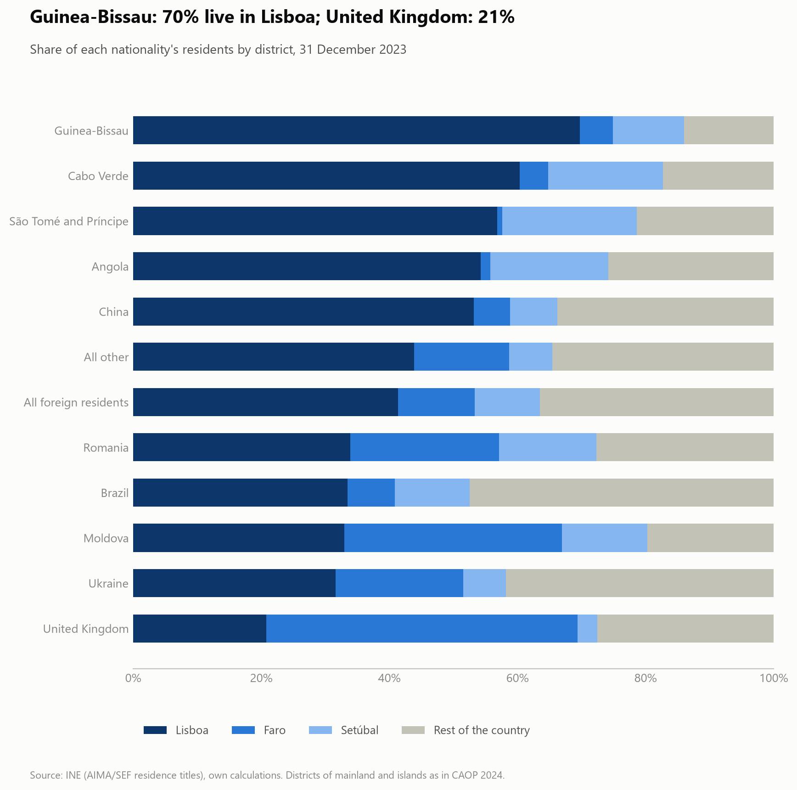

Tables: `foreign_residents_totals.csv`, `foreign_residents_by_nationality.csv`, `foreign_residents_by_place_2023.csv`,
`foreign_residents_concentration_2023.csv`, `foreign_residents_by_municipality_2023.csv`,
`foreign_residents_location_by_nationality.csv`.

## Do the conclusions depend on the definition? (M1)

The base indicator is price-to-income with the census mean dwelling size and the median income per tax household. Six
alternatives were swapped in one at a time (`p1_06`), comparing, across municipalities, the ranking (Spearman rank
correlation of the 2024 levels and of the change over a window) and the direction (share worsening, same sign as the base).

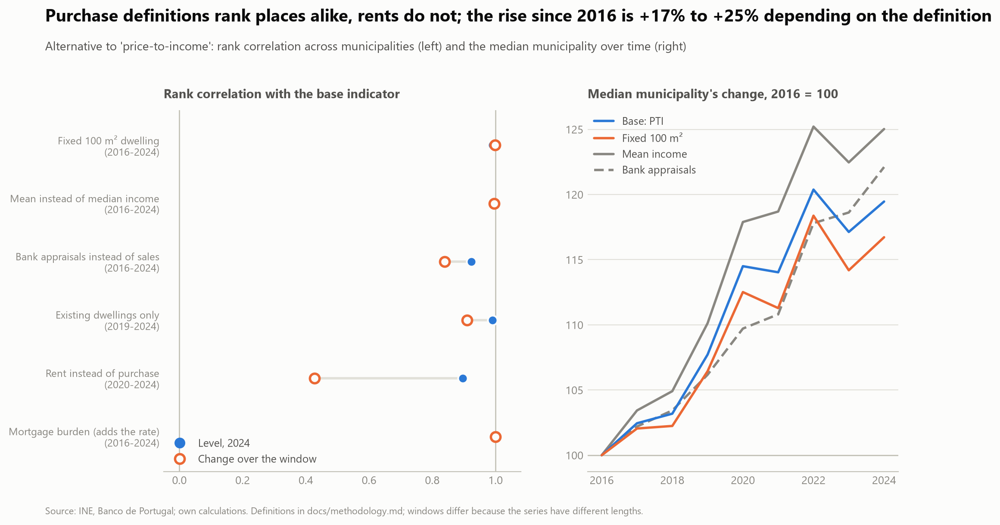

- **The ranking of places does not depend on the purchase definition.** The 2024 levels rank alike with a fixed 100 m²
  dwelling (0.99), mean income (1.00), existing dwellings only (0.99) and, from a different source, bank appraisals
  (0.92). The mortgage burden is the same ranking by construction (one national rate).
- **Rents rank places differently.** Rent-to-income has a level correlation of 0.90 with price-to-income, but the rank
  correlation of the **changes** in 2020-2024 is only 0.43: where rents rose is not where prices rose, so a price-based
  map of deterioration is not a map of what tenants faced.
- **The direction mostly holds.** Affordability worsened since 2016 in 75% of municipalities with the base, 70% with a fixed
  dwelling, 80% with mean income and 87% with appraisals (84% for the base in the same municipalities). The fixed dwelling
  size flips the sign in 14 of 296 municipalities (13 inland rural ones and Ponta do Sol), all with a change of less than 3.5% either way,
  so the sign is not meaningful there.
- **The size of the rise does.** The median municipality's price-to-income is 17% (fixed dwelling), 19% (base), 22%
  (appraisals) or 25% (mean income) above its 2016 value in 2024. The headline of `p1_02` is therefore a range of about
  17-25%, not a point; the rate shows up only in the mortgage burden (+64%).

Tables: `indicator_robustness.csv`, `indicator_robustness_trends.csv`, `indicator_robustness_sign_differs.csv`.

## Kinds of home and kinds of price (RQ1.2, RQ1.8)

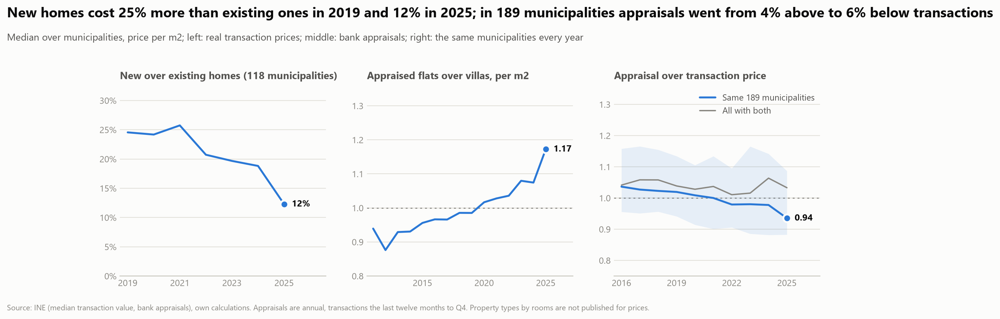

Prices by number of rooms are not published, and neither are asking prices (`p1_08`). What the data give:

- **New against existing homes** (INE transaction values, 2019-2025, 118 municipalities with both every year). The median
  premium of new homes fell from 24.5% to 12.3%, in two steps (2022: 20.7%; 2025: 12.3%); they were dearer in 97% of the
  municipalities in 2019 and 85% in 2025. Real prices of new homes rose 50% and of existing ones 61% since 2019. The
  premium is larger in rural municipalities (28% in 2019, 18% in 2025) than in urban ones (23%, 12%).
- **Flats against villas** (bank appraisals, 2011-2025). The median flats-to-villas ratio of the appraised price per m²
  was 0.94 in 2011, 1.02 in 2020 and 1.17 in 2025; in the 112 municipalities with both in both years, real appraisals of
  flats rose 81% and of villas 43%.
- **Appraisal against transaction** (2016-2025). In the 189 municipalities with both every year the median appraised price
  fell from 4% above to 6% below the transaction price (quartiles 0.88 to 1.09 in 2025); with all municipalities that
  have both, the ratio stays near 1.03 because the sample grows toward smaller markets. A year's appraisal growth is
  correlated 0.32 with the same year's transaction growth and 0.05 to 0.10 at one or two years either side: appraisals
  neither lead nor follow by a year, they under-react over the decade.

Tables: `new_vs_existing.csv`, `new_premium_by_class.csv`, `flats_vs_villas.csv`, `flats_vs_villas_change.csv`,
`appraisal_vs_transaction.csv`, `appraisal_growth_leadlag.csv`.

## Limitations

- **Short municipal history.** Municipal prices exist from 2016 and rents from 2020; INE's national index starts in
  2009. The thirty-year view is national only (BIS and OECD, `p1_03`); RQ1.1 stays partly answered for municipalities.
- **The long national series has a seam in 2009.** Before it the price index is a BIS compilation whose source is not
  stated in the data; there is no overlap with another index to test the join, and the 2009 growth differs between the BIS
  (-0.9%) and the OECD (+0.2%): read the change across 2008 to 2009 with about a point of doubt. The OECD's 2025 values are
  the latest and may be revised. Price-to-income uses income per head, not per household, and starts in 1995.
- **Levels are not comparable internationally.** Income is the median per IRS tax household (single filers
  included) and a dwelling is the municipality's census mean size (the size of occupied homes, probably larger than
  what is bought or newly let). Lisboa shows 25 years of income and a burden of 119% for this reason. Compare places
  and years; the 100 m² variants and the sensitivity table in the methodology show how much the levels move
  (2024 median burden between 40% and 57% across plausible loan terms and loan-to-value ratios).
- **Rents cover a subset.** A municipal rent is published only from 33 new leases a year, so 96 of 308 municipalities
  (mostly inland) are missing in 2024; rents are those of new leases, not of existing contracts.
- **Thin markets are volatile.** The largest percentage price rises (for example Lajes do Pico, +547%) come from
  municipalities with few sales; use the tables with the sales count in the panel.
- **Rent versus buy rests on assumptions and mixes two rent concepts.** Municipal rents are those of new leases for
  2020-2024 only; the national history applies the OECD price-to-rent index, which covers all leases, scaled to the
  municipal yield, and differs from the measured yield by -0.5 to +0.6 pp in 2020-2024 (`rent_vs_buy_anchor_check.csv`).
  Dwellings that are rented are not those that are sold (size, age, quality), the taxable value for IMI is assumed to be
  60% of the price, and the comparison ignores risk, mobility, rent control and who can get a loan.
- **Foreign residents are titles, not people.** The series ends in 2023, excludes naturalised citizens and has an
  unexplained +34% step in 2023; the share divides by an estimate of residents of a different vintage and logic, so levels
  are indicative (Vila do Bispo's 38% is the extreme). Titles are not net migration: the population balance (section
  *Population change*) gives net migration of all nationalities, but not of foreign nationals only.
- **Net migration is a residual.** It holds statistical adjustments and, in the municipal series, INE's +201,000
  post-census revision of 2020-2021, so those two years are left out of the municipal comparison; 2011 starts at the census
  (17,000 lower than the national flow) and the latest national years may be revised. Municipal data cover 2011-2023 only,
  so the thirty-year split is national.
- **Kinds of price.** New-against-existing starts in 2019 and needs both prices in a municipality (118 of 308, larger
  markets); appraisals are annual, suppressed below about 33 valuations, and measure what a bank values, not what is paid
  or asked. The appraisal and transaction series differ in timing (year against twelve months to Q4), so the level of the
  ratio matters less than its drift. Types by number of rooms and asking prices cannot be examined with these data.
- **One national mortgage rate** (agreed rate on new floating-rate loans) applies to every municipality, and the loan
  (80% of the price over 30 years) is an assumption, not an estimate.
- **Descriptive, not causal.** The report says what changed and where, not why; that is phase 2.

## Questions answered

RQ1.3, RQ1.4, RQ1.5, RQ1.6, RQ3.1, RQ3.2, M1, RQ4.1 and RQ4.2 are answered with the available data; RQ1.1 (national thirty years done, municipal from 2016), RQ1.2 (new/existing, flats/villas), RQ1.7 and RQ1.8 (appraisal against transaction only) are partly answered
(see [research_questions](../docs/research_questions.md)).
