# Phase 1 — Establish the evidence

How have prices, rents and affordability evolved, and where? Descriptive evidence only: nothing here is a causal
claim. Figures: `reports/figures/p1/`, tables: `reports/tables/p1/`, notebooks: `notebooks/p1_evidence/`
(`p1_01_prices_rents_rates`, `p1_02_affordability_indicators`). Definitions: [methodology](../docs/methodology.md).

## Key findings

1. **House prices have more than doubled in real terms since 2013.** Deflated with the CPI, the national index
   fell until 2013 and is now 2.6 times its low. Nominally Portugal's index is 3.0 times its 2015 level against 1.7
   for the EU27; the next highest are Ireland and Spain, at about 2.0.
2. **Prices per m² rose 68% in real terms in the median municipality between 2016 and 2025** (645 to 1,083 euros,
   constant 2024 euros). In 213 of 302 municipalities they rose more than 50%. Lisboa is at 4.4 times the median.
3. **Rents have risen as fast as prices, and faster lately.** On a fixed set of 187 municipalities, real prices and
   real rents both rose about 24% between 2020 and 2024; over the last two years rents rose 18% and prices 11%.
4. **The mortgage rate explains most of the recent jump in the burden of buying.** Rates on new loans fell to 0.6% in
   2021 and rose to 4.8%; a loan of 100,000 euros costs 73% more a month at the peak than at the trough. The median
   burden went from 28% to 45% of income (2016 to 2024); with the rate held at its 2016 level it would be 33%.
5. **Affordability worsened in three quarters of municipalities, and the gap between places widened.** The median
   municipality needs 9.5 years of income to buy (8.0 in 2016), the 90th percentile 18 (12 in 2016). Municipalities
   above 15 years went from 5% to 19% of the total; price-to-income worsened in 222 of 296 and improved in 74.
6. **The pressure is concentrated.** In 2024, 56 of 299 municipalities are above 15 years of income, 14 of the 15 in
   Faro and 10 of the 16 around Lisboa. The largest deteriorations are in Cascais (+13 years), Lagos (+12), Aljezur
   (+12), Porto (+11) and Vila do Bispo (+10); by district, Setúbal (+7.2) and Lisboa (+6.8). Interior districts such
   as Bragança and Guarda stayed near 5 years, and 70 municipalities are below 6.

## Prices and rents

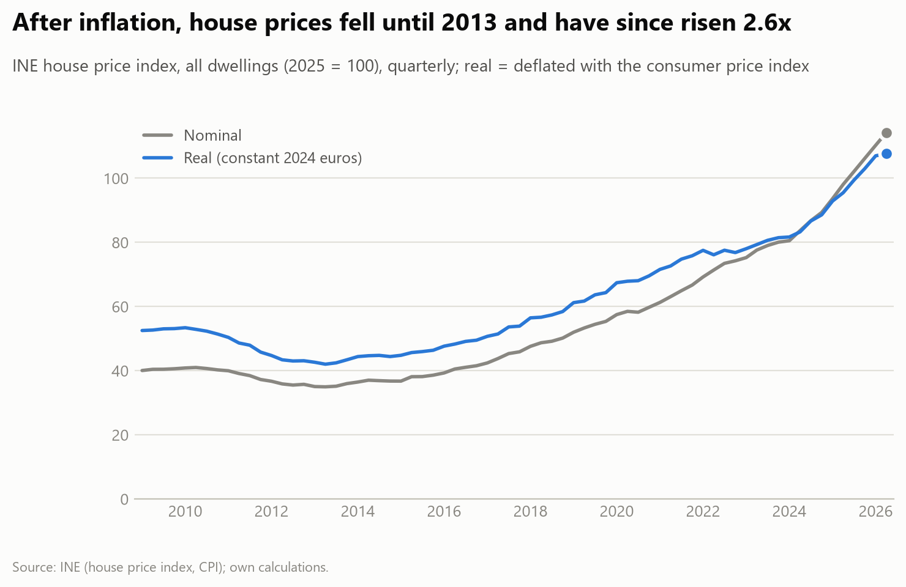

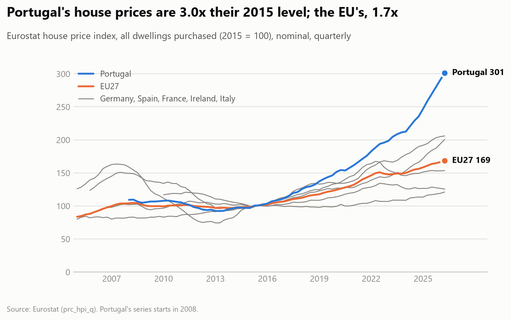

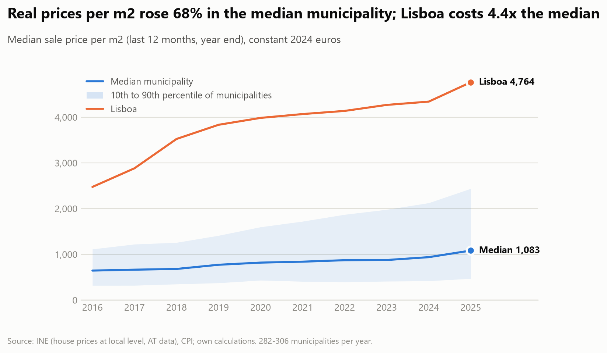

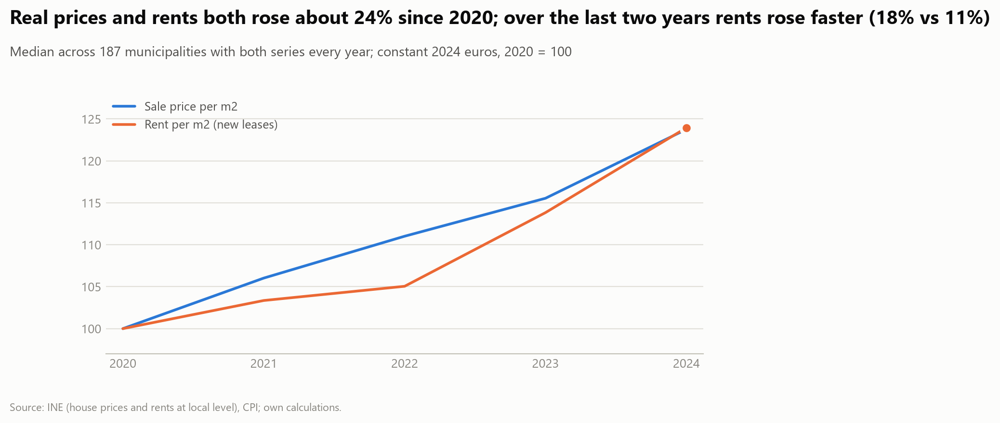

Tables: `real_growth_by_municipality.csv`, `price_sqm_real_by_district_2016_2025.csv`,
`rent_sqm_real_by_district_2020_2024.csv`.

## Mortgage rates

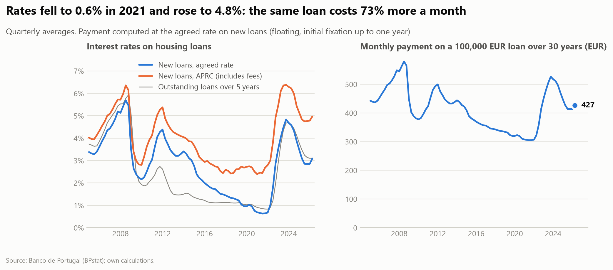

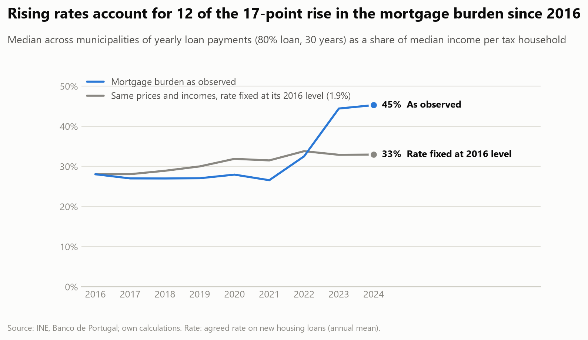

## Affordability indicators

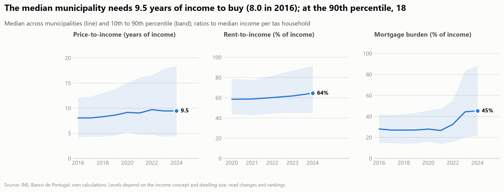

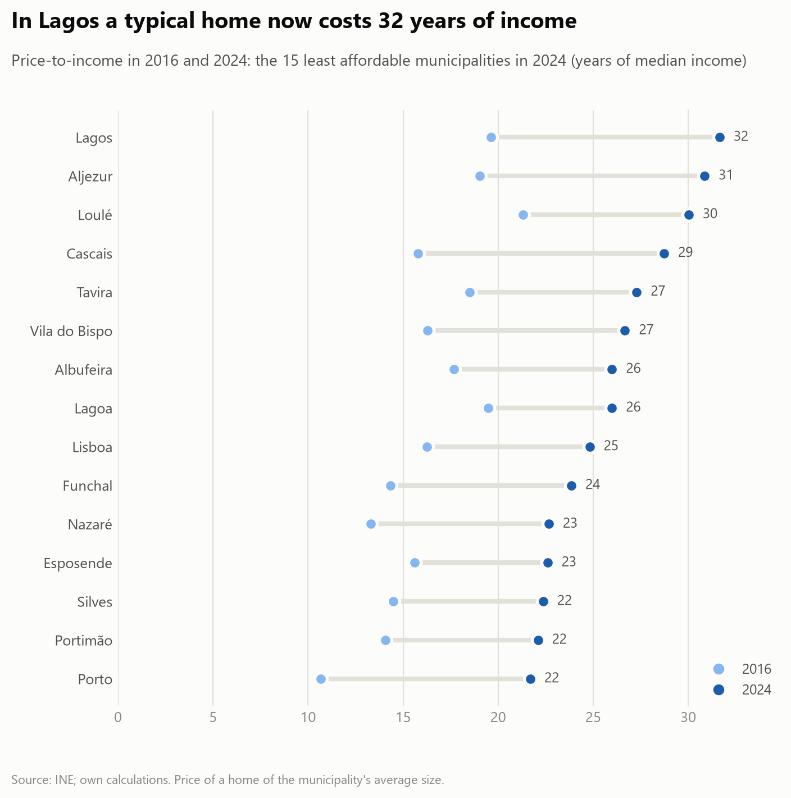

## Where

| Price-to-income, 2024 | Change in price-to-income, 2016 to 2024 |
|---|---|
|  | 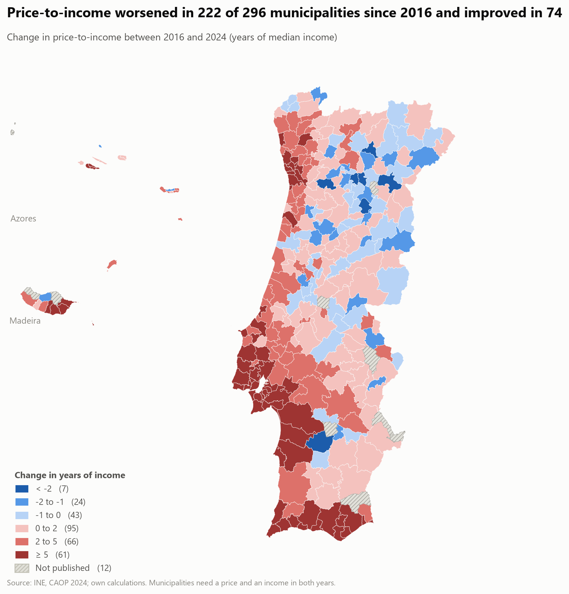 |

| Rent-to-income, 2024 | Mortgage burden, 2024 |
|---|---|
| 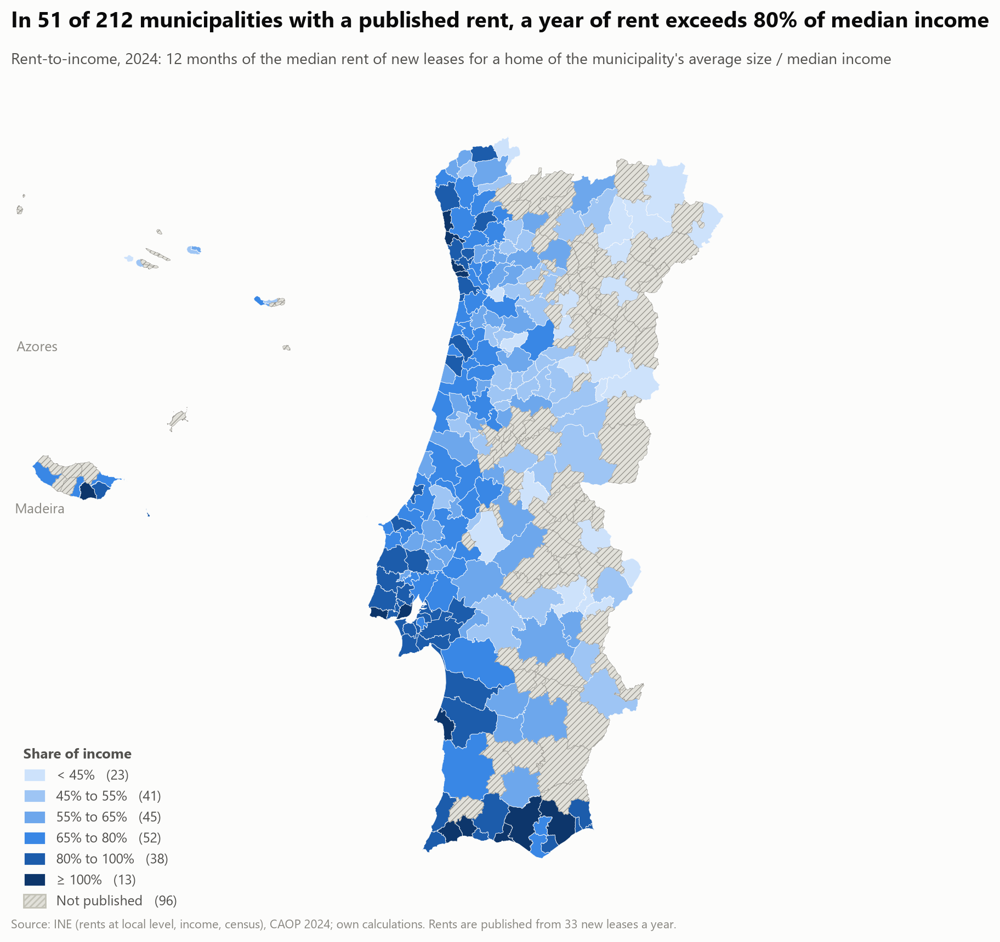 | 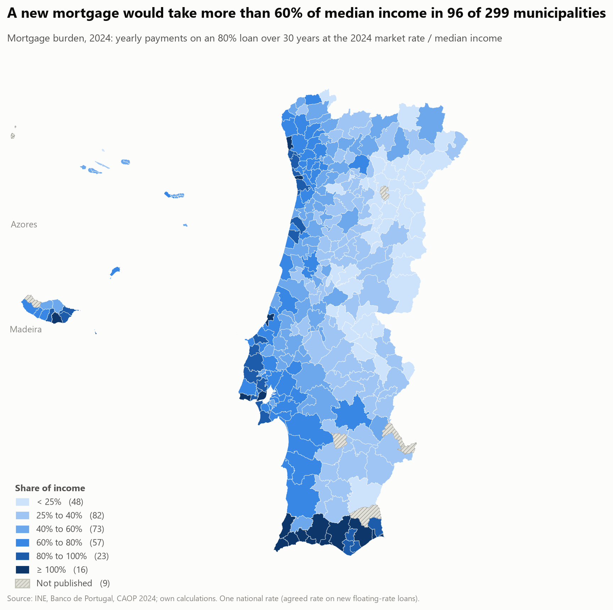 |

Tables: `affordability_by_municipality_2024.csv`, `pti_by_district_2016_2024.csv`,
`pti_change_by_municipality_2016_2024.csv`.

## Limitations

- **Short municipal history.** Municipal prices exist from 2016 and rents from 2020; the national index starts in
  2009. The question about 30 years is only partly answered (RQ1.1).
- **Levels are not comparable internationally.** Income is the median per IRS tax household (single filers
  included) and a dwelling is the municipality's census mean size (the size of occupied homes, probably larger than
  what is bought or newly let). Lisboa shows 25 years of income and a burden of 119% for this reason. Compare places
  and years; the 100 m² variants and the sensitivity table in the methodology show how much the levels move
  (2024 median burden between 40% and 57% across plausible loan terms and loan-to-value ratios).
- **Rents cover a subset.** A municipal rent is published only from 33 new leases a year, so 96 of 308 municipalities
  (mostly inland) are missing in 2024; rents are those of new leases, not of existing contracts.
- **Thin markets are volatile.** The largest percentage price rises (for example Lajes do Pico, +547%) come from
  municipalities with few sales; use the tables with the sales count in the panel.
- **One national mortgage rate** (agreed rate on new floating-rate loans) applies to every municipality, and the loan
  (80% of the price over 30 years) is an assumption, not an estimate.
- **Descriptive, not causal.** The report says what changed and where, not why; that is phase 2.

## Questions answered

RQ1.3, RQ1.5, RQ4.1 and RQ4.2 are answered with the available data; RQ1.1, RQ1.4 and RQ1.7 are partly answered
(see [research_questions](../docs/research_questions.md)).
