# Phase 2 — Explain the trends

Why did affordability deteriorate, and where? This phase moves from description to association; nothing here is a
causal claim. Figures: `reports/figures/p2/`, tables: `reports/tables/p2/`, notebooks: `notebooks/p2_explain/`
(`p2_01` to `p2_10`). Methods: [methodology](../docs/methodology.md), choices:
[decisions](../docs/decisions.md).

## Summary

**Affordability worsened where people want to live, and the data cannot say much more than that.** From 2016 to
2024 the median municipality's price-to-income rose 19%, driven by prices, not incomes; it rose 52% on the coast and
72% in urban municipalities, against 10% inland and 7% in rural ones.

- **Geography accounts for most of it.** District, coast class and density class explain 53% of the variation in
  the change across 271 mainland municipalities; demand, supply, tourism and second homes together add 1.7 points
  (`p2_07`). The drivers alone explain 35%, but geography still adds 20 points after them: they mostly describe the
  same dense coastal places.
- **The clustering is regional, not a spillover.** Neighbours resemble each other (Moran's I 0.63 to 0.76), but
  within a region no residual clustering is left and a placebo does as well as the lag (`p2_01`, `p2_03`).
- **Demand shows up through foreign residents, strongest in dense coastal places.** +4.3% in price-to-income per
  point of population added through foreign residents (+3.1% within region-year), weaker where second homes are
  common; an association with where residence titles are issued, not an effect of immigrants (`p2_02`, `p2_04`,
  `p2_06`).
- **Supply fell short where households grew, and everywhere since 2021.** 2011 to 2021 the stock grew with
  households nationally (+1.9% against +2.6%) but not in the Lisboa, Setúbal and Porto districts, while the interior
  added dwellings and lost households; since 2021 about 236,000 implied new households met 43,300 completions
  (`p2_05`). Municipalities that built more saw smaller rises, but this fades once the coast and density are
  accounted for.
- **Tourism and second homes do not add.** Short-term rentals have no association within a region-year; second
  homes are a rural stock that did not grow and goes with *smaller* rises (`p2_02`, `p2_06`).

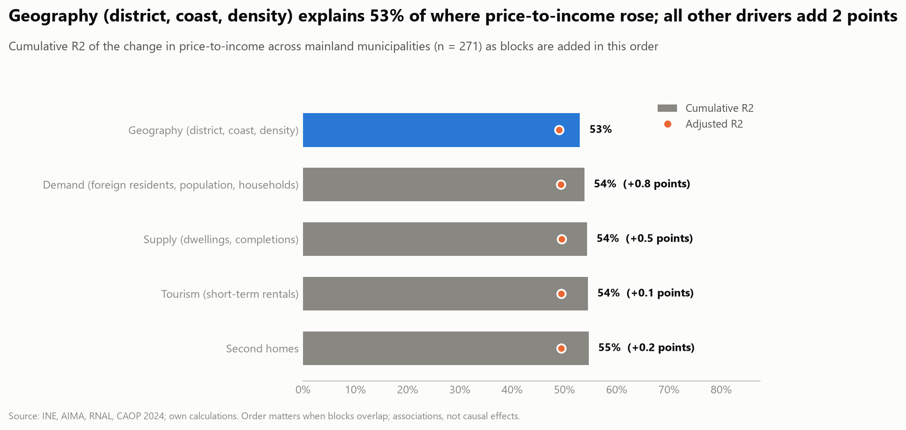

**What this means for the next phases.** The observational drivers cannot be separated from place with the variation
available, so a credible answer to "what would change affordability?" needs a policy with a comparison group
(phase 3) and a simulator that keeps accounting effects apart from behavioural responses (phase 4). Tables:
`synthesis_r2_ladder.csv`, `synthesis_r2_order_check.csv`, `synthesis_joint_model.csv`.

**Contents:** spatial autocorrelation (`p2_01`), fixed-effects regressions with foreign residents
(`p2_02`, RQ3.3, RQ5.1), spillover tests (`p2_03`, RQ4.4), segmentation (`p2_04`, RQ4.6), supply against demand
(`p2_05`, RQ2.1 to RQ2.4, RQ3.4, RQ4.5), second homes (`p2_06`, RQ5.3, RQ5.4) the synthesis (`p2_07`, RQ3.6), mortgage rates (`p2_08`, RQ1.7, RQ9.2, RQ9.5), wages and the labour market (`p2_09`, RQ9.1, RQ1.4) and big municipalities against their surroundings (`p2_10`, RQ4.3).

## Key findings

1. **Neighbouring municipalities resemble each other, and more every year.** Moran's I of price-to-income rose from
   0.63 (2016) to 0.76 (2024) and that of the real price per m² from 0.65 to 0.75, while that of median income fell
   from 0.61 to 0.56. All are significant (permutation p ≤ 0.001) and 6-nearest-neighbour weights agree. The
   geography of prices is concentrating faster than the geography of incomes.
2. **The deterioration is clustered.** Moran's I of the change in price-to-income 2016 to 2024 is 0.72 (0.67 with
   k-nearest weights), above that of price growth (0.45) or income growth (0.53) alone.
3. **Most of it is regional.** With each NUTS 3 sub-region's mean removed, Moran's I falls to 0.20 (queen) or 0.08
   (6 nearest), still significant. The pattern is mainly coast against interior and metropolitan areas against the
   rest; only a smaller, weights-dependent part is clustering within regions.
4. **The worst-hit clusters** (45 high-high municipalities) are in the districts of Faro (13), Lisboa (11),
   Setúbal (8) and Porto (6), with three in Madeira; Lisboa, Porto, Cascais and Faro are among them. The 50
   low-low municipalities are the interior (Viseu, Guarda, Bragança, Castelo Branco).
5. **No urban islands.** No municipality is a significant high-low or low-high outlier, so the large centres moved
   with their surroundings rather than away from them (RQ4.3, for the change in price-to-income).

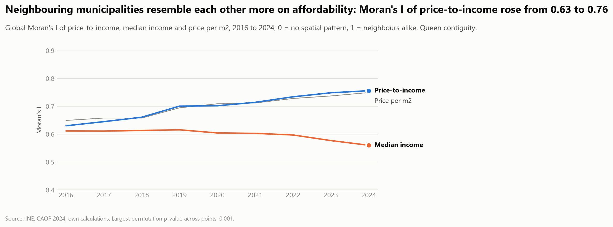

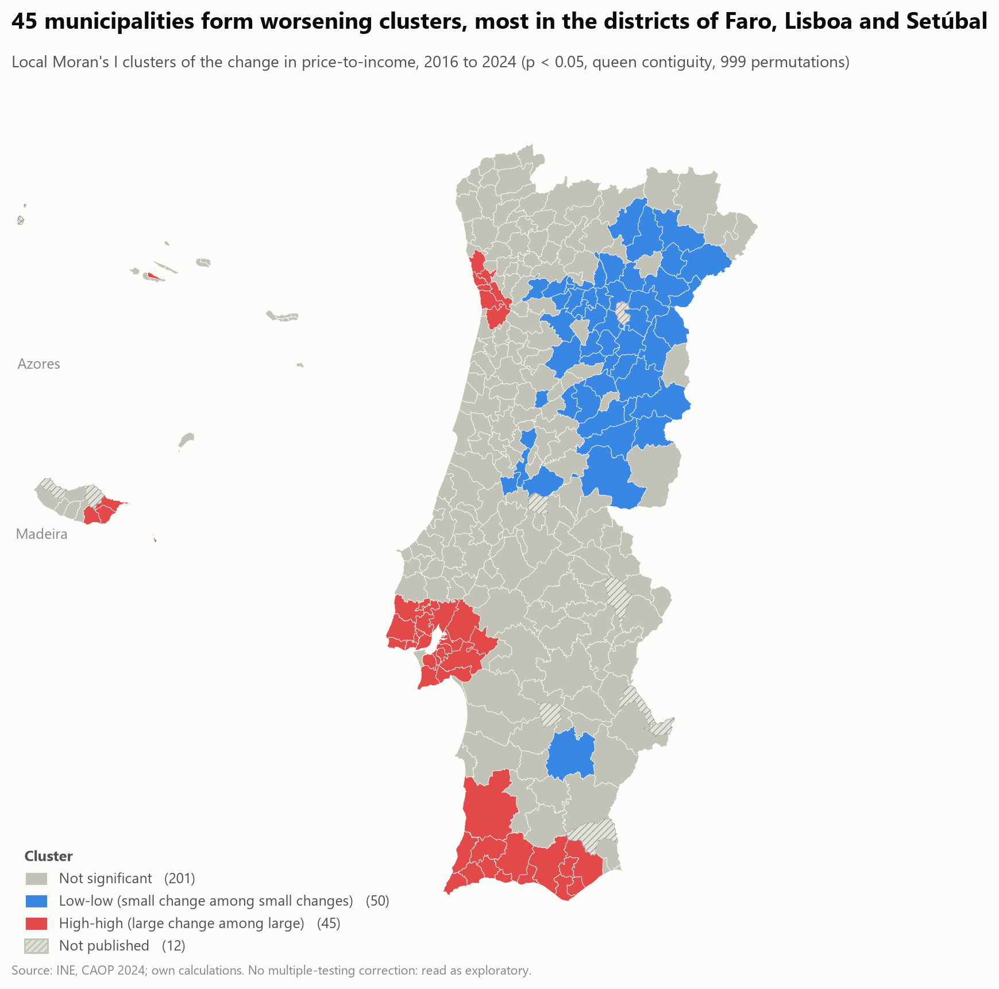

Tables: `moran_levels_by_year.csv`, `moran_changes.csv`, `moran_within_regions.csv`, `lisa_clusters_by_district.csv`.

## Fixed-effects regressions (`p2_02_fixed_effects_regressions`)

Outcome: log price-to-income, 2016 to 2023, 298 municipalities. Drivers: the change in foreign residents with a legal
title (AIMA, via INE) and the change in the rest of the population, both in % of last year's population; completions
in the previous three years; share aged 65+; and (mainland) short-term rentals. Municipality and year effects; a
harder variant adds NUTS 3 × year effects. All coefficients are adjusted associations.

6. **Prices, not incomes, drive where affordability worsened.** From 2016 to 2024 the median municipality's real
   price per m² rose 51% and its real income 29%, so price-to-income rose 19%. Across municipalities 92% of the
   variance of the deterioration is the price change and 9% the income change; the two are negatively correlated
   (−0.31), so income is decomposed, not used as a driver.
7. **Foreign residents stand out.** One more percentage point of the population added through foreign residents goes
   with +4.3% in price-to-income (p < 0.001); a point of other population change with +1.0%. With region-year
   effects the foreign-resident coefficient stays at +3.1% (p < 0.001) and the other falls to +0.45% (p = 0.10). It
   survives region-clustered errors, lagged drivers, dropping Lisboa, Setúbal and Porto (+2.3%) and dropping 2023
   (+3.3%), and has the same sign for price per m². It is an association with where foreign residents settle, not an
   effect of immigrants: one added resident is four times as associated as one added through other population
   change, so the variable also carries concentration in the tightest markets and the processing of residence titles.
8. **The observed drivers still explain little.** They account for 6.8% of the variation left after the fixed effects
   (1.6% with region-year effects), up from 5.4% when foreign residents are not split out. One within-municipality
   standard deviation of recent completions goes with +2.3%, of foreign-resident change with +2.0% and of other
   population change with +1.4%. The completions sign is supply following prices, not building raising them.
9. **Short-term rentals: an association that does not survive the region.** On the mainland, 10 more registered
   units per 1,000 dwellings go with +3.4% (p < 0.001), but within region-year the coefficient is 0.07% per unit
   (p = 0.37). Ageing shows no robust association.

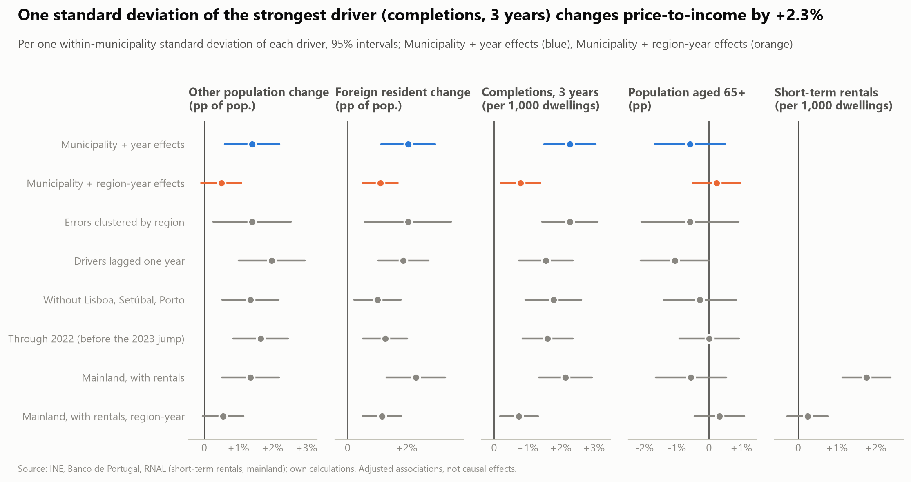

Tables: `pti_change_decomposition.csv`, `fe_regressions_pti.csv`, `fe_regressions_pti_total_population.csv`,
`fe_regressions_price.csv`, `fe_residual_moran.csv`.

## Spillovers between neighbours (`p2_03_spillovers`)

Does a municipality's price-to-income depend on its neighbours', beyond its own drivers and its region's yearly
shocks? Three tests with the regression above, queen-contiguity neighbours, 2017 to 2022.

10. **The leftover clustering was regional.** With municipality and year effects the residuals are spatially
    correlated (Moran's I 0.18 in 2017, 0.28 in 2022); with NUTS 3 × year effects none is positive and
    significant.
11. **Neighbours' drivers matter only through the region.** With year effects the neighbours' completions, population
    change and foreign-resident change are all associated with a municipality's price-to-income; with NUTS 3 × year
    effects none is (p = 0.11, 0.56, 0.30), while the municipality's own foreign-resident change stays (+2.7%).
12. **Diffusion cannot be told from shared shocks.** Within a region the neighbours' price-to-income last year goes
    with a municipality's (0.18, p = 0.03), but next year's, which cannot be a cause, does almost as well (0.12,
    p = 0.21). Evidence for spillovers between neighbours is weak at best.

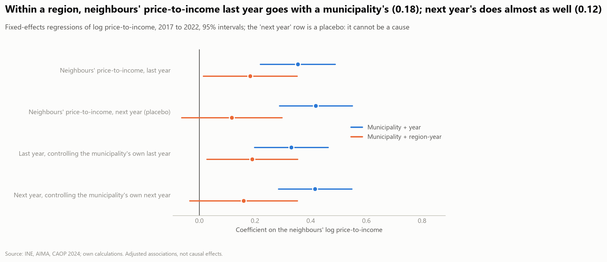

Tables: `spillover_residual_moran.csv`, `spillover_slx.csv`, `spillover_diffusion.csv`. The region effects also absorb
a spillover spread across a whole region, so the tests are conservative; these are the space-time and SLX forms
estimable by fixed effects, not spatial-lag or spatial-error panel models (decisions.md).

## Coast, density and tourism (`p2_04_segmentation`)

Mainland municipalities grouped by three proxies (coast, 2021 density, rental registry; see
[decisions](../docs/decisions.md)).

13. **The deterioration is coastal and urban.** From 2016 to 2024 the median price-to-income rose 52% in the 57
    coastal municipalities (11.3 to 17.0 years of income) against 10% inland (7.0 to 7.4); 72% in the 32 urban ones
    (10.1 to 15.9) against 7% in the 165 rural ones (6.5 to 6.6); 47% in the 34 tourist ones against 16%. Real prices
    rose 84% on the coast and 41% inland, while real income rose less on the coast (25%) than inland (30%).
14. **Density matters most, then the coast, tourism adds nothing.** With all three dimensions in one regression, urban
    municipalities rose about 44% more than rural ones and coastal ones about 23% more than inland ones (38% and 13%
    within the same district); the tourist gap is 0.05 log points (p = 0.29) and 0.00 within the district. Tourist
    municipalities are mostly coastal and dense, so their raw gap is the coast's and the city's.
15. **The foreign-resident association is strongest in dense coastal places.** With NUTS 3 × year effects, the effect of
    a point of population added through foreign residents is +2.3% in an inland, rural, non-tourist municipality, plus
    2.8 points on the coast, plus 4.3 in urban municipalities and minus 3.3 in tourist ones (exploratory: three
    overlapping interactions).

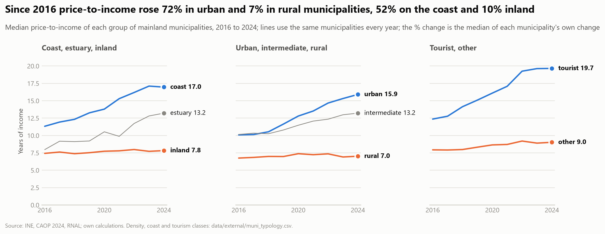

Tables: `segment_summary.csv`, `segment_pti_by_year.csv`, `segment_adjusted_differences.csv`,
`segment_foreign_interactions.csv`, `segment_foreign_interactions_joint.csv`.

## Supply against demand (`p2_05_supply_vs_demand`)

Two periods with the same sign (negative: construction fell short of new households). 2011 to 2021 is observed
(census dwellings and households). 2021 to 2023 is *implied*: new households = population growth / persons per
household, against completions of 2022 and 2023 (new family dwellings only).

16. **Construction collapsed and has recovered only partly.** Completions peaked at 126,000 in 2002, fell to 7,100 in
    2015 and were 27,300 in 2025: 93,000 a year in 1995 to 2004, 42,000 in 2005 to 2014, 16,000 in 2015 to 2025.
17. **Supply kept pace with households between the censuses nationally, not locally.** Dwellings +1.9% (+111,000),
    households +2.6%, population +0.4%; the balance is +1.4 per 1,000 households. But households fell in 169
    municipalities that still added 11,500 dwellings, while in the 139 where households grew (+147,000) dwellings
    grew less (+99,600). Setúbal (−30 per 1,000), Lisboa (−24) and Porto (−23) fell short; the interior (Castelo
    Branco +94, Bragança +91) added dwellings while losing households.
18. **Since 2021 the pressure is everywhere.** About 236,000 implied new households against 43,300 completions
    (−46 per 1,000): a shortfall in 18 of 20 areas and 237 of 308 municipalities, largest in Faro (−96), Beja (−80),
    Lisboa and Setúbal (−73). The size is uncertain (population estimates, household size), the geography is not.
19. **The stock is mostly lived in.** 69.4% usual residence, 18.5% secondary, 12.1% vacant (723,000) in 2021 (2011:
    68.1, 19.3, 12.5); rural municipalities 54% usual and 31% secondary against 81% and 9% in urban ones.
20. **Weak, non-robust link to affordability.** Within a district, municipalities whose dwellings grew more than
    their households in 2011 to 2021 saw a smaller rise in price-to-income (−6.8% per standard deviation, p = 0.001)
    and those with more population growth since 2021 a larger one (+6.3%), but these fade with coast and density
    class (−2.6%, p = 0.16) and without the three metropolitan districts. Completions in 2022 and 2023 stay positive
    (+2.9% to +4.8%): supply follows prices.

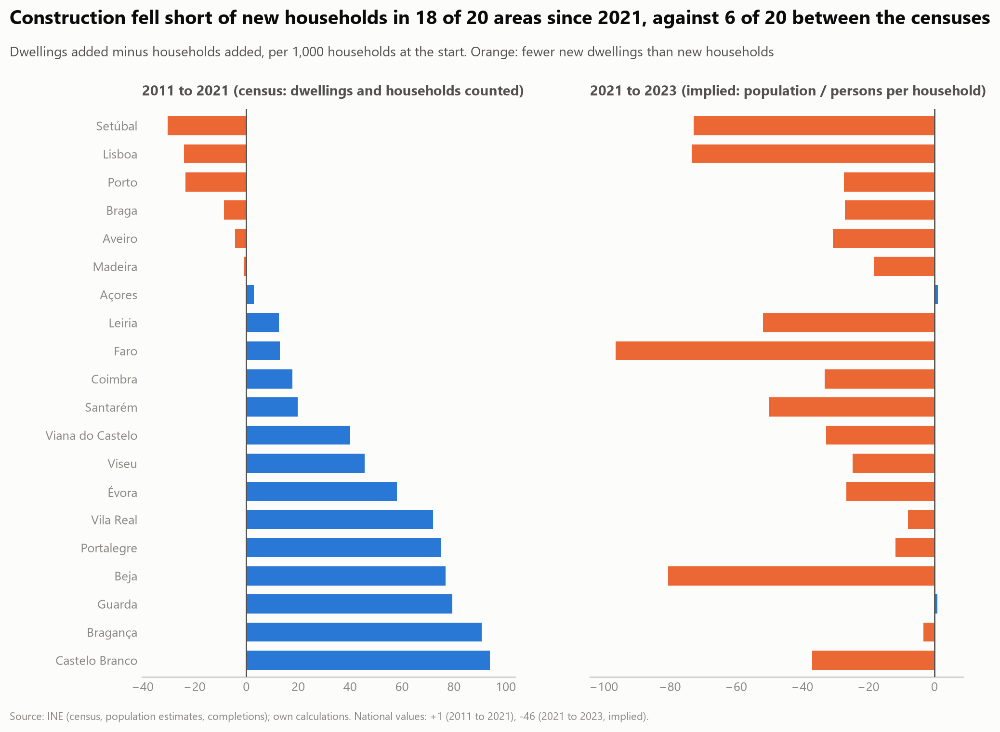

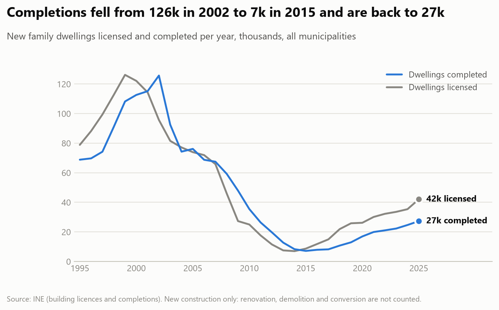

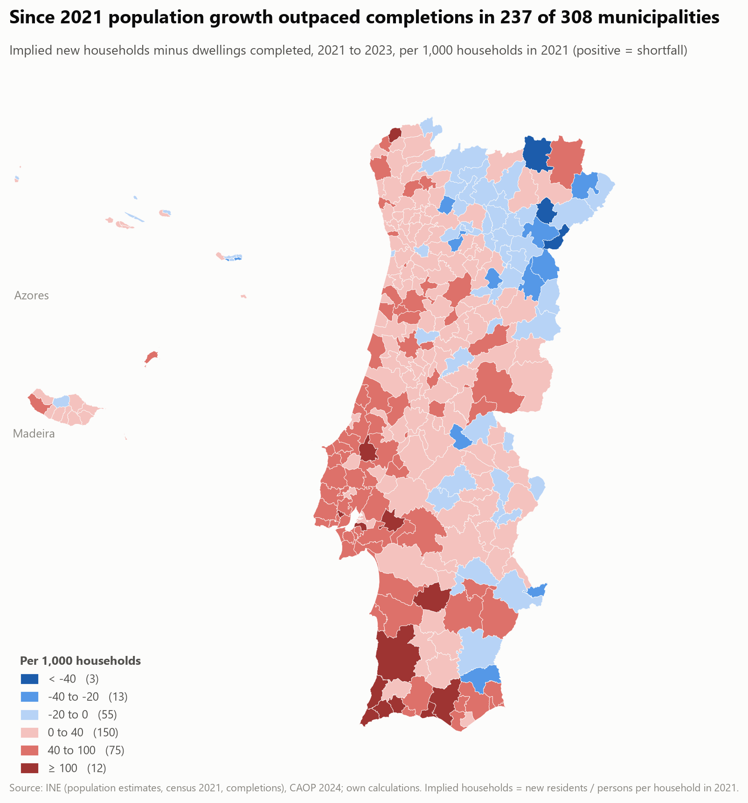

Tables: `construction_flows.csv`, `housing_balance_by_area.csv`, `housing_balance_by_household_trend.csv`,
`stock_composition_national.csv`, `stock_composition_by_class.csv`, `supply_demand_associations.csv`,
`supply_demand_sensitivity.csv`. Map for 2011 to 2021: `figures/p2/housing_shortfall_map_2011_2021.png`.

## Second homes (`p2_06_second_homes`)

Census secondary residences, 2011 and 2021, mainland; a cross-section, so the panel uses it only as an interaction.

21. **A rural, interior stock that barely moved.** Median share in 2021: 34% in rural municipalities, 7.6% in urban,
    27.6% inland, 21.4% on the coast, 39% in tourist ones. The mean share was 26.7% in 2011 and 26.8% in 2021; the
    national count fell by 28,000. No sign of conversions of permanent homes in the census decade.
22. **More second homes, smaller rise in price-to-income.** Within a district one sd of the share (13.6 points) goes with
    −6.3% in the 2016 to 2024 change (−3.6% with coast and density, p = 0.08) and −17% in the 2024 level. The share
    marks low-demand places, not pressure on permanent housing; only on the coast is it clearly negative (−9.1%).
23. **The foreign-resident association is weaker where second homes are common.** 2.4 points less per 10 points of
    share (1.4 with NUTS 3 × year effects, both p < 0.001); the interaction with other population change is nil.

Tables: `second_homes_by_class.csv`, `second_homes_cross_section.csv`, `second_homes_subsamples.csv`,
`second_homes_interactions.csv`.

## Big municipalities and their surroundings (`p2_10_centres_and_surroundings`)

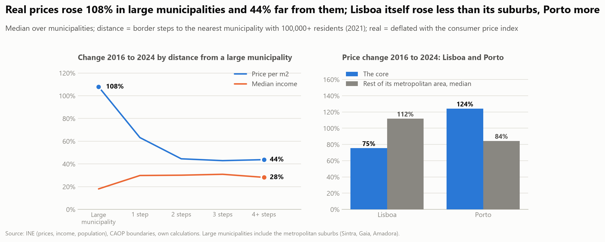

A centre is a municipality with at least 100,000 residents in 2021 (25: the two metropolitan cores and their large
suburbs, plus Braga, Guimarães, Coimbra, Leiria, Viseu, Funchal and others); distance is the number of border steps to the
nearest one (RQ4.3). Changes are 2016 to 2024, real, medians over municipalities.

30. **Prices rose most in the big municipalities and less the further out.** Real price per m²: +108% in the 25 centres,
    +63% one step away (58 municipalities), +45% two steps, +43% three and +44% four or more. Price-to-income follows
    (+73%, +26%, +14%, +13%, +14%) because incomes rose least in the centres (+18% against 28 to 31% elsewhere).
31. **It survives region effects.** Within the same NUTS 3 region, municipalities one step from a centre rose 9 log points
    less than the centre (interval −15 to −3), two or more steps 19 less (−30 to −7); for price-to-income 14 and 24 to
    25 less. Only 9 regions have a centre, so the intervals are approximate.
32. **The cores themselves are not the same story.** Lisboa rose 75% (price-to-income +53%) against a median 112% (+92%) in the
    rest of its metropolitan area, and all 17 other municipalities above it; Porto rose 124% (+104%) against 84% (+44%), with
    2 of 16 above it. The pressure at the top of the ranking is large, dense municipalities, with Lisboa's own level
    already the highest (4.4 times the median municipality in 2025).

Tables: `centre_gradient.csv`, `centre_gradient_within_regions.csv`, `centre_gradient_within_regions_pti.csv`,
`core_vs_metro.csv`.

## Mortgage rates and the price cycle (`p2_08_rates_and_cycles`)

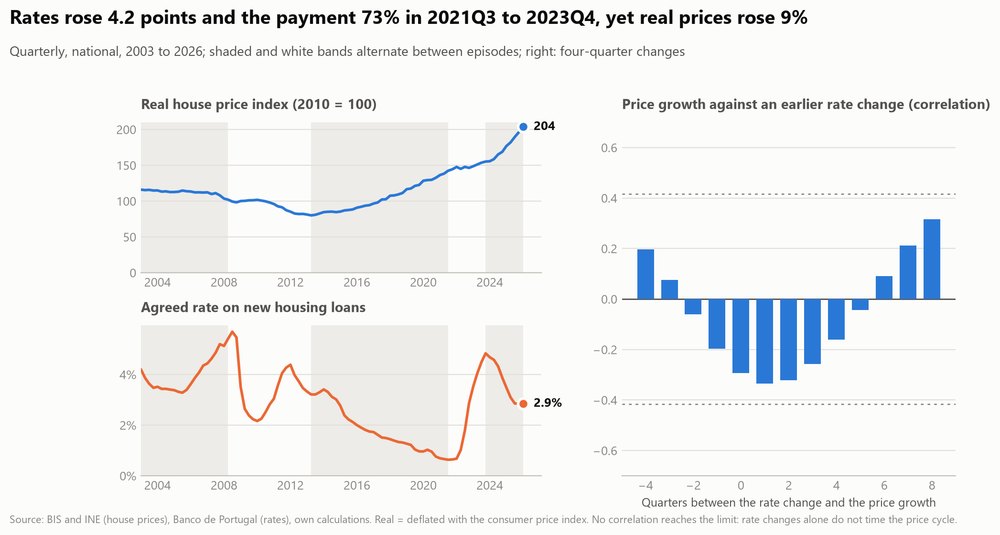

National quarterly series, 2003 to 2026 (RQ1.7, RQ9.2, RQ9.5): real prices (BIS, INE's from 2009), the agreed rate on new
housing loans and the payment it implies.

24. **The rate shock hit the burden, not the price.** From 2021Q3 to 2023Q4 the rate rose from 0.6% to 4.8% and the
    payment on a loan of 100,000 euros by 73%, while real prices rose 9% (nominal +23%). The later fall of the rate to
    2.9% came with real prices up another 31%. Affordability fell because of the rate, not through a price response.
25. **Crisis and recovery.** Real prices fell 19% from 2008Q3 to the 2013Q2 low and then rose 78% to 2021Q3 while the rate
    fell from 3.2% to 0.6% (payment −30%). Completions averaged 73,000 a year before the crisis, 34,000 during it and
    11,700 in the recovery: building did not come back with prices (21,000 to 25,000 a year since 2021).
26. **Rate changes do not time the price cycle.** Correlations of a year's real price growth with the rate change 0 to 3
    quarters earlier are −0.26 to −0.33, all inside the 95% limit for no relation (±0.42). The pre-specified test (price
    growth on the rate change of the year before) gives −1.0 points per pp [−3.6, +1.7]; with last year's growth it is
    0.0 [−1.4, +1.4], and a placebo with next year's rate change is as large in size (+0.2, +0.4). The association is
    −2.0 per pp in 2003 to 2013 (p = 0.006, the sovereign-debt crisis moving both) and −0.2 since 2014 (p = 0.42).

Tables: `rate_episodes.csv`, `rate_lag_profile.csv`, `rate_timing.csv`.

## Wages, unemployment and GDP (`p2_09_wages_and_labour_market`)

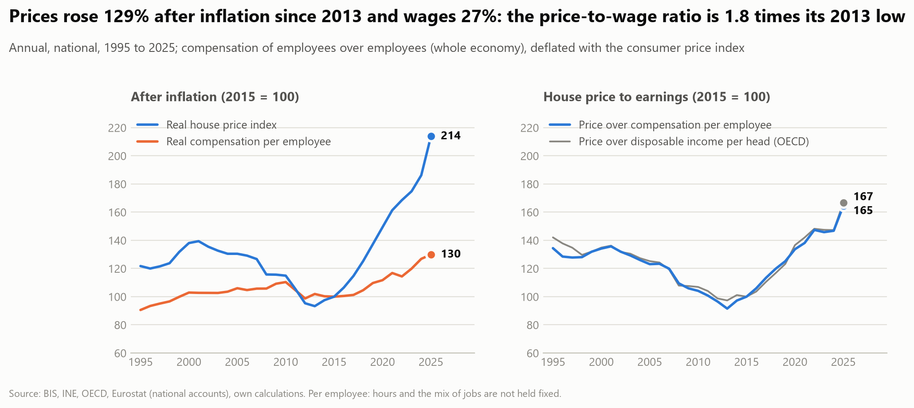

National annual series, 1995 to 2025, from national accounts and the labour force survey (RQ9.1, RQ1.4).

27. **Prices left wages behind after 2013.** Since the 2013 low, real house prices are up 129% and real compensation per
    employee up 27%. The price-to-wage ratio is 1.8 times its 2013 low and 165 (2015 = 100), against 134 in 1995 and
    136 in 2001; the OECD's price-to-income gives 167, so the two earnings concepts agree.
28. **Price growth follows the labour market.** In a year, one more point of real wage growth goes with +1.0 points of real
    price growth [+0.7, +1.3] and one point more unemployment with −2.1 [−2.7, −1.5] (R2 0.57, 30 years); GDP growth adds
    nothing in the same year once those are in (−0.2, [−0.8, +0.4]) and takes a small negative sign when lagged
    (−0.5, [−1.0, −0.1]), which is not a demand story: it probably picks up the cycle's turning points. With last year's variables the signs and sizes hold (+1.0 and −2.7),
    and with last year's price growth added they shrink to +0.6 and −1.8 but stay clear of zero. Nominal prices on
    nominal wages give the same (+1.0, −2.1), with inflation at 0.0, so the shared deflator is not the reason.
29. **Read as co-movement.** These are two or three business cycles (the 2008 and 2011-2013 recessions, the recovery, the
    pandemic) in one country. Removing 2020-2022 changes nothing (+1.0, −2.1), but wages and unemployment move together
    with credit, rates and expectations, none of which are separated here.

Tables: `wages_prices_levels.csv`, `price_growth_fundamentals.csv`.

## Limitations

- **A pattern, not a mechanism.** Spatial autocorrelation does not show that price changes spill over: shared
  income, coast, labour markets and policy produce it as well. The within-region check removes only average
  regional differences. The spillover tests in the next section go further.
- **Short history.** Municipal prices start in 2016, so changes cover eight years.
- **Weights matter at the margin.** Contiguity treats very unequal municipalities alike; the within-region result
  drops from 0.20 to 0.08 with k-nearest weights.
- **Exploratory clusters.** LISA and Gi* use 300 tests with no multiple-testing correction; they flag the same
  municipalities because the statistics are closely related, so agreement is not independent confirmation.
- **Residual spatial dependence.** Residual Moran's I of the main regression is 0.03 to 0.39 depending on the year
  (0.39 in 2023), so errors clustered by municipality are probably too small; clustering by region (26 clusters)
  keeps the conclusions, but few clusters are a caveat of its own.
- **Foreign residents.** The series counts residence titles on 31 December (2014 to 2023; 2024 is not published at
  municipal level). It jumps by a third in 2023, possibly partly because of processing of applications, and may include
  people already living in the municipality; results are shown without 2023. Nationalities are not
  yet used.
- **Typology.** Coast, density and tourism are proxies (CAOP shoreline, 2021 density, today's rental registry),
  the groups overlap and some are small (9 to 57 municipalities); islands are left out.
- **Rentals.** The series is the stock of units still registered today (survivors, mainland only), which understates
  the past and so overstates its growth.
- **Synthesis.** The block ladder is one cross-section of 271 municipalities and one change (2016 to 2024); the
  order of blocks matters when they overlap (reverse order in `synthesis_r2_order_check.csv`), and R2 says what
  accompanies the outcome, not what causes it.
- **Second homes.** The census category mixes holiday homes, inherited village houses and the diaspora's homes, is
  observed only in 2011 and 2021 (before part of the recent rental and foreign-buyer boom) and cannot show later
  conversions or seasonal occupancy.
- **Implied households.** The 2021 to 2023 gap divides new residents by 2021 persons per household, ignores
  household-size change and revisions of population estimates, and completions exclude renovation, conversion and
  demolition; it is a proxy (almost minus population growth, correlation −0.99). Census years are ten years apart.
- **Rates and prices.** One national series with a persistent rate: 23 years hold roughly two cycles, annual changes
  overlap, and the rate is set for the euro area in response to conditions that also move prices (inflation enters
  the real price through the deflator; the nominal check is weaker, −0.8 [−1.9, +0.4]). A null does not mean no
  effect, only that this series cannot tell. Credit supply is not tested: the loan volume we hold covers loans fixed
  for up to one year (the share of fixed-rate loans grew after 2018), not total lending.
- **Centres.** The 100,000-resident rule is a size cut-off, not a functional urban area: it counts suburbs such as Sintra
  and Amadora as centres and Coimbra or Viseu alongside Lisboa. Distance in border steps ignores how far a step is
  (Alentejo municipalities are large) and commuting. The gradient is a description of 302 municipalities with prices in
  2016 and 2024, one boom, and the contrast within regions rests on 9 regions.
- **Wages and the labour market.** Thirty yearly observations, one economy; compensation per employee does not hold hours
  or the mix of jobs fixed and is not the income of buyers (who are older, richer and more often foreign than the
  average employee); Newey-West errors with two lags are approximate at this length. Rents are not analysed.
- **Missing municipalities.** 12 municipalities have no price-to-income for 2016 or 2024 and are left out (hatched on
  the map); their neighbours' weights are re-standardised without them.

## Questions answered

RQ4.3 (large municipalities rose most, less further out; Lisboa itself less than its suburbs), RQ4.4 (little evidence of spillovers beyond the regional pattern), RQ4.6 (coastal and urban, not tourism as such), RQ2.1 to
RQ2.3 and RQ4.5 (supply against households) and RQ5.4 (second homes separated) are answered; RQ3.6 is answered as far as these data allow (demand differences cannot be told from the regional pattern); RQ3.3, RQ5.1, RQ5.3, RQ1.7, RQ9.1, RQ9.2 and RQ9.5 are partly answered; RQ1.4 is answered (income and wages) (see [research_questions](../docs/research_questions.md)).
