# Phase 2 — Explain the trends

Why did affordability deteriorate, and where? This phase moves from description to association; nothing here is a
causal claim. Figures: `reports/figures/p2/`, tables: `reports/tables/p2/`, notebooks: `notebooks/p2_explain/`
(`p2_01` to `p2_23`). Methods: [methodology](../docs/methodology.md), choices:
[decisions](../docs/decisions.md).

## Summary

**Affordability worsened where people want to live, and the data cannot say much more than that.** From 2016 to
2024 the median municipality's price-to-income rose 19%, driven by prices, not incomes; it rose 52% on the coast and
72% in urban municipalities, against 10% inland and 7% in rural ones.

- **Geography accounts for most of it.** District, coast class and density class explain 53% of the variation in
  the change across 271 mainland municipalities; demand, supply, tourism and second homes together add 1.7 points
  (`p2_07`). The drivers alone explain 35%, but geography still adds 20 points after them: they mostly describe the
  same dense coastal places.
- **The clustering is regional, not a spillover.** Neighbours resemble each other (Moran's I 0.63 to 0.76), but
  within a region no residual clustering is left and a placebo does as well as the lag (`p2_01`, `p2_03`).
- **Demand shows up through foreign residents, strongest in dense coastal places.** +4.3% in price-to-income per
  point of population added through foreign residents (+3.1% within region-year), weaker where second homes are
  common; an association with where residence titles are issued, not an effect of immigrants (`p2_02`, `p2_04`,
  `p2_06`).
- **Supply fell short where households grew, and everywhere since 2021.** 2011 to 2021 the stock grew with
  households nationally (+1.9% against +2.6%) but not in the Lisboa, Setúbal and Porto districts, while the interior
  added dwellings and lost households; since 2021 about 236,000 implied new households met 43,300 completions
  (`p2_05`). Municipalities that built more saw smaller rises, but this fades once the coast and density are
  accounted for.
- **Tourism and second homes do not add.** Short-term rentals have no association within a region-year; second
  homes are a rural stock that did not grow and goes with *smaller* rises (`p2_02`, `p2_06`).

**What this means for the next phases.** The observational drivers cannot be separated from place with the variation
available, so a credible answer to "what would change affordability?" needs a policy with a comparison group
(phase 3) and a simulator that keeps accounting effects apart from behavioural responses (phase 4). Tables:
`synthesis_r2_ladder.csv`, `synthesis_r2_order_check.csv`, `synthesis_joint_model.csv`.

**Contents:** spatial autocorrelation (`p2_01`), fixed-effects regressions with foreign residents
(`p2_02`, RQ3.3, RQ5.1), spillover tests (`p2_03`, RQ4.4), segmentation (`p2_04`, RQ4.6), supply against demand
(`p2_05`, RQ2.1 to RQ2.4, RQ3.4, RQ4.5), second homes (`p2_06`, RQ5.3, RQ5.4) the synthesis (`p2_07`, RQ3.6), mortgage rates (`p2_08`, RQ1.7, RQ9.2, RQ9.5), wages and the labour market (`p2_09`, RQ9.1, RQ1.4), big municipalities against their surroundings (`p2_10`, RQ4.3), age structure (`p2_11`, RQ3.5) mortgage credit and household debt (`p2_12`, RQ9.2, RQ9.3) what wages and rates could finance (`p2_13`, RQ9.4) and foreign residents by nationality group (`p2_14`, RQ3.3) vacant dwellings against the shortfall (`p2_16`, RQ2.5) construction costs against prices and licensing (`p2_17`, RQ2.7) foreign buyers (`p2_18`, RQ5.2) renovation of existing buildings (`p2_19`, RQ2.8) household size (`p2_20`, RQ3.4, RQ3.5) and the evidence ladder (`p2_21`, M3).

## Key findings

1. **Neighbouring municipalities resemble each other, and more every year.** Moran's I of price-to-income rose from
   0.63 (2016) to 0.76 (2024) and that of the real price per m² from 0.65 to 0.75, while that of median income fell
   from 0.61 to 0.56. All are significant (permutation p ≤ 0.001) and 6-nearest-neighbour weights agree. The
   geography of prices is concentrating faster than the geography of incomes.
2. **The deterioration is clustered.** Moran's I of the change in price-to-income 2016 to 2024 is 0.72 (0.67 with
   k-nearest weights), above that of price growth (0.45) or income growth (0.53) alone.
3. **Most of it is regional.** With each NUTS 3 sub-region's mean removed, Moran's I falls to 0.20 (queen) or 0.08
   (6 nearest), still significant. The pattern is mainly coast against interior and metropolitan areas against the
   rest; only a smaller, weights-dependent part is clustering within regions.
4. **The worst-hit clusters** (45 high-high municipalities) are in the districts of Faro (13), Lisboa (11),
   Setúbal (8) and Porto (6), with three in Madeira; Lisboa, Porto, Cascais and Faro are among them. The 50
   low-low municipalities are the interior (Viseu, Guarda, Bragança, Castelo Branco).
5. **No urban islands.** No municipality is a significant high-low or low-high outlier, so the large centres moved
   with their surroundings rather than away from them (RQ4.3, for the change in price-to-income).

Tables: `moran_levels_by_year.csv`, `moran_changes.csv`, `moran_within_regions.csv`, `lisa_clusters_by_district.csv`.

## Fixed-effects regressions (`p2_02_fixed_effects_regressions`)

Outcome: log price-to-income, 2016 to 2023, 298 municipalities. Drivers: the change in foreign residents with a legal
title (AIMA, via INE) and the change in the rest of the population, both in % of last year's population; completions
in the previous three years; share aged 65+; and (mainland) short-term rentals. Municipality and year effects; a
harder variant adds NUTS 3 × year effects. All coefficients are adjusted associations.

6. **Prices, not incomes, drive where affordability worsened.** From 2016 to 2024 the median municipality's real
   price per m² rose 51% and its real income 29%, so price-to-income rose 19%. Across municipalities 92% of the
   variance of the deterioration is the price change and 9% the income change; the two are negatively correlated
   (−0.31), so income is decomposed, not used as a driver.
7. **Foreign residents stand out.** One more percentage point of the population added through foreign residents goes
   with +4.3% in price-to-income (p < 0.001); a point of other population change with +1.0%. With region-year
   effects the foreign-resident coefficient stays at +3.1% (p < 0.001) and the other falls to +0.45% (p = 0.10). It
   survives region-clustered errors, lagged drivers, dropping Lisboa, Setúbal and Porto (+2.3%) and dropping 2023
   (+3.3%), and has the same sign for price per m². It is an association with where foreign residents settle, not an
   effect of immigrants: one added resident is four times as associated as one added through other population
   change, so the variable also carries concentration in the tightest markets and the processing of residence titles.
8. **The observed drivers still explain little.** They account for 6.8% of the variation left after the fixed effects
   (1.6% with region-year effects), up from 5.4% when foreign residents are not split out. One within-municipality
   standard deviation of recent completions goes with +2.3%, of foreign-resident change with +2.0% and of other
   population change with +1.4%. The completions sign is supply following prices, not building raising them.
9. **Short-term rentals: an association that does not survive the region.** On the mainland, 10 more registered
   units per 1,000 dwellings go with +3.4% (p < 0.001), but within region-year the coefficient is 0.07% per unit
   (p = 0.37). Ageing shows no robust association.

Tables: `pti_change_decomposition.csv`, `fe_regressions_pti.csv`, `fe_regressions_pti_total_population.csv`,
`fe_regressions_price.csv`, `fe_residual_moran.csv`.

## Spillovers between neighbours (`p2_03_spillovers`)

Does a municipality's price-to-income depend on its neighbours', beyond its own drivers and its region's yearly
shocks? Three tests with the regression above, queen-contiguity neighbours, 2017 to 2022.

10. **The leftover clustering was regional.** With municipality and year effects the residuals are spatially
    correlated (Moran's I 0.18 in 2017, 0.28 in 2022); with NUTS 3 × year effects none is positive and
    significant.
11. **Neighbours' drivers matter only through the region.** With year effects the neighbours' completions, population
    change and foreign-resident change are all associated with a municipality's price-to-income; with NUTS 3 × year
    effects none is (p = 0.11, 0.56, 0.30), while the municipality's own foreign-resident change stays (+2.7%).
12. **Diffusion cannot be told from shared shocks.** Within a region the neighbours' price-to-income last year goes
    with a municipality's (0.18, p = 0.03), but next year's, which cannot be a cause, does almost as well (0.12,
    p = 0.21). Evidence for spillovers between neighbours is weak at best.

Tables: `spillover_residual_moran.csv`, `spillover_slx.csv`, `spillover_diffusion.csv`. The region effects also absorb
a spillover spread across a whole region, so the tests are conservative; these are the space-time and SLX forms
estimable by fixed effects, not spatial-lag or spatial-error panel models (decisions.md).

## Coast, density and tourism (`p2_04_segmentation`)

Mainland municipalities grouped by three proxies (coast, 2021 density, rental registry; see
[decisions](../docs/decisions.md)).

13. **The deterioration is coastal and urban.** From 2016 to 2024 the median price-to-income rose 52% in the 57
    coastal municipalities (11.3 to 17.0 years of income) against 10% inland (7.0 to 7.4); 72% in the 32 urban ones
    (10.1 to 15.9) against 7% in the 165 rural ones (6.5 to 6.6); 47% in the 34 tourist ones against 16%. Real prices
    rose 84% on the coast and 41% inland, while real income rose less on the coast (25%) than inland (30%).
14. **Density matters most, then the coast, tourism adds nothing.** With all three dimensions in one regression, urban
    municipalities rose about 44% more than rural ones and coastal ones about 23% more than inland ones (38% and 13%
    within the same district); the tourist gap is 0.05 log points (p = 0.29) and 0.00 within the district. Tourist
    municipalities are mostly coastal and dense, so their raw gap is the coast's and the city's.
15. **The foreign-resident association is strongest in dense coastal places.** With NUTS 3 × year effects, the effect of
    a point of population added through foreign residents is +2.3% in an inland, rural, non-tourist municipality, plus
    2.8 points on the coast, plus 4.3 in urban municipalities and minus 3.3 in tourist ones (exploratory: three
    overlapping interactions).

Tables: `segment_summary.csv`, `segment_pti_by_year.csv`, `segment_adjusted_differences.csv`,
`segment_foreign_interactions.csv`, `segment_foreign_interactions_joint.csv`.

## Supply against demand (`p2_05_supply_vs_demand`)

Two periods with the same sign (negative: construction fell short of new households). 2011 to 2021 is observed
(census dwellings and households). 2021 to 2023 is *implied*: new households = population growth / persons per
household, against completions of 2022 and 2023 (new family dwellings only).

16. **Construction collapsed and has recovered only partly.** Completions peaked at 126,000 in 2002, fell to 7,100 in
    2015 and were 27,300 in 2025: 93,000 a year in 1995 to 2004, 42,000 in 2005 to 2014, 16,000 in 2015 to 2025.
17. **Supply kept pace with households between the censuses nationally, not locally.** Dwellings +1.9% (+111,000),
    households +2.6%, population +0.4%; the balance is +1.4 per 1,000 households. But households fell in 169
    municipalities that still added 11,500 dwellings, while in the 139 where households grew (+147,000) dwellings
    grew less (+99,600). Setúbal (−30 per 1,000), Lisboa (−24) and Porto (−23) fell short; the interior (Castelo
    Branco +94, Bragança +91) added dwellings while losing households.
18. **Since 2021 the pressure is everywhere.** About 236,000 implied new households against 43,300 completions
    (−46 per 1,000): a shortfall in 18 of 20 areas and 237 of 308 municipalities, largest in Faro (−96), Beja (−80),
    Lisboa and Setúbal (−73). The size is uncertain (population estimates, household size), the geography is not.
19. **The stock is mostly lived in.** 69.4% usual residence, 18.5% secondary, 12.1% vacant (723,000) in 2021 (2011:
    68.1, 19.3, 12.5); rural municipalities 54% usual and 31% secondary against 81% and 9% in urban ones.
20. **Weak, non-robust link to affordability.** Within a district, municipalities whose dwellings grew more than
    their households in 2011 to 2021 saw a smaller rise in price-to-income (−6.8% per standard deviation, p = 0.001)
    and those with more population growth since 2021 a larger one (+6.3%), but these fade with coast and density
    class (−2.6%, p = 0.16) and without the three metropolitan districts. Completions in 2022 and 2023 stay positive
    (+2.9% to +4.8%): supply follows prices.

Tables: `construction_flows.csv`, `housing_balance_by_area.csv`, `housing_balance_by_household_trend.csv`,
`stock_composition_national.csv`, `stock_composition_by_class.csv`, `supply_demand_associations.csv`,
`supply_demand_sensitivity.csv`. Map for 2011 to 2021: `figures/p2/housing_shortfall_map_2011_2021.png`.

## Second homes (`p2_06_second_homes`)

Census secondary residences, 2011 and 2021, mainland; a cross-section, so the panel uses it only as an interaction.

21. **A rural, interior stock that barely moved.** Median share in 2021: 34% in rural municipalities, 7.6% in urban,
    27.6% inland, 21.4% on the coast, 39% in tourist ones. The mean share was 26.7% in 2011 and 26.8% in 2021; the
    national count fell by 28,000. No sign of conversions of permanent homes in the census decade.
22. **More second homes, smaller rise in price-to-income.** Within a district one sd of the share (13.6 points) goes with
    −6.3% in the 2016 to 2024 change (−3.6% with coast and density, p = 0.08) and −17% in the 2024 level. The share
    marks low-demand places, not pressure on permanent housing; only on the coast is it clearly negative (−9.1%).
23. **The foreign-resident association is weaker where second homes are common.** 2.4 points less per 10 points of
    share (1.4 with NUTS 3 × year effects, both p < 0.001); the interaction with other population change is nil.

Tables: `second_homes_by_class.csv`, `second_homes_cross_section.csv`, `second_homes_subsamples.csv`,
`second_homes_interactions.csv`.

## Big municipalities and their surroundings (`p2_10_centres_and_surroundings`)

A centre is a municipality with at least 100,000 residents in 2021 (25: the two metropolitan cores and their large
suburbs, plus Braga, Guimarães, Coimbra, Leiria, Viseu, Funchal and others); distance is the number of border steps to the
nearest one (RQ4.3). Changes are 2016 to 2024, real, medians over municipalities.

30. **Prices rose most in the big municipalities and less the further out.** Real price per m²: +108% in the 25 centres,
    +63% one step away (58 municipalities), +45% two steps, +43% three and +44% four or more. Price-to-income follows
    (+73%, +26%, +14%, +13%, +14%) because incomes rose least in the centres (+18% against 28 to 31% elsewhere).
31. **It survives region effects.** Within the same NUTS 3 region, municipalities one step from a centre rose 9 log points
    less than the centre (interval −15 to −3), two or more steps 19 less (−30 to −7); for price-to-income 14 and 24 to
    25 less. Only 9 regions have a centre, so the intervals are approximate.
32. **The cores themselves are not the same story.** Lisboa rose 75% (price-to-income +53%) against a median 112% (+92%) in the
    rest of its metropolitan area, and all 17 other municipalities above it; Porto rose 124% (+104%) against 84% (+44%), with
    2 of 16 above it. The pressure at the top of the ranking is large, dense municipalities, with Lisboa's own level
    already the highest (4.4 times the median municipality in 2025).

Tables: `centre_gradient.csv`, `centre_gradient_within_regions.csv`, `centre_gradient_within_regions_pti.csv`,
`core_vs_metro.csv`.

## Mortgage rates and the price cycle (`p2_08_rates_and_cycles`)

National quarterly series, 2003 to 2026 (RQ1.7, RQ9.2, RQ9.5): real prices (BIS, INE's from 2009), the agreed rate on new
housing loans and the payment it implies.

24. **The rate shock hit the burden, not the price.** From 2021Q3 to 2023Q4 the rate rose from 0.6% to 4.8% and the
    payment on a loan of 100,000 euros by 73%, while real prices rose 9% (nominal +23%). The later fall of the rate to
    2.9% came with real prices up another 31%. Affordability fell because of the rate, not through a price response.
25. **Crisis and recovery.** Real prices fell 19% from 2008Q3 to the 2013Q2 low and then rose 78% to 2021Q3 while the rate
    fell from 3.2% to 0.6% (payment −30%). Completions averaged 73,000 a year before the crisis, 34,000 during it and
    11,700 in the recovery: building did not come back with prices (21,000 to 25,000 a year since 2021).
26. **Rate changes do not time the price cycle.** Correlations of a year's real price growth with the rate change 0 to 3
    quarters earlier are −0.26 to −0.33, all inside the 95% limit for no relation (±0.42). The pre-specified test (price
    growth on the rate change of the year before) gives −1.0 points per pp [−3.6, +1.7]; with last year's growth it is
    0.0 [−1.4, +1.4], and a placebo with next year's rate change is as large in size (+0.2, +0.4). The association is
    −2.0 per pp in 2003 to 2013 (p = 0.006, the sovereign-debt crisis moving both) and −0.2 since 2014 (p = 0.42).

Tables: `rate_episodes.csv`, `rate_lag_profile.csv`, `rate_timing.csv`.

## Wages, unemployment and GDP (`p2_09_wages_and_labour_market`)

National annual series, 1995 to 2025, from national accounts and the labour force survey (RQ9.1, RQ1.4).

27. **Prices left wages behind after 2013.** Since the 2013 low, real house prices are up 129% and real compensation per
    employee up 27%. The price-to-wage ratio is 1.8 times its 2013 low and 165 (2015 = 100), against 134 in 1995 and
    136 in 2001; the OECD's price-to-income gives 167, so the two earnings concepts agree.
28. **Price growth follows the labour market.** In a year, one more point of real wage growth goes with +1.0 points of real
    price growth [+0.7, +1.3] and one point more unemployment with −2.1 [−2.7, −1.5] (R2 0.57, 30 years); GDP growth adds
    nothing in the same year once those are in (−0.2, [−0.8, +0.4]) and takes a small negative sign when lagged
    (−0.5, [−1.0, −0.1]), which is not a demand story: it probably picks up the cycle's turning points. With last year's variables the signs and sizes hold (+1.0 and −2.7),
    and with last year's price growth added they shrink to +0.6 and −1.8 but stay clear of zero. Nominal prices on
    nominal wages give the same (+1.0, −2.1), with inflation at 0.0, so the shared deflator is not the reason.
29. **Read as co-movement.** These are two or three business cycles (the 2008 and 2011-2013 recessions, the recovery, the
    pandemic) in one country. Removing 2020-2022 changes nothing (+1.0, −2.1), but wages and unemployment move together
    with credit, rates and expectations, none of which are separated here.

    Rents (the OECD index of all leases) move far less: since 2013 real rents are up 16% against 129% for prices. A year's real rent growth goes with +0.3 points per point of real wage growth [+0.0, +0.7] against +1.0 for prices,
    nothing with unemployment alone (−0.1 [−0.8, +0.5]), and nothing a year later (+0.1 [−0.1, +0.4], R2 0.03). Adding GDP growth lifts the fit (R2 0.56) but with a negative GDP sign (−0.4 [−0.7, −0.2]), possibly the 2008-2013
    recession and the 2012 change in the lease law at one end of a 30-year sample, not a demand story. The index follows the stock of leases, so it understates what new tenants pay (`p4_05`, data quality).

Tables: `wages_prices_levels.csv`, `price_growth_fundamentals.csv`, `rent_growth_fundamentals.csv`.

## Age structure (`p2_11_age_structure`)

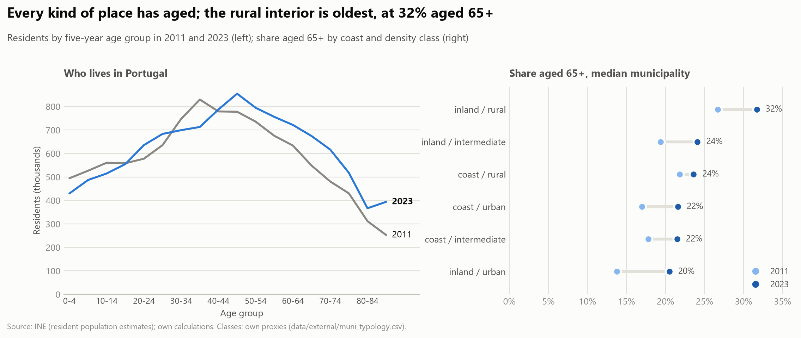

Resident population by five-year age group, 2011 to 2023 (RQ3.5).

30. **The country aged; the pool of household-forming ages shrank, then recovered.** Residents aged 65+ went from 19.2% (2.02 million) to 22.9% (2.57 million),
    80+ from 5.3% to 6.8%, children from 15.0% to 12.8%. People aged 25 to 44 fell from 2.99 million to 2.70 million (2016) and were back to 2.88 million in 2023 (share 28.3% to 25.7%).
31. **The rural interior is oldest; inland towns aged fastest.** Median share aged 65+ in 2023: 31.7% in inland rural municipalities (296 people 65+ per 100 children), 20.5% in the 15 inland urban ones (up 6.7 points
    from the lowest start), 21.5% to 23.6% in the coastal classes.
32. **Neither age variable goes with the rise in price-to-income once foreign residents are in.** Across 267 mainland municipalities, 2016 to 2023: the 25 to 44 share +1.3% per point in the same district (p = 0.07),
    +0.4% with coast and density (p = 0.54), −1.3% with the foreign-resident change (p = 0.15); the 65+ share −2.2% (p = 0.046), −1.7% (p = 0.11), −0.7% (p = 0.59). The foreign-resident
    change stays +1.6% to +2.4% per point (p = 0.002 to 0.035). Consistent with P2.02, where the 65+ share had no robust association in the panel.
33. **The young-adult share is carried by migrants.** The 25 to 44 share fell 1.9 points in the third of municipalities with the least growth in foreign residents and 0.4 in the third with the most
    (correlation 0.58); the median log rise of price-to-income was 0.03 against 0.36. Age structure is mostly a restatement of where migrants went.

Tables: `age_bands_national.csv`, `age_structure_by_class.csv`, `age_structure_associations.csv`, `age_structure_by_foreign_third.csv`. Limits: ages of residents (ageing in place cannot be told from the young leaving),
no internal-migration flows by age and no single-person households between censuses, one cross-section, proxy classes.

## Mortgage credit and household debt (`p2_12_credit_and_household_debt`)

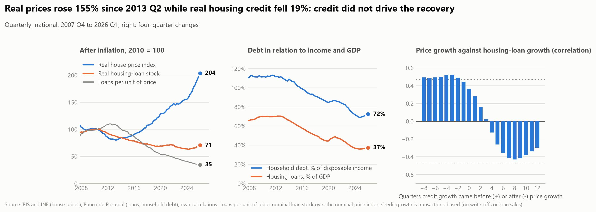

National quarterly series, 2007 Q4 to 2026 Q1: the stock of household loans for house purchase and total household debt (Banco de Portugal, all lenders) against BIS real prices (RQ9.2, RQ9.3).

34. **The price recovery ran on shrinking credit.** From 2013 Q2 to 2024 Q2 real prices rose 98% while the real housing-loan stock fell 27% (nominal −12%): housing loans per unit of price fell 63%. Housing loans went from 66% of GDP
    (2007) to 37%, household debt from 110% to 72% of disposable income. Credit only revived from 2024 (real +12% to 2026 Q1, with prices +28%) and the ratio of loans to price kept falling (−13%).
35. **Credit did not lead the price cycle; it followed it.** Price growth correlates with housing-loan growth four to eight quarters *later* (0.48 to 0.52, outside the ±0.47 limit for no relation) and not with growth that came earlier.
    The test of price growth on credit growth a year before gives −0.3 points per pp [−1.1, +0.5]; once last year's price growth is in, −0.6 [−1.2, +0.1], and next year's credit growth (a placebo that should do nothing) is as large and opposite
    (+0.8, p = 0.003, against −0.9). The negative sign is the regime (credit shrank in 2011-2019 while prices recovered), not an effect of credit on prices.
36. **What this does and does not say.** Prices rose with little new borrowing, so the rise was not a borrowed bubble of the 2000s kind; it does not say who bought, with what (savings, inheritance, foreign or cash buyers, loans from outside the
    stock counted here) or how strict lenders were. Lending standards are a yearly series only for 2018-2025 (see the lending conditions section, `p2_22`) and new lending in total is not available (the volume we hold covers loans fixed up to a year), so RQ9.3 stays partly open.

Tables: `credit_episodes.csv`, `credit_lag_profile.csv`, `credit_timing.csv`.

## What wages and mortgage rates could finance (`p2_13_wages_rates_and_prices`)

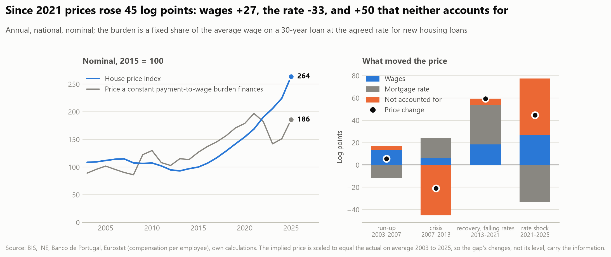

National annual series, 2003 to 2025 (RQ9.4): the price a fixed share of the average wage could service on a 30-year loan at the agreed rate, against the actual price. The gap is what wages and rates do not account for, not a measure of speculation.

37. **Wages and falling rates explain the recovery.** From 2013 to 2021 prices rose 60 log points: wages +18, the rate +35 (the payment per euro borrowed fell by a third), and +6 not accounted for. The payment-to-wage ratio of buying at the index price barely moved (103 to 109, 2015 = 100).
38. **Since the rate shock they do not.** From 2021 to 2025 prices rose another 45 log points while the rate went from 0.7% to 3.1% (−33 on what can be financed) and wages added +27: +50 is left over, and the payment-to-wage ratio rose from 109 to 180 (2007: 161). The rise of the gap is +40 to +60 under APRC, 20- and 40-year loans and other benchmark windows. Letting the term follow the observed mean term of new loans (33.2 years in 2021, 31.9 in 2025, Banco de Portugal, `p2_22`) makes it larger, +56: shorter terms offset part of the rate fall, so the lending terms do not account for the remainder (the State guarantee loans, 37.8 years, are 15% of the contracts and are in that mean).
39. **Read the gap as everything else, not as expectations.** It holds credit rationing (the gap fell 45 points in the 2007-2013 crisis, when loans were hard to get), buyers richer than the average employee, cash, foreign and savings-funded purchases, supply, and expectations; it matches `p2_12` (credit stock flat to 2024) in suggesting that the latest rise was not financed by new loans. These data cannot tell the parts apart.

Tables: `financeable_price.csv`, `price_change_parts.csv`, `financeable_price_variants.csv`.

## Foreign residents by nationality group (`p2_14_nationality_and_prices`)

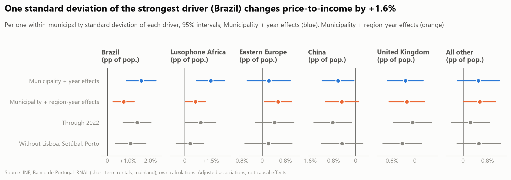

The regression of `p2_02` with the change in foreign residents split into six groups (RQ3.3): Brazil, Lusophone Africa (Angola, Cabo Verde, Guinea-Bissau, São Tomé and Príncipe), Eastern Europe (Romania, Moldova, Ukraine), China, the United Kingdom and all other; log price-to-income, 2016 to 2023, municipality and year effects.

40. **The groups grew very differently.** Residents with a title 2014 to 2023: Brazil 85,000 to 368,000 (35% of the 2023 total), Lusophone Africa 88,000 to 163,000, the United Kingdom 17,000 to 47,000, all other 102,000 to 387,000 (37%), China 21,000 to 28,000 and Eastern Europe *down* from 78,000 to 50,000.
41. **Brazil and Lusophone Africa go with the rise in price-to-income; the others do not.** +7.9% per point of population added through Brazilians [+4.4, +11.3] and +10.5% through Lusophone Africans [+4.8, +16.3], about +1.6% per within-municipality standard deviation each, against +4.3% for all foreign residents together. Eastern Europe (+3.3% [−7.6, +14.2]), the United Kingdom (−1.3% [−3.8, +1.2]) and all other (+2.3% [−0.9, +5.4]) are indistinguishable from zero, China is negative (−15.8% [−30.1, −1.5], the group is small and concentrated). The six coefficients are not equal (chi-square 35.0, 5 degrees of freedom, p < 0.001).
42. **Within a region the groups converge, so nationality is a marker of place.** With NUTS 3 × year effects Brazil falls to +4.8% [+1.7, +8.0], Lusophone Africa to +5.4% [+0.3, +10.5], Eastern Europe rises to +8.7% [+1.2, +16.2] and all other is +2.7% [+0.1, +5.4]: +0.6% to +0.8% per standard deviation for each, UK and China still at or below zero. The equality test weakens to p = 0.019. Stopping in 2022 or dropping Lisboa, Setúbal and Porto keeps the signs but widens the intervals (Lusophone Africa is no longer clearly positive without the three districts). These are the municipalities where particular groups settled (Brazilians and Africans in the metropolitan belts and the Algarve, British in the Algarve), not evidence that one nationality raises prices.

Tables: `nationality_group_sizes.csv`, `nationality_regressions_pti.csv`, `nationality_equality_tests.csv`. Limits: titles, not the foreign-born; groups are fixed by size, not by income or legal route (work, study, investment); coefficients per point of population are not comparable with a group's typical size (compare per standard deviation); the same adjusted-association caveats as `p2_02`.

## New dwellings against households, by size (`p2_15_new_build_vs_households`)

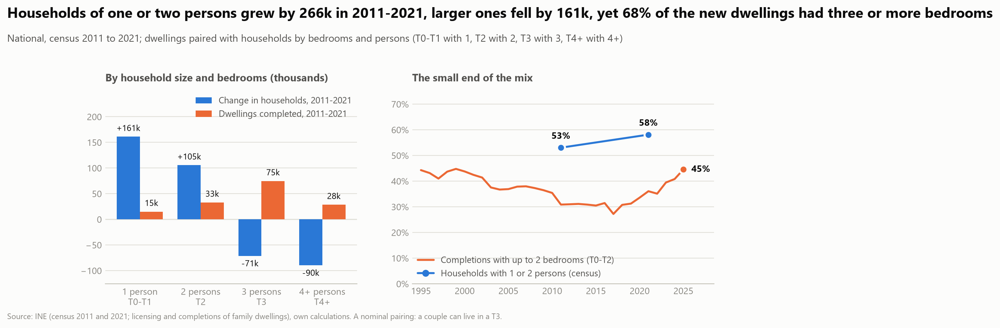

Completed family dwellings by number of bedrooms against private households by number of persons (census 2011 and 2021), paired one to one (T0-T1 with 1 person ... T4+ with 4 or more; RQ2.6). The pairing is nominal and only flows are compared.

43. **Households grew only at the small end; new building did not.** 2011-2021: one-person households +161,000 and two-person +105,000, three-person -71,000 and four or more -90,000. Of the 151,000 dwellings completed in those years 68% had three or more bedrooms and 32% up to two, against 58% of households with one or two persons (53% in 2011).
44. **The mix is moving the other way now.** The share of completions with up to two bedrooms fell from 44% (1995) to 27% (2017) and is 45% in 2025 (T0-T1 alone 17%, from 9%).
45. **The gap is widest where prices are lowest.** In 266 municipalities with at least 50 completions the median gap between the household mix and the completion mix is 33 pp (positive in 97%): urban 23 pp, intermediate 28, rural 38. It is negatively associated with 2024 price-to-income (Spearman -0.66) and with real price growth 2019-2024 (-0.39). New building is least matched to households in the cheap, ageing interior, where houses are built for families that are no longer there, so the mismatch is no sign of where affordability is worst.

Tables: `households_and_completions_by_size.csv`, `completion_shares_by_bedrooms.csv`, `small_dwelling_gap_by_density.csv`, `small_dwelling_gap_association.csv`, `small_dwelling_gap_terciles.csv`. Limits: a nominal pairing, flows only (who lives in the existing T3s is not observed: the households that left large sizes may have freed them), 2011-2021 completions against two census dates, flats against houses not covered.

## Vacant dwellings against housing pressure (`p2_16_vacant_dwellings`)

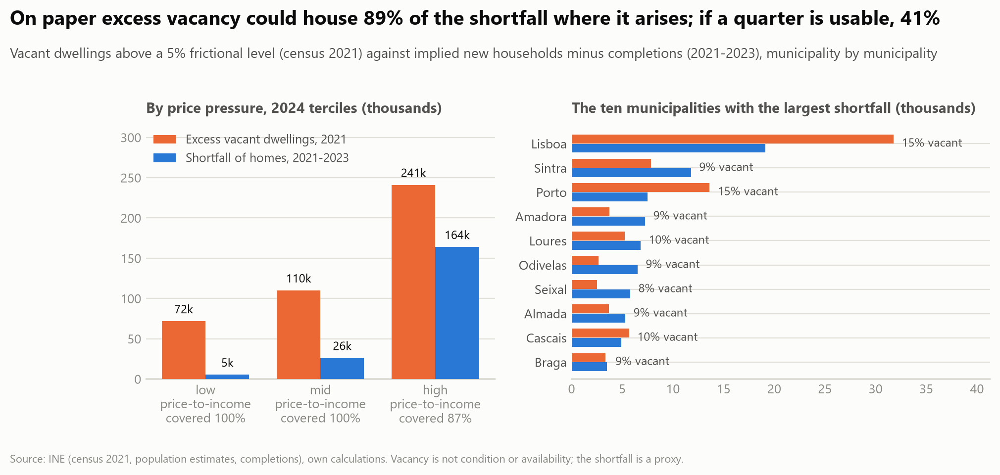

Census vacant dwellings (2011, 2021) against the household shortfall of `p2_05` (implied new households 2021-2023 minus completions, floored at zero), municipality by municipality (RQ2.5). Only vacancy above a frictional 5% of the stock counts (3% and 8% as checks); a vacant home helps only in the municipality where it stands.

46. **Vacancy barely moved, but left the cities.** Vacant dwellings 735,000 (12.5% of the stock, 2011) to 723,000 (12.1%, 2021). Urban municipalities lost 42,000 (12.3% to 10.4%), intermediate ones gained 1,000 and rural ones 28,000 (13.0% to 14.6%). Vacancy is highest where prices are lowest (Spearman -0.39 with 2024 price-to-income).
47. **On paper, vacant homes are enough where they are needed.** Above 5%, 425,000 dwellings are excess vacancy, against a shortfall of 195,000 in 2021-2023; counted municipality by municipality, excess vacancy could house 174,000 of it (89%): 100% in the low and middle price-to-income terciles, 87% in the high one, which holds 164,000 of the shortfall.
48. **The answer hangs on how much is usable.** With a quarter of the excess usable the coverage falls to 41%; at frictional levels of 3% and 8% it is 51% and 24%. Local coverage reaches half of the shortfall when a third of the excess is usable (5%) and three quarters when 60% is; at an 8% frictional level three quarters cannot be reached. Nothing in the data says what share of vacant homes is habitable, for sale or let, or worth the repair (the simulator prices a renovation at about 17,000 to 101,000 EUR a unit, assumed).
49. **The largest shortfalls are in the suburbs, where vacancy is lowest.** Ten municipalities hold 40% of the shortfall; Lisboa, Porto and Cascais could cover theirs, but Sintra (67%), Amadora (52%), Odivelas (41%) and Seixal (44%), at 8% to 9% vacancy, could not. Lisboa and Porto hold the most excess (32,000 and 14,000, at 15% vacancy), a stock the census cannot tell apart from short-term lets, second homes and homes awaiting works.

Tables: `vacancy_by_density.csv`, `vacancy_by_price_pressure.csv`, `vacancy_largest_shortfalls.csv`, `vacancy_sensitivity.csv`, `vacancy_usable_share_needed.csv`. Limits: census dates ten years apart, the shortfall is the `p2_05` proxy (implied households, no demolitions), a frictional level that is assumed, and a count of dwellings, not of homes anyone could move into.

## What it costs to build (`p2_17_construction_costs`)

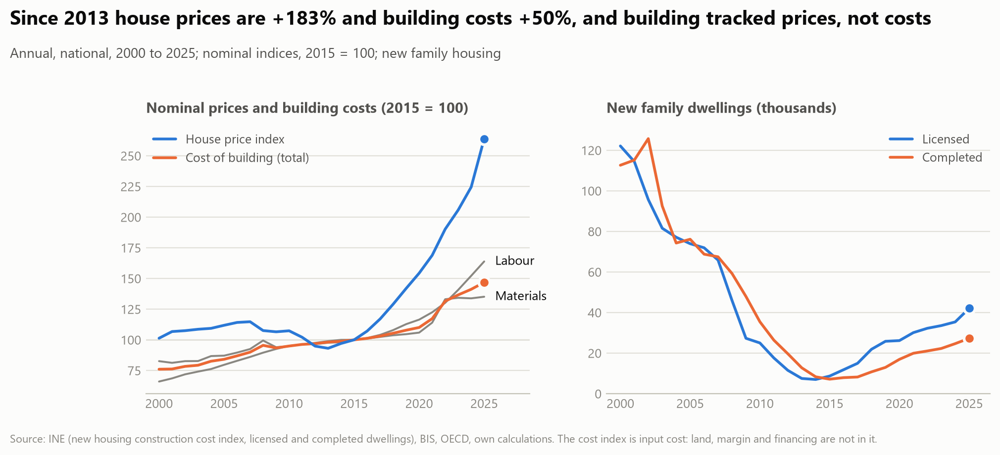

INE's cost index of new housing (monthly, materials and labour; 2000 to 2025 as complete years) against the nominal house price index and the new family dwellings licensed and completed (RQ2.7). The index is input cost only: land, margin, financing and licensing time are not in it, so the ratio of the price index to the cost index is "everything in the price except the cost of building", not a margin in euros.

50. **Building got dearer, but far less than houses.** 2013-2025: nominal house prices +183%, the cost of building +50% (materials +38%, labour +66%), wages +58%; in real terms prices +129% and costs +21%. The cost index accounts for 39% of the log rise in price (30% in 2013-2021, 50% since 2021, when costs jumped 25% in four years); the price-to-cost ratio is up 89% since 2013.
51. **Labour is dearer than materials, but only as much as wages.** Labour cost rose 66% against materials 38% since 2013, and the labour index over compensation per employee is flat (97 in 2013, 102 in 2025, 2015 = 100): building labour followed wages in general.
52. **Licensing follows prices, not costs.** A 1 log-point rise in the real price goes with 3.8 log points more licensed dwellings the next year (interval 2.8 to 4.7); the coefficient on the real cost is -1.2 (-3.6 to 1.1). Without the crisis years 2008-2011 it is 3.2 (2.0 to 4.3) for prices and 0.0 for costs; without 2021-2023, 3.9 and -0.4. Licensing averaged 87,800 dwellings a year in 2000-2007, 28,700 in 2007-2013, 17,100 in 2013-2021 and 34,700 since 2021, when costs rose fastest and licensing recovered.

Tables: `construction_episodes.csv`, `construction_supply_response.csv`, `construction_labour_vs_wages.csv`. Limits: an input-cost index only (no land price, margin or financing; the level of the cost per m2 is not in the data), national, annual and 24 yearly changes over two cycles (the intervals are wide and the cost and price changes are correlated), association not a supply elasticity. Land availability, planning rules and licensing times are not in the project, so RQ2.7 is only partly answered.

## What foreign buyers pay, and where they buy (`p2_18_foreign_buyers`)

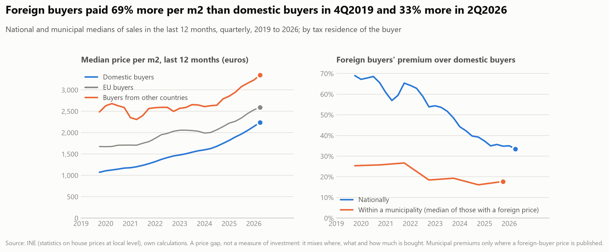

INE's median sale price per m2 by the buyer's tax residence (national territory, EU, other countries), nationally and by municipality, 4Q2019 to 2Q2026 (RQ5.2). There is no count of sales by buyer, and a cell is blank when there are too few transactions: the premium is a price gap, not a measure of investment, and a municipality with a foreign-buyer price is one with enough foreign purchases, the only signal of where they buy. The euro flow of foreign real-estate investment (Banco de Portugal) was not found in BPstat and is not measured.

53. **Foreign buyers pay more, and the gap has halved.** Nationally the median foreign buyer paid 69% more per m2 than a domestic buyer in 4Q2019 and 35% more in 4Q2025 (33% in 2Q2026): buyers from other countries 132% to 54% more, EU buyers 56% to 19%. Domestic buyers' median rose 92% (1,071 to 2,051 EUR/m2), foreign buyers' 53% (1,810 to 2,765), so domestic prices converged on the foreign ones.
54. **Most of the gap is geography.** Inside a municipality the median premium is 25% (2019) and 18% (2025), and foreign buyers paid more in 87% to 97% of the municipalities where a foreign price is published. Only 37 to 67 of about 300 municipalities have one in a year, but they hold 44% to 61% of all sales. 49 municipalities (a foreign price in at least four of seven yearly snapshots) are the foreign markets: 50% of coastal municipalities, 4% of inland ones, 74% of tourist ones.
55. **Foreign markets are dearer, but the data do not show they rose more.** Domestic buyers' prices are 84% higher in foreign markets (46% within a district) but the difference is 3.6% (-11.8 to 19.1) once 2019 sales are held fixed and -8.1% (-24.2 to 8.0) with place types as well; their 2019-2025 growth is 8.6 log points higher raw, 1.2 (-3.8 to 6.2) within district and -4.4 (-16.0 to 7.2) with sales and typology. The result does not move when a foreign market needs one, two, four or seven years of foreign prices.

Tables: `foreign_buyer_premium.csv`, `foreign_markets_by_year.csv`, `foreign_markets_by_typology.csv`, `foreign_markets_price_growth.csv`, `foreign_markets_price_level.csv`, `foreign_markets_sensitivity.csv`. Limits: prices without counts, seven years, 255 to 278 municipalities (20 district clusters), cells blank where sales are few (so presence favours big markets, the reason sales are controlled), no purchase value or number of homes, an association between where foreign buyers are active and where domestic buyers' prices are higher or rose more, not an effect of their buying (who buys where is not random).

## Renovation of existing buildings (`p2_19_renovation`)

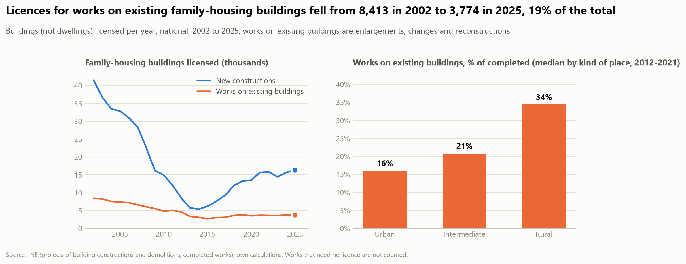

INE counts buildings licensed (2002-2025) and completed (2011-2025) by type of project, by municipality: new constructions and "enlargements, changes and reconstructions", which is every work on an existing building (RQ2.8). The unit is the building, not the dwelling, and works that need no licence are not counted, so the series give the pace and the place of the work, not the homes it returned to use.

56. **Works on existing buildings have been flat while new building swung.** Licences for family-housing buildings: works on existing buildings 8,413 (2002), 3,112 (2014) and 3,774 (2025), new constructions 41,439, 5,348 and 16,279. Renovation's share of licences rose from 17% to a peak of 37% (2013), when new building collapsed, and is 19% in 2025; of completed buildings it is 16% (23% in 2011). Completions of such works averaged 2,232 buildings a year in 2015-2024 (3,467 licensed).
57. **It happens in the country, not where homes are short.** Works on existing buildings are 16% of completed family-housing buildings in urban municipalities, 21% in intermediate and 34% in rural ones (median; 2.3, 4.6 and 6.4 buildings per 1,000 dwellings over 2012-2021). Across municipalities they are unrelated to the vacancy rate (Spearman +0.05) and negatively related to the shortfall per 1,000 dwellings (-0.37, `p2_05`), and they go with a rising vacancy rate (+0.23). A city's blocks hold many dwellings each, so the per-dwelling rates understate cities; the share of works, which does not use the stock, tells the same story.
58. **At today's pace renovation touches the vacant stock slowly.** The 425,000 excess vacant homes of `p2_16` against 2,232 buildings a year: if each building returned one vacant home, a quarter of the excess (the usable share assumed in `p2_16`) would take 48 years and all of it 190; three homes a building 16 and 63 years; ten homes a building 5 and 19. These are upper bounds on the contribution (some homes were occupied, some are not let or sold afterwards). The simulator's renovation lever (10,000 units a year, an assumption, `config/scenarios.yaml`) is 4.5 times the number of buildings with such works completed a year now and more than twice the 2011 peak of 4,552.

Tables: `renovation_national.csv`, `renovation_changes.csv`, `renovation_by_density.csv`, `renovation_by_coast.csv`, `renovation_association.csv`, `renovation_share_association.csv`, `renovation_years_to_clear.csv`. Limits: buildings not dwellings (a renovated block counts once), no licence-free works, extensions are in the same group as rehabilitation, no link between a work and a vacant home, no cost or quality, completions from 2011 only, an association across 308 municipalities.

## Household size (`p2_20_household_size`)

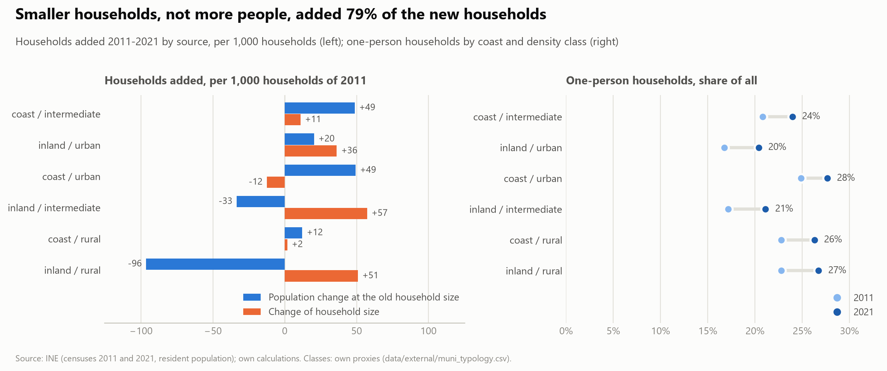

The two censuses give households by number of persons (`ine_households_size`) and, with the resident population, persons per household (RQ3.4). Between them the change in households splits exactly into what the population change would add at the 2011 size and what comes from the change of size. Only 2011 and 2021 exist, so nothing is said of the years between.

59. **Most new households are smaller households.** Households grew 2.6% (4.04 to 4.15 million) on a population that grew 0.4%; persons per household fell from 2.61 to 2.55. Of the 105,000 households added, 22,000 (21%) are what population growth gives at the old size and 83,000 (79%) come from smaller households. One-person households rose by 161,000 (21.4% to 24.8% of households), two-person by 105,000; households of three and of four or more fell by 71,000 and 90,000.
60. **In the interior households grew without people.** 239 of 308 municipalities lost residents, 72 of them still gained households. Per 1,000 households of 2011, inland rural lost 96 through population and gained 51 through size, inland intermediate -33 and +57; coastal urban gained 49 through population and lost 12 to larger households.
61. **The one-person share does not go with the rise in price-to-income (RQ3.5).** -1.6% per point (p = 0.30) within district, -0.7% (p = 0.63) with coast and density, +0.1% (p = 0.94) with the 65+ and foreign-resident changes; the foreign-resident change stays positive (+1.4% to +1.7% per point). Persons per household goes the other way (+0.50 log points per person within district, p = 0.004) but fades to +0.15 (p = 0.41) with the controls, so larger households mark the places migrants went to.
62. **The one-person share is partly ageing.** Its change was 3.4 points in the third of municipalities that aged least and 4.4 in the third that aged most (correlation with the 65+ change 0.38).

Tables: `household_size_national.csv`, `households_by_size_national.csv`, `household_size_by_class.csv`, `household_size_associations.csv`, `household_size_by_ageing_third.csv`. Limits: two census years; persons per household includes residents of collective homes; a one-person household is not a measure of choice or unmet demand; household change 2011-2021 and price window 2016-2024 differ; 271 mainland municipalities, one cross-section.

## Which associations survive controls, and which designs test themselves (`p2_21_evidence_ladder`)

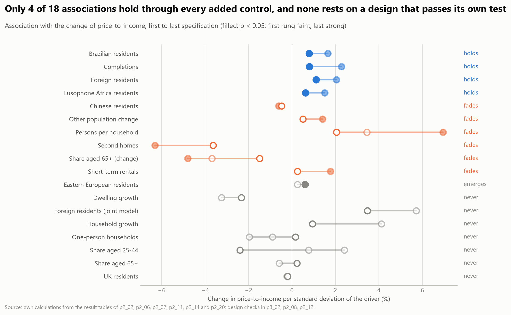

A synthesis of earlier tables with one reading rule (M3): each driver is followed from the least to the most controlled specification of the notebook that tested it; it "holds" if its coefficient keeps its sign and stays below p = 0.05 at every rung. Separately, the three designs of the project with a test of their own assumption are read side by side.

63. **Four of 18 associations hold at every rung.** In the panel (municipality and year effects, then municipality and region-year effects): foreign residents (+2.0% then +1.1% of price-to-income per standard deviation), completions (+2.3%, +0.8%), Brazilian residents (+1.6%, +0.8%) and Lusophone Africa residents (+1.5%, +0.6%). Six fade (other population change, Chinese residents, second homes, the 65+ share, short-term rentals, persons per household), one emerges (Eastern European residents) and seven are never significant, among them household growth, dwelling growth, the 25-44 share, the one-person share and UK residents.
64. **What holds is regional.** The coefficients fall by a half to two thirds once region-year effects absorb where prices rose; completions have a positive sign, so they mark places that boomed, not supply that eased prices; the foreign-resident change that holds in the panel is not significant in the cross-section with every block in (p = 0.11, 0.21).
65. **No relationship has a credible causal identification.** The IMI event study rejects its pre-trend (p = 0.024) and its effect is not distinguishable from zero; the mortgage-rate timing test does not reject its placebo (p = 0.67) but finds no effect; credit growth rejects its placebo (p = 0.003: credit follows prices). Identifying a policy effect would need a sharp rule change with a comparison group, transaction data by buyer and a window long enough to test pre-trends.

Tables: `evidence_ladder.csv`, `evidence_ladder_rungs.csv`, `evidence_design_checks.csv`. Limits: the specifications of each ladder differ in sample and controls, so rungs are not all nested; 18 drivers is what was tested, not what matters; no correction for the number of tests.

## Lending conditions: maturity, loan-to-value and the deposit (`p2_22_lending_conditions`)

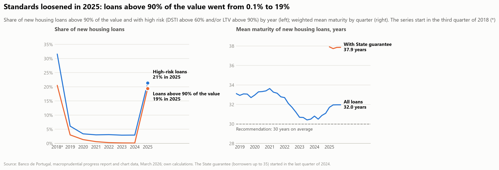

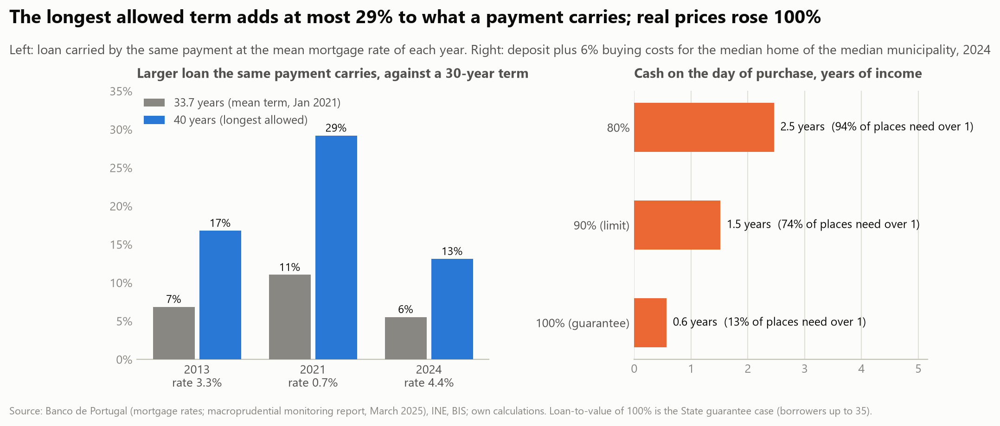

The Banco de Portugal publishes the terms of new housing loans in a yearly monitoring report. The March 2026 edition (covering 2025) comes with the data of its charts, read into `data/external/lending_series.csv`: yearly series from the third quarter of 2018 to 2025 (maturity quarterly). The March 2025 edition is transcribed in `data/external/lending_standards.csv` (a few points). On top of them, accounting: the loan a fixed payment carries by term and rate, and the cash needed on the day of purchase and the payment burden by loan-to-value.

66. **Standards tightened from 2018 to 2024, then loosened in 2025 (RQ9.3).** Loans above 90% of the value went from 20.5% of new loans (third quarter of 2018) to 0.1% in 2024 and 19.4% in 2025; high-risk loans (DSTI above 60% and/or LTV above 90%) from 31.6% to 2.9% and 21.4%; the mean LTV from 77.9% to 69.9% and 75.4%; the mean term from 33.4 years (July 2018) to 31.0 (December 2024), 31.9 in 2025 (above the 30-year reference of the Recommendation in all 29 quarters). Real prices rose 49% in 2018-2024 and 14.9% in 2025 alone. Without the State guarantee the high-risk share stayed at 2.6% in 2025: the loans under it carry a mean LTV of 99.2%, a mean DSTI of 33.7% (29.6% for all) and a mean term of 37.8 years, 15.0% of new contracts and 19.8% of the amount lent. The loosening and the price rise coincide in time; one year, national, no design tests a link. The reports start in July 2018, so they cannot say whether standards fed the 34% rise of 2013-2018.
67. **A longer term cannot account for the price rise.** The longest term allowed (40 years) carries a loan 17% larger than 30 years at the 2013 mean rate, 29% at the 2021 rate (0.7%) and 13% at the 2024 rate (4.4%), against real prices +100% in 2013-2024 (+49% in 2018-2024); it is a ceiling for borrowers up to 30 that was not reached, since the actual mean term fell from 33.4 to 31.0 years and by itself cut what a payment carries by 3.4%. The rate rise from 0.7% to 4.4% cut it by 39% at 30 years.
68. **The guarantee removes the deposit, not the payment (RQ6.4, partly).** Cash on the day of purchase for the median municipality's home is 2.5 years of income at an 80% loan, 1.5 at the legal 90% and 0.6 with the State guarantee for borrowers up to 35 (13% of municipalities need more than a year, against 94% at 80%); but the payment on a 100% loan is 57% of gross income at 30 years and 50% at 40, with 57% and 50% of municipalities above half of gross income (a rough proxy for the debt-service cap). The share of borrowers up to 35 was 37% to 43% in 2018-2024 and 54.0% in 2025, with the guarantee and the August 2024 exemption of IMT and stamp duty.

Tables: `lending_standards.csv`, `lending_series.csv`, `lending_guarantee_2025.csv`, `lending_maturity_capacity.csv`, `lending_cash_needed.csv`, `lending_burden.csv`. Limits: one report's chart data, the first year a quarter; the DSTI of the 2026 edition (29.7% for 2024) differs from the 2025 edition's (26.2%), so it is read within the series; only granted loans are seen; no estimate of the guarantee's uptake or its effect on prices; capacity and cash are accounting at the national mean rate, not household behaviour.

## The dwelling stock: how much of what was built shows up in the count (`p2_23_dwelling_stock`)

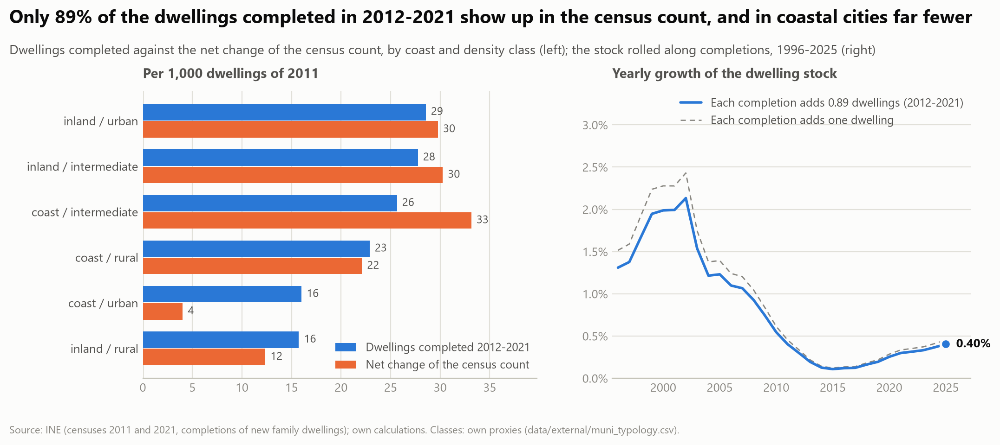

The census counts dwellings only in 2011 and 2021; completions of new family dwellings are annual. Between the censuses the net change of the count is set against the completions of 2012-2021, and the stock is rolled along completions to give a yearly path (RQ2.4). The gap is an accounting residual: demolitions, merged and split dwellings, conversions, works on existing buildings and census definitions all sit in it.

69. **Nine in ten completions show up in the count.** 5,859,540 dwellings in 2011, 5,970,677 in 2021 (+111,137) against 124,572 completed: a gap of -13,435, retention 0.89. 66 municipalities counted fewer dwellings in 2021 than in 2011, all with completions.
70. **The national total hides offsetting local gaps.** In the 20 coastal urban municipalities 26,821 were completed and the count grew by 6,748 (retention 0.25); in the other 288, 97,751 were completed and the count grew by 104,389. Lisboa and Porto lost 7,109 on the count against 5,783 completed. In coast / intermediate the count exceeds completions by 8,217 (Albufeira, Portimao, Lagoa, Odemira 1,000 to 1,700 each).
71. **The gap is not clearly tied to demand.** Median gap per 1,000 dwellings: -3.6, -3.4 and 0.0 in the thirds of municipalities by population change 2011-2021, rank correlation 0.09.
72. **The stock between censuses.** Rolled from 2021: 4.60 to 4.75 million in 1995, 5.17 to 5.26 million in 2001, 6.06 to 6.07 million in 2025 (+85,000 to +95,000 since 2021). Yearly growth peaked at 2.0% to 2.3% in 2001, bottomed at 0.11% to 0.12% in 2015 and was 0.40% to 0.45% in 2025.

Tables: `dwelling_stock_national.csv`, `dwelling_stock_by_class.csv`, `dwelling_stock_largest_gaps.csv`, `dwelling_stock_by_population_change.csv`, `dwelling_stock_path.csv`. Limits: the gap cannot be split into its causes; calendar-year completions against March censuses; retention measured in a low-building decade and applied to the boom is an extrapolation, so the two paths are a range, not a bound; composition is not rolled.

## Limitations

- **A pattern, not a mechanism.** Spatial autocorrelation does not show that price changes spill over: shared
  income, coast, labour markets and policy produce it as well. The within-region check removes only average
  regional differences. The spillover tests in the next section go further.
- **Short history.** Municipal prices start in 2016, so changes cover eight years.
- **Weights matter at the margin.** Contiguity treats very unequal municipalities alike; the within-region result
  drops from 0.20 to 0.08 with k-nearest weights.
- **Exploratory clusters.** LISA and Gi* use 300 tests with no multiple-testing correction; they flag the same
  municipalities because the statistics are closely related, so agreement is not independent confirmation.
- **Residual spatial dependence.** Residual Moran's I of the main regression is 0.03 to 0.39 depending on the year
  (0.39 in 2023), so errors clustered by municipality are probably too small; clustering by region (26 clusters)
  keeps the conclusions, but few clusters are a caveat of its own.
- **Foreign residents.** The series counts residence titles on 31 December (2014 to 2023; 2024 is not published at
  municipal level). It jumps by a third in 2023, possibly partly because of processing of applications, and may include
  people already living in the municipality; results are shown without 2023. Nationalities are not
  yet used.
- **Typology.** Coast, density and tourism are proxies (CAOP shoreline, 2021 density, today's rental registry),
  the groups overlap and some are small (9 to 57 municipalities); islands are left out.
- **Rentals.** The series is the stock of units still registered today (survivors, mainland only), which understates
  the past and so overstates its growth.
- **Synthesis.** The block ladder is one cross-section of 271 municipalities and one change (2016 to 2024); the
  order of blocks matters when they overlap (reverse order in `synthesis_r2_order_check.csv`), and R2 says what
  accompanies the outcome, not what causes it.
- **Second homes.** The census category mixes holiday homes, inherited village houses and the diaspora's homes, is
  observed only in 2011 and 2021 (before part of the recent rental and foreign-buyer boom) and cannot show later
  conversions or seasonal occupancy.
- **Implied households.** The 2021 to 2023 gap divides new residents by 2021 persons per household, ignores
  household-size change and revisions of population estimates, and completions exclude renovation, conversion and
  demolition; it is a proxy (almost minus population growth, correlation −0.99). Census years are ten years apart.
- **Rates and prices.** One national series with a persistent rate: 23 years hold roughly two cycles, annual changes
  overlap, and the rate is set for the euro area in response to conditions that also move prices (inflation enters
  the real price through the deflator; the nominal check is weaker, −0.8 [−1.9, +0.4]). A null does not mean no
  effect, only that this series cannot tell. Credit supply is not tested: the loan volume we hold covers loans fixed
  for up to one year (the share of fixed-rate loans grew after 2018), not total lending.
- **Credit and household debt.** One national series of stocks (not new lending), two credit regimes in 18 years and overlapping annual changes; the stock changes with write-offs and sales of loans (the growth rate we use is transactions-based), covers all lenders and counts loans, not who bought. Loans per unit of price assumes a constant housing stock and share bought with a loan, so it is a gauge, not leverage. Lending standards are observed only from 2018 (`p2_22`).
- **Wages and rates as fundamentals.** The benchmark assumes a constant payment-to-wage burden, one national average wage (not buyers' incomes, which rose faster if buyers are older, richer or foreign), the floating-rate series (fixed-rate loans reset slowly) and a fixed loan share and term; its level depends on the benchmark window, so only changes in the gap are read. Annual, nominal, 23 years, two regimes: a description of a gap, not a test of a bubble.
- **Centres.** The 100,000-resident rule is a size cut-off, not a functional urban area: it counts suburbs such as Sintra
  and Amadora as centres and Coimbra or Viseu alongside Lisboa. Distance in border steps ignores how far a step is
  (Alentejo municipalities are large) and commuting. The gradient is a description of 302 municipalities with prices in
  2016 and 2024, one boom, and the contrast within regions rests on 9 regions.
- **Wages and the labour market.** Thirty yearly observations, one economy; compensation per employee does not hold hours
  or the mix of jobs fixed and is not the income of buyers (who are older, richer and more often foreign than the
  average employee); Newey-West errors with two lags are approximate at this length. Rents are the OECD index of all leases, which lags what new tenants pay.
- **Dwelling stock.** The reconciliation of the census count with completions is an accounting residual, not an estimate of demolitions or conversions; the path before 2011 extrapolates a retention measured in 2012-2021, and the censuses fall in March while completions are calendar years.
- **Missing municipalities.** 12 municipalities have no price-to-income for 2016 or 2024 and are left out (hatched on
  the map); their neighbours' weights are re-standardised without them.

## Questions answered

RQ4.3 (large municipalities rose most, less further out; Lisboa itself less than its suburbs), RQ4.4 (little evidence of spillovers beyond the regional pattern), RQ4.6 (coastal and urban, not tourism as such), RQ2.1 to
RQ3.5 (ageing, the 25-44 pool and the one-person share add nothing beyond the foreign-resident change; internal migration not observable), RQ3.4 (households grew by smaller households, 79% of the added), RQ2.3 and RQ4.5 (supply against households) and RQ5.4 (second homes separated) are answered; RQ3.6 is answered as far as these data allow (demand differences cannot be told from the regional pattern); RQ2.4 (nine in ten completions show up in the census count, a quarter in coastal cities; stock path 1995-2025), RQ2.5, RQ2.7, RQ2.8, RQ3.3, RQ5.1, RQ5.2, RQ5.3, RQ1.7, RQ9.1, RQ9.2 and RQ9.5 are partly answered; RQ1.4 is answered (income and wages) (see [research_questions](../docs/research_questions.md)).
