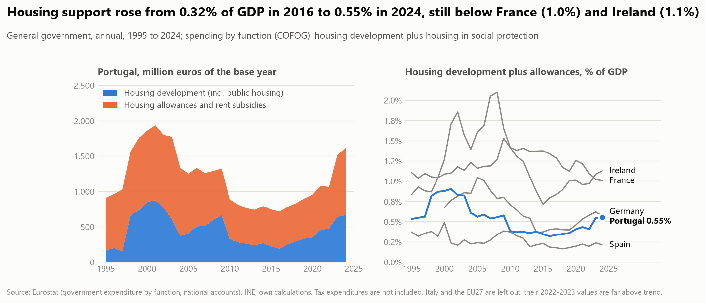
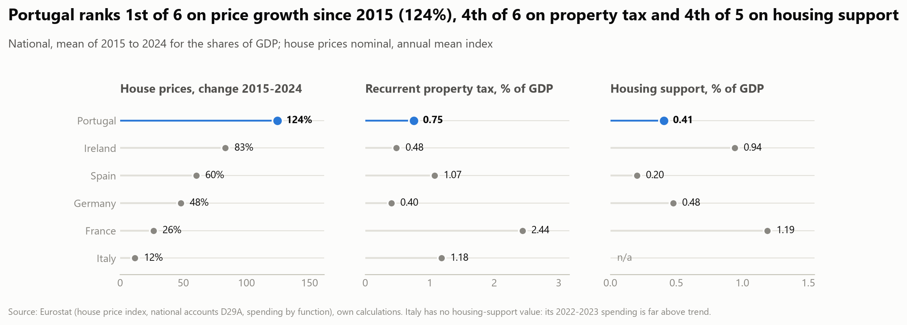
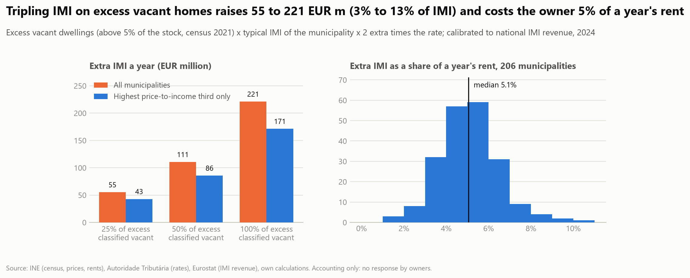
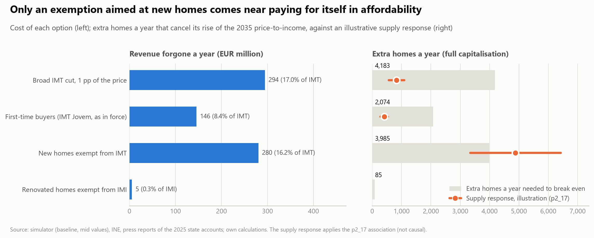
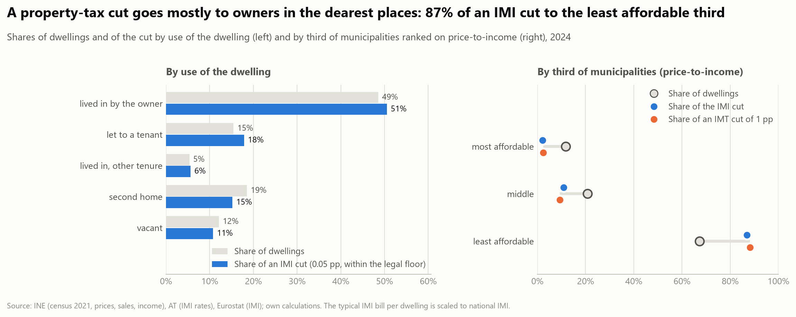

# Phase 3 — Evaluate a policy

Write-up of findings. Figures: `reports/figures/p3/`, tables: `reports/tables/p3/`, notebooks: `notebooks/p3_policy/`.

**Status:** estimated (2026-10-23). The policy was chosen on 2026-10-22 from five candidates (see [decisions](../docs/decisions.md)).
Result: **inconclusive, and an adjusted association rather than a causal effect**; phase 4 gets an upper bound, not a point estimate
(see Key findings).

## Question

**Are cuts in the municipal IMI rate capitalised into sale prices?** Each municipality sets its urban IMI rate
(0.30% to 0.45%, 0.50% for some municipalities until 2023) every year. A permanent cut lowers the yearly tax on
a dwelling; if buyers value it, prices rise and the benefit goes to owners, not to buyers or renters (RQ7.4). The
estimate is also the behavioural parameter the phase 4 IMI lever needs. Outcomes: log real price per m² (main), the
price-to-income ratio (the affordability version; income is not affected by the rate) and, secondarily, real rent per
m² (2020 to 2024, only municipalities with at least 33 leases).

## Data (verified 2026-10-22)

Rates: Portal das Finanças, urban rate per municipality and tax year, 2012 to 2025, 308 municipalities every year
(`config/sources.yaml`, `at_imi_rates`; caveats in [data_quality](../docs/data_quality.md): 12 municipalities with
parish-specific rates in some years, island codes to match by name, year convention inferred, rates as stored today).
Prices, rents, income and the typology are already in the panel.

| Fact (mainland, 278 municipalities) | Count |
|---|---|
| Municipalities with a complete rate series 2015 to 2025 | 243 |
| Municipalities that never changed 2016 to 2025 (of which at the 0.30% floor) | 113 (98) |
| Rate cuts per year, 2016 to 2025 | 87, 47, 48, 43, 84, 39, 43, 46, 43, 30 |
| Rate increases per year, 2016 to 2025 | 0, 8, 4, 1, 0, 2, 2, 0, 0, 6 |
| Changes in 2018 to 2023 with two years before and one after observed | 303 (295 cuts) |
| of which isolated (no other change in that window) | 71 (68 cuts; 22 of at least 0.03 pp, 16 of at least 0.05 pp) |

Changes are small: the median is 0.01 pp (about 3% of the bill), the largest 0.15 pp. The prices start in 2016,
so the 87 municipalities that first cut in 2016 have no pre-period.

## Design

1. **Treatment.** A cut in the urban rate in tax year *t* (in 0.01 pp). The rate is decided in the last months of *t*
   and applies to the assessment of *t* (paid in *t*+1); INE's price is the 4th-quarter median of the last 12
   months, so the response is expected from *t*+1. Alternative alignments (response in *t*, *t*+2) are run as checks.
2. **Main estimate: stacked event study.** One stack per event year; treated units are municipalities with an isolated
   cut in *t* (no other change from *t*−2 to *t*+1); controls in the same stack are municipalities with no change in the
   window, compared within the same NUTS 3 region and year (region-year effects). Dynamic effects for *k* = −2 to +2, with
   the pre-period coefficients as the pre-trend test. A robust staggered estimator (Callaway and Sant'Anna or
   Sun and Abraham) is the check, because the two-way fixed-effects version is biased when effects differ by cohort.
3. **Second estimate: dose-response.** Log price growth on the change in the rate (and its lag) with municipality and
   region-year effects, using all changes, not only isolated ones.
4. **Controls and sensitivity.** Lagged price growth (cuts may follow booms), baseline rate (controls above the
   floor only, since 98 of the 113 never-changers are at 0.30% and cannot cut), cut size (at least 0.03 pp), dropping the
   2016 and 2020 waves (87 and 84 cuts, probably common shocks), dropping Lisboa and Porto, parish-rate
   municipalities treated as missing or at the range's midpoint.
5. **Placebos.** Future cuts (*t*+2 to *t*+3) on current price growth; rent as an outcome (it should not capitalise the tax
   if landlords do not pass it on, and is short); a cut in *t*+1 as "treatment" of *t*.

## Threats to credibility and how they are handled

- **Rates are chosen, not assigned.** Councils cut when budgets allow, after booms or before elections. Pre-trends
  and the lagged-growth control test this; a failed test means the result is reported as an adjusted association only
  (project guardrail), not a causal effect.
- **The effect is small and the outcome noisy (power).** A 0.01 pp cut on a tax base below market value, capitalised at
  3% to 5%, is worth roughly 0.1% to 0.25% of the price (assumptions: tax value 50% to 100% of price). An exploratory
  two-way fixed-effects fit with annual real price growth (standard deviation 16 pp) has a standard error of about 0.35 pp
  per 0.01 pp cut (0.35 with NUTS 3 × year effects; only the standard error was inspected). The minimum detectable
  effect is therefore about 0.7 pp per 0.01 pp cut, several times the plausible effect. The design can
  **bound** a pass-through (rule out large capitalisation) but cannot confirm a small one; results are reported with
  confidence intervals against the full-capitalisation benchmark, not as significant or not.
- **Few clean events.** 71 isolated events (22 of at least 0.03 pp); the dose-response estimate uses all 303 to 436 changes
  but is exposed to the staggered-timing bias.
- **Concurrent measures.** Family deductions (the IMI Familiar scheme), municipal short-term-rental rules and the 2020
  pandemic measures coincide with some cuts; the family-deduction flag is in the data and is a control.
- **Price measurement.** Municipal medians of the last 12 months, thin in small places; an annual log change of
  15% is common. Municipalities without a price in an event window drop out of that stack.

## Decision rules (fixed before estimating)

- Pre-trend coefficients jointly significant at 10%: report as an adjusted association, do not use causal language.
- Interval contains both zero and full capitalisation: report as inconclusive; phase 4 uses full capitalisation as the
  upper bound of the behavioural parameter with the range stated, not a point estimate.
- Interval excludes full capitalisation: phase 4 uses the interval as the cited estimate.

## Plan

1. **Done:** `sources/at.py` (dated raw snapshots, 308 pages), interim table `at_imi_rates` (4,312 rows), checks in
   `validate.py`, catalog rows, tests. 2025 rates are complete (checked in `p3_01`); the meaning of the parish link is still not verified
   (handled as a sensitivity run).
2. **Done:** `imi_urban_pct`, `imi_change_pp`, `imi_parish_rates`, `imi_deduction_link` in the municipal panel, with panel checks and tests.
3. **Done:** `analysis/causal.py` (event table, stacks, stacked event study, cohort 2×2 check, dose-response, benchmark) with
   tests on synthetic data with a known effect and a known pre-trend.
4. **Done:** notebooks `p3_01` (who cuts and when), `p3_02` (event study, dose-response), `p3_03` (robustness, rent, power).
5. **Done (2026-10-23):** the bound is in the phase 4 IMI lever (`config/scenarios.yaml`, `policies.imi_reform`; the simulator runs capitalisation from none to full, `reports/p4_forecast.md`). **Open:**
   the placebo "a cut in *t*+1 as treatment of *t*" is covered by the future-cut leads of the dose-response, not run separately.

## Key findings

All effects are in % of the real price per m² per 0.01 pp of cut (a typical isolated cut is 0.02 pp). Full capitalisation of a
permanent 0.01 pp cut is **0.19%** (range 0.10% to 0.33%: assessed value 50% to 100% of the price, discount rate 3% to 5%).

1. **Municipalities that cut are not like those that do not** (`p3_01`). In the year before the cut, their real price grew 9.7%
   against 4.5% (t = 3.7); they are more urban (23% against 3%) and pricier, and start from higher rates. Cuts follow booms.
2. **Usable events are few and small.** 303 cuts in 2018 to 2023, 295 with the window observed, **68 isolated** (22 of at least 0.03 pp),
   of which 65 have prices in the whole window; 30 of those are in the 2020 wave. Median isolated cut 0.02 pp.
3. **The pre-trend test fails** (`p3_02`). Treated municipalities' prices were 1.5% per 0.01 pp lower two years before the cut than one year before
   (joint pre-trend test p = 0.02; p = 0.06 for a cut of any size). Under the decision rule the post-cut coefficients are **adjusted associations**,
   not causal effects. The cohort-by-cohort check gives the same picture (−1.2% before; binary −4.3%, significant).
4. **The post-cut effect is not pinned down.** One year after: −0.24% [−1.83, +1.35]; two years after: −0.81% [−3.54, +1.92]
   (stacked regression). The cohort check is +0.53% [−1.24, +2.76] and −0.21% [−2.08, +2.76]. Every interval contains zero and the full-capitalisation benchmark.
5. **Robustness** (`p3_03`). Across nine specifications no interval excludes either zero or full capitalisation. The pre-trend test is rejected in 7 of 9;
   it is *not* rejected when the 2020 wave is dropped (p = 0.21) or when controls are limited to municipalities above the floor (p = 0.19), but those
   estimates are the least precise (35 treated municipalities, or 157 controls). Price-to-income as the outcome gives the same result as price.
6. **Dose-response** (all rate changes, 2016 to 2025). A cut raises price growth by +0.24% this year and +0.14% last year per 0.01 pp; the sum is +0.38% (SE 0.39),
   or +0.23% (SE 0.48) controlling for last year's growth. Positive and close to the benchmark, but its interval includes zero. The placebo (cuts one and two years
   *ahead*) is of the same size (+0.45%, −0.62%; neither significant), so the estimate cannot be separated from the timing of cuts.
7. **Power.** The minimum detectable effect (2.8 standard errors) is 2.3% one year after and 3.9% two years after: **12 and 21 times** the full-capitalisation benchmark.
   The dose-response (SE 0.39) detects about 1.1%, 6 times the benchmark. The design can rule out only capitalisation far above the benchmark (the one-year interval's upper end is 1.35%, 7× the benchmark).
8. **Rent** is not usable: INE rents start in 2020, which leaves 5 treated municipalities (one-year coefficient −4.0% [−11.0, +3.0]).

**Decision rules applied:** pre-trends rejected, so no causal language. Interval contains zero and full capitalisation, so the result is *inconclusive*.
**For phase 4:** the IMI lever uses the share of a cut capitalised into prices as an assumption between 0 (no capitalisation) and 1 (full: 0.19% of the price per
0.01 pp, range 0.10% to 0.33%), run at both ends; there is no estimate to cite for the middle. Under the project rule on behavioural parameters, the simulator must say so.

## Context: how much revenue is at stake (`p3_04`, RQ7.1)

National general-government revenue, accrual basis (Eurostat; no municipal series exists), in constant 2024 euros. Figure `reports/figures/p3/property_tax_revenue.png`.

- **IMT (with stamp duty) follows the market.** Real revenue fell 67% from 2007 to 2013, rose 377% from 2013 to 2025 and in 2025 is 2,051 EUR m, 0.68% of GDP (0.55% in 2007).
- **IMI has not followed prices.** Real revenue rose 23% in 2013-2019 and fell 12% in 2019-2025 while nominal prices rose 86%; from 0.86% of GDP in 2015 it is 0.59% in 2025.
- **Rate and base.** Over 2013-2025 IMI revenue rose 29 log points: the weighted average rate fell 12 (0.370% to 0.327%) and the implied base rose 41, against 104 for the nominal house price. The base lags the market by 63 log points, 52 of them since 2019.
  The base also carries reassessments, exemptions and the additional IMI, so the lag is an upper-level reading, not an assessment ratio.
- **Scale for a cut.** A 0.01 pp cut of the average rate costs about 55 EUR m a year (linear, 2025). The 2024 anchors of the simulator are within 3% of these series.

### Room for cuts and who pays (`p3_05`, RQ7.2, RQ7.3)

- **The revenue is municipal.** IMI and IMT are municipal revenue (art. 14 of Lei 73/2013, as quoted in the press); the 2023 IMT of the national accounts (1,676 EUR m) is within 1% of the municipal figure reported in the press (1,695), and IMI is 161 EUR m higher, about the size of a State-collected additional IMI (not verified). A rate cut costs councils, not the central budget.
- **The IMI rate has a floor.** The urban rate is legally between 0.30% and 0.45%, and no municipality is below 0.30% in 2012-2025. Councils at the floor rose from 131 (2012) to **199 of 300 (2025)**. The weighted average gap to the floor is **0.027 pp, 8.2% of the bill (about 147 EUR m)**, down from 19.8% in 2012. That is the largest cut councils can make without a change of the law.
- **The simulator's IMI cut does not fit that room.** The package cuts the average rate by 0.05 pp (15% of the bill, about 276 EUR m a year). If each council cuts 0.05 pp but none below the floor, only 67 can do it in full and the average cut is 0.020 pp (6.0%, 109 EUR m). The 0.05 pp lever is therefore an assumption about a changed floor, not a cut available today; the cost in `p4_forecast` is an upper bound for current law.
- **Recovering the loss.** Revenue is rate times base, so a cut of a share c needs the base to grow by c / (1 - c) at the new rate. The full headroom needs +8.9%, which is 22 years of completions (0.41% of the 2021 stock a year, new homes taken to carry the average bill); 0.05 pp everywhere needs +18.1%, 44 years. For IMT, revenue is 5.7% of the benchmark value of dwellings sold in 2024, a 1 pp cut is 18% of it, and dwelling sales value would have to rise at least 21% to pay for it (the lower bound: revenue also holds land, other buildings and stamp duty). The value rose 34% in 2019-2024, mostly through prices, with one year (2021, a rebound from 2020) above 21%. A cut that is capitalised into prices raises the base too, but that response is not estimated here.
- **The cost is the same in every scenario** (`p4_02`): revenue is held at the level of the base year, so a scenario with higher prices does not raise the bill that a cut applies to. For IMI that is a fair simplification, since the base grew 41 log points against 104 for prices in 2013-2025 (`p3_04`); for IMT, which follows prices and sales, the cost would differ between scenarios.

Revenue is the cost side of a rate cut; the capitalisation result above is the benefit side, and it is inconclusive.

### What the State spends on housing (`p3_06`, RQ8.1)

General-government spending by function (COFOG): housing development (public housing included) plus housing allowances and rent subsidies. Tax expenditures are not in it.

- **Level.** 1,615 EUR m in 2024 (667 housing development, 948 allowances), **0.55% of GDP**. The share was 0.91% in 2001 and fell to 0.32% in 2016, so the recent rise is a recovery to the 1995 level (0.53%).
- **Since 2015.** Real housing development +198% (224 to 667 EUR m of the base year), real allowances +81%. Allowances rose 56% in nominal terms from 2022 to 2023 (548 to 853 EUR m), possibly the 2023 rent and mortgage-interest support measures, not checked against the measures themselves.
- **Peers.** 2015-2024 mean as a share of GDP: Portugal 0.41%, Germany 0.48%, Spain 0.20%, France 1.19%, Ireland 0.94%. In 2024 Portugal is at 0.55% against 0.57% (Germany), 0.21% (Spain), 1.01% (France), 1.13% (Ireland). Italy and the EU27 aggregate are left out: their 2022-2023 values are far above trend, probably renovation tax credits booked as expenditure.
- **Scale.** Housing support equals 27% to 36% of IMI plus IMT revenue in 2013-2022 and 44% to 48% in 2023-2024 (`p3_04`). The two are for scale only: the property taxes go to councils, the spending is mostly central.

Limits: spending, not tax expenditures; what counts as housing differs by country; programme-level cost-effectiveness (RQ8.2) is out of reach with these data.

### Portugal against its peers (`p3_07`, RQ6.5 partly)

Three national indicators for Portugal, Spain, Italy, France, Germany and Ireland: the change of the nominal house price index 2015 to 2024, the recurrent property tax (D29A) and housing support (`p3_06`), the last two as a share of GDP averaged over 2015-2024.

- **Prices.** Portugal +124%, Ireland +83%, Spain +60%, Germany +48%, France +26%, Italy +12%: the largest rise of the six.
- **Property tax.** Portugal 0.75% of GDP, fourth of six: France 2.44%, Italy 1.18%, Spain 1.07%, Ireland 0.48%, Germany 0.40%. Portugal's own share rose from 0.40% (2000) to 0.80% (2019) and fell to 0.58% in 2024 (`p3_04`), below Spain (0.89%), Italy (1.02%) and France (2.09%).
- **Housing support.** Portugal 0.41%, fourth of five (Italy left out, 2022-2023 values distorted): France 1.19%, Ireland 0.94%, Germany 0.48%, Spain 0.20%.
- **What this is.** The country with the largest price rise taxes property below the peer median and spends less than the peer median on housing support. Six countries and no control for incomes, rates or supply cannot say what causes what: Ireland combines low tax with high support, Spain low support with middling tax, France high tax and support with the smallest rise among the countries with a support value.

Not covered: the policies themselves (rent regulation, tenant protection, planning rules, public-housing stock), and transfer taxes (booked under different codes: Germany's is 0.00% of GDP in D214C).

### A surcharge on vacant homes (`p3_08`, RQ7.6 partly)

CIMI art. 112(3) lets a council raise the urban IMI rate on buildings vacant for over a year; the multiple used in practice is three (54 councils for the 2017 tax, 8,239 owners, press reports; the rules after Lei 56/2023 are not checked). The excess vacant homes of `p2_16` (425,000 above 5% of the stock) are given an IMI of two extra times the typical bill of their municipality (price per m2 x census area x taxable share x urban rate, scaled to the national-accounts IMI of 2024, 1,677 EUR m; the scale is 0.73, equivalent to a taxable share of 44% instead of 60%).

- **Revenue.** If a quarter, half or all of the excess can be classified as vacant: 55, 111 or 221 EUR m a year, 3.3%, 6.6% or 13.2% of IMI. The highest price-to-income third of municipalities holds 78% of it (43, 86, 171 EUR m). The money goes to councils (`p3_05`), and it is an upper bound: an owner who lets, sells or repairs pays nothing extra.
- **Bite.** The extra tax of a typical home is 317 EUR a year (90th percentile 691), 5.1% of a year's new-lease rent (median of 206 municipalities with a published rent, 1.8% to 10.7%): a home that earns about twenty times the surcharge is not pushed to let by it, so the revenue is not the lever, and the number of homes returned cannot be read from these data.

Not covered: the legal classification of vacant homes (the census counts homes with no usual resident, not homes without consumption of water and power), owners' response, the cost of identifying vacant homes, and other reforms (first-time buyer and new-build exemptions, RQ7.5). Limits: a bottom-up bill for the average home, calibrated to total IMI (which includes commercial and rustic property), so residential IMI is probably overstated; rents are of new leases.

### Targeted exemptions against broad cuts (`p3_09`, RQ7.5)

Three exemptions sized from the data and press reports of the 2025 state accounts: the IMT and stamp-duty exemption for young first-time buyers, an IMT exemption on new homes and an IMI exemption for renovated homes, each against the broad cut of one point of the price. The simulator's price channel is an average rate, so an exemption enters as the average cut that costs the same revenue; what is solved for is the extra homes it would have to cause to break even.

- **Cost a year.** Broad cut 294 EUR m (17% of IMT, 1,942 EUR a sale); youth exemption 146 EUR m (8.4% of IMT) for 60,000 buyers, 36% of sales, 2,427 EUR each (1.2% of a typical price, 6.2% of the deposit); new homes 280 EUR m (16% of IMT; 210 to 350 over the share sold) for about 21,800 homes at 12,835 EUR; renovation 5.5 EUR m (0.3% of IMI) for 6,700 homes.
- **Price channel.** Fully capitalised, each option raises the 2035 price-to-income (a 4.6-year rise in the baseline) by 0.15, 0.075, 0.145 and 0.003 years; nothing if not capitalised. Per euro it is the same for a broad cut and an exemption, by construction. Fully capitalised, none of a youth buyer's 2,427 EUR stays with the buyer.
- **Break-even.** About 70,000 EUR forgone per extra home cancels the rise, against 33,333 EUR per extra home for a direct construction subsidy at mid values: 4,183 extra homes a year for the broad cut, 2,074 youth, 3,985 new homes (18% of the homes exempted), 85 renovation.
- **Supply illustration.** The `p2_17` association (3.0 log points of completions per log point of price) gives 4,880 extra homes a year for the new-home exemption (3,338 to 6,424), 1.2 times its break-even, at 57,000 EUR per extra home; 0.2 times for the broad cut and the youth exemption (355,000 EUR per extra home). It is an upper-bound illustration, not an estimate.

Not covered: take-up and eligibility rules, price ceilings, exemptions on rented homes, any estimate of buyers', builders' or owners' response, the VAT on works. The cost of the youth exemption and its buyers are press reports, not checked against the Conta Geral do Estado.

### Who benefits from a property-tax cut (`p3_10`, RQ7.4)

Accounting incidence of the simulator's IMI cut (0.05 pp, limited by the legal floor) and of an IMT cut of one point of the price, by use of the dwelling (census 2021) and by third of municipalities; no behaviour. The IMI bill of a typical dwelling is the municipality's, scaled to national IMI (`p3_08`).

- **Who holds the cut.** Inside the floor the IMI cut is 95 EUR m a year (102 of 300 councils can cut, 70 in full). 51% goes to owners living in the home (49% of dwellings), 18% to landlords, 6% to other tenure, 15% to second homes and 11% to vacant ones: a quarter to homes nobody lives in. Tenants (15% of dwellings, about a fifth of households) gain only if the landlord passes it on, which nothing measures.
- **Where.** The third of municipalities with the highest price-to-income (67% of dwellings) gets 87% of an IMI cut and 88% of an IMT cut of 1 pp; the most affordable third (12%) 2%. By income the highest third (60% of dwellings) gets 79% and 76%, the lowest (18%) 3% and 6%. Urban municipalities (40% of dwellings) get 55% of an IMI cut and 60% of an IMT cut. A cut is regressive across places and reaches where housing is dearest.
- **Pass-through.** An IMT cut of 294 EUR m (1,942 EUR a sale) stays with buyers if none is capitalised, half at the midpoint of the bound, and goes wholly to sellers if all is capitalised. The capitalisation of IMI is inconclusive (`p3_02`, `p3_03`), so the split between buyers, sellers and tenants is a bound.

Not covered: households by income or age, the same bill for every use and owner, the response of landlords, the pass-through to tenants, IMT exemptions by buyer (see `p3_09`).

## Limitations

- **Selection into treatment.** Rates are chosen after price booms, and the pre-trend test rejects. The design cannot separate the effect of the cut from mean reversion after
  the boom that preceded it.
- **Power.** Few, small, isolated cuts and noisy municipal medians (annual log change with sd 16 pp). Only effects 12 to 21 times the benchmark are detectable.
- **Common shocks.** The 2020 wave is almost half the treated sample; without it the estimates move but remain imprecise. The 2016 wave (87 cuts) has no pre-period and is not used.
- **Rates as stored today.** Later corrections overwrite history; 'year' is the inferred tax year; 12 municipalities have parish-specific rates and no single rate; the meaning of the parish link is
  unverified (a sensitivity run drops the 102 municipalities that show it in any year from 2013; the 2012 pages use another convention, 206 municipalities).
- **Timing.** The response is assumed to start the year after the rate is decided; alternative alignments are only covered through the k = 0 and k = +2 coefficients.
- **Benchmark assumptions.** Assessed value/price (0.5 to 1.0) and the discount rate (3% to 5%) are assumptions, not estimates; the assessed value of many old dwellings is far below market value, which would put the true benchmark at the low end.
- **Concurrent measures.** The family-deduction (IMI Familiar) flag is a sensitivity only (dropping units whose status changes in their window); municipal short-term-rental rules and
  pandemic measures are not controlled.
- **Mainland only.** The islands' rates use a different code scheme and have few events.
