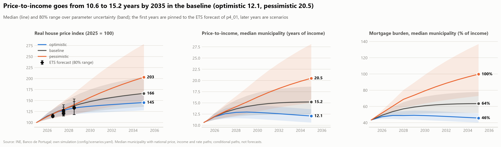
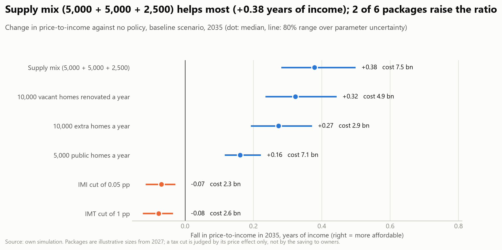
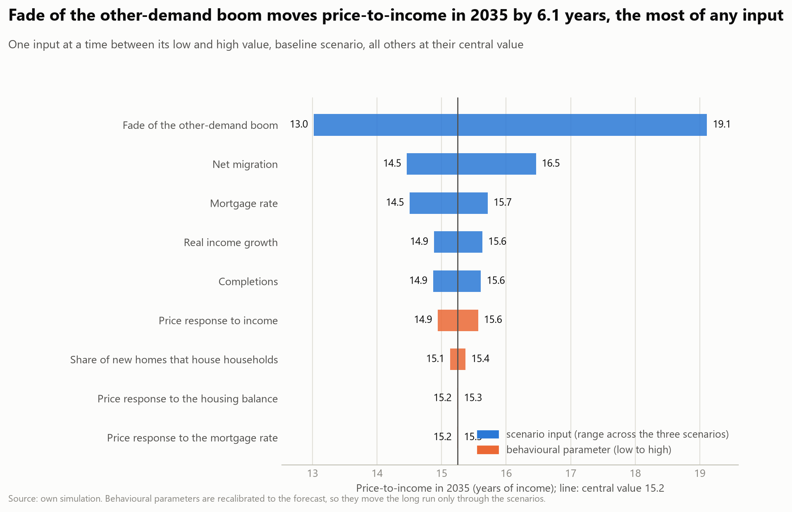

# Phase 4 — Forecast and simulate

Write-up of findings. Figures: `reports/figures/p4/`, tables: `reports/tables/p4/`, notebooks: `notebooks/p4_forecast/`.

**Status:** forecasting baselines and the national two-year forecast (`p4_01`) and the scenario simulator with its dashboard page
(`p4_02`, `app/pages/4_Simulator.py`) done, 2026-10-23. Regional detail (RQ10.2) and rents are not covered.

## Question

Which statistical forecaster should anchor the five to ten year affordability scenarios, and how wide must its intervals be?
Affordability is the outcome, so the forecast targets are the real house price index and an **ownership cost index** (real price
index × monthly payment per 100,000 EUR on a 30-year loan at the quarter's new-loan rate, 2024 = 100). The second is the quarterly
affordability indicator that exists: there is no quarterly national income, so the burden (cost over income) is formed in the simulator
from an income scenario.

## Design

- Series: national quarterly, 2009Q1 to 2026Q2 (70 quarters), on logs. Municipal series have 9 to 10 annual points (2016 to 2025), too
  short to validate a time-series model, so regional detail comes from the explanatory results of phase 2 and the simulator, not from
  municipal ETS or ARIMA.
- Methods (`analysis/forecasting.py`): naive, seasonal naive, drift, ETS (six forms, additive errors, chosen by AICc) and ARIMA(p,1,q)
  with or without drift (p, q ≤ 2, by AICc). Intervals: model-based for ETS and ARIMA, random-walk formulas for the baselines.
- Validation: rolling origin, first window 36 quarters (origins from 2017Q4), refit at every origin, horizons 1 to 8 quarters, RMSE, MASE,
  bias, coverage of the 80% and 95% intervals. Selection rule fixed before looking: lowest mean RMSE over horizons on both series.
- Checks: a 28-quarter first window, and dropping the origins of 2020 and 2021.

## Key findings

1. **ETS beats everything else on both series, and ARIMA is second.** RMSE relative to the naive forecast, mean over 1 to 8 quarters:
   real price index ETS 0.54, ARIMA 0.61, drift 0.77, seasonal naive 1.56; ownership cost index ETS 0.76, ARIMA 0.83, drift 1.00,
   seasonal naive 1.54. The ranking holds with a 28-quarter first window and without the 2020 and 2021 origins (ETS 0.50 to 0.54 and
   0.74 to 0.77). The rule picks **ETS** (additive trend with additive seasonality at the end of the sample).
2. **The naive forecast is badly biased in this period.** It under-forecasts real prices by 8.8 log points on average (ETS +0.8) because
   prices rose steadily; seasonal naive is worse than naive, so there is no usable seasonal pattern to repeat.
3. **The gain shrinks with the horizon for the cost index.** ETS beats naive by 37% one quarter ahead but by only 12% at eight (ARIMA by
   1%): credit costs move in jumps (2022 to 2023) that no trend model anticipates.
4. **Intervals are about right for prices and too narrow for the cost of ownership.** ETS 80% intervals contain 82% of price outcomes
   (95%: 96%) and 77% of cost-index outcomes (95%: 86%). The naive baseline contains 27% and 61%, so its intervals are the ones to distrust.
5. **Forecast, two years ahead (ETS, fitted on all 70 quarters).** Real price index 108 in 2026Q2 to 132 in 2028Q2 (80% range 115 to 150; the price index is INE's, 2025 = 100 nominal, deflated to
   2024 euros). Ownership cost index 108 to 127 (80% range 98 to 166; 2024 = 100). The model extends the recent trend; it knows nothing of rate or policy shocks.

## Limitations

- **One regime.** All origins (2017Q4 onward) lie in a boom: real prices fell until 2013 and rose after. A trend model wins in a boom by
  construction, and nothing here tests it on a turning point. The 2011 to 2013 downturn is inside the first window, not validated.
- **Eight quarters is the validated range.** A 20-quarter ETS forecast (tried first) extrapolates the boom to a real price index of 178 in
  2031 (80% range 91 to 348), so the five to ten year paths are scenarios, not statistical forecasts. This forecast is the starting point.
- **Short series, structural breaks.** 70 quarters with the 2011 crisis, the 2022 to 2023 rate shock and the pandemic; model selection by
  AICc on so few points is noisy.
- **National only, no income.** The ownership cost index excludes income; the municipal pattern (RQ10.2) is not forecast.
- **The index is a financing cost at constant real income**, not a burden: the level depends on the base period and on the assumed loan
  (30 years, one national rate, `MORTGAGE_TERM_YEARS`).

## Scenarios and the simulator (`p4_02`)

An annual, national stock-flow model, 2025 to 2035 (`src/pthousing/simulation`, assumptions and their sources in
`config/scenarios.yaml`, reasons in [decisions](../docs/decisions.md)). Population (natural change plus net migration) gives
households; completions and policy levers add dwellings that can house them; the households formed beyond those dwellings are the
year's *balance pressure*. Real prices respond to the pressure, to income growth and to the mortgage rate, plus an *other-demand*
drift (tourism, foreign buyers, credit, expectations) that **starts where the baseline reproduces the ETS forecast for 2028** (the
forecast's 80% interval sets the spread of that anchor) and fades at a scenario-specific pace. So the first three years are the
validated forecast, and the later years are scenarios. Price-to-income and the mortgage burden of the median municipality (2025:
10.6 years and 43%) move with the national price, income and mortgage-rate paths. Direct effects (homes, euros) are kept apart from
behavioural responses; each behavioural parameter has a low, mid and high value with a status (literature, project or assumption).
Uncertainty runs draw all of them (1,000 draws, triangular, common random numbers across scenarios and policies).

**Scenarios** (median and 80% parameter range in 2035; real prices relative to 2025):

| | Real price | Price-to-income (2025: 10.6) | Mortgage burden (2025: 43%) | Households short of a usable dwelling |
|---|---|---|---|---|
| Optimistic | +46% | 12.1 (10.6 to 13.6) | 46% | -221,000 (spare capacity) |
| Baseline | +68% | 15.2 (12.4 to 18.6) | 63% | +20,000 |
| Pessimistic | +108% | 20.5 (15.0 to 28.1) | 100% | +334,000 |

Tables: `scenario_paths.csv`, `scenario_end_year.csv`, `simulator_scenarios.csv`, `simulator_parameters.csv`.

### Key findings

6. **Whatever the scenario, price-to-income rises over the next three years, because the forecast says so.** The pin to the ETS forecast
   takes real prices up by about a third by 2028 in every scenario; the scenarios differ in what happens after (optimistic: price-to-income
   peaks around 2029 and falls; pessimistic: keeps rising). The pin inherits the weakness noted above: every validation origin lies in a boom.
7. **The fade of the other-demand boom matters more than any other input.** Moving its half-life from 1 to 4 years moves 2035's price-to-income
   from 13.0 to 19.1 (6.1 years); net migration across the three scenarios moves it by 2.0, the mortgage rate by 1.2, income growth and
   completions by 0.7 each. The behavioural parameters hardly move the long run (under 0.7 years each) because the near term is pinned to the
   forecast; they matter for what a lever *does* (`sensitivity.csv`, `sensitivity_tornado.png`). The half-life is an assumption with no estimate
   behind it, so the width of the scenario fan is, in part, a statement about that assumption.
8. **Supply levers help, modestly, and cost a lot.** From 2027, against no policy in the baseline, the fall in 2035's price-to-income (median, 80% range) is
   0.27 years (0.19 to 0.37) for 10,000 extra completions a year (about 2.9 billion EUR to 2035), 0.32 (0.24 to 0.44) for 10,000 renovated vacant homes
   (4.9 bn), 0.16 (0.12 to 0.22) for 5,000 public homes (7.1 bn) and 0.38 (0.28 to 0.50) for the mix of all three (7.5 bn). That is a 1% to 3% effect on
   a ratio that rises by 4.6 years in the baseline: the levers are small against the drift, and the gain has the same sign in every draw (`policy_effects.png`).
9. **Tax cuts raise the ratio.** An IMI cut of 0.05 pp (15% of the average bill, 2.3 bn EUR of revenue to 2035) and an IMT cut of 1 pp (2.6 bn) both
    worsen price-to-income (+0.07 and +0.08 years) because they can only enter through prices. Phase 3 could not tell whether IMI cuts are
    capitalised, so the lever is run at both ends: with no capitalisation prices do not move and the cost is pure revenue lost; with full capitalisation
    prices rise by 0.94% (the p3 benchmark, 0.19% per 0.01 pp) and the ratio by 0.14 years. This scores the cuts on affordability for *buyers*; the owners'
    saving on the tax bill is not in the indicator.
10. **The ranking of supply levers depends on unit costs, which are assumptions.** The model is linear in each lever, so a budget goes entirely to the lever with the
    largest gain per euro (all to extra completions at mid costs: 1.06 years (0.75 to 1.44) for 1 bn EUR a year, 11.5 bn over the period). Per billion euros,
    extra completions give 0.25, 0.12 and 0.05 years at their low, mid and high unit cost; renovation 0.21, 0.07, 0.04; public housing 0.07, 0.02, 0.01
    (`unit_cost_check.csv`). Extra completions beat renovation at equal cost positions, but extra completions at a high cost (0.05) lose to renovation at mid (0.07):
    the ranking is not robust to the cost assumptions. Public housing is the least efficient for *this* indicator, but it houses its tenants directly at an
    affordable rent, which the indicator (a median municipality's ownership ratio) does not measure.
11. **The effect of a lever grows with the pressure.** Extra completions lower the ratio by 0.22, 0.27 and 0.36 years in the optimistic, baseline and pessimistic
    scenarios (`policy_gain_by_scenario.csv`).

Tables: `policy_effects_baseline.csv`, `policy_gain_by_scenario.csv`, `imi_bounds.csv`, `budget_mixes.csv`, `unit_cost_check.csv`, `scenario_by_package.csv`.

### Limitations of the simulator

- **Conditional paths, not forecasts.** Only the first three years are anchored to a validated forecast. The scenarios are internally consistent stories with
  assumed inputs (`config/scenarios.yaml`); the bands show parameter uncertainty, not the probability of a scenario.
- **The long run rests on one unestimated assumption.** The fade of the other-demand drift (half-life 1, 2 or 4 years) has no estimate; it is the largest
  source of difference between scenarios. A boom that does not fade is the pessimistic case, one that fades at once the optimistic one.
- **Price response parameters are from the literature or assumed.** The price flexibility to the housing balance is the inverse of a demand elasticity from a survey of mostly
  non-Portuguese studies; the income elasticity, additionality, reoccupation and crowd-out are assumptions with stated bounds. The phase 2 associations (supply and affordability
  fade once the coast and density are accounted for) are not used as estimates, since they are adjusted associations. Nothing here is a causal estimate of a policy.
- **National and median.** One price, income and rate path moves the median municipality's ratio proportionally. Coast and city, where affordability worsened (phase 2), are not
  modelled separately (RQ10.2 stays open), and a supply lever acts the same everywhere although where it is built matters.
- **No feedback.** Completions are a scenario input, not a response to prices (phase 2 shows they follow prices); household formation does not react to affordability; rents are not
  modelled; demolitions are a fixed 11% of completions (census 2011 to 2021).
- **Household and population base.** Households are population over persons per household extrapolated from the census trend; the 2025 population change is assumed equal to 2024's (INE's
  figure for 2025 was not verified); the INE population series was revised between vintages, so only changes are used.
- **Fiscal figures are order-of-magnitude.** IMI revenue (1,630 million EUR, 2024, AT through the press) is scaled by the rate change relative to the simple mean of municipal rates (not
  weighted by the tax base); the IMT base is the value of dwellings sold from the panel, with a 100 m² benchmark dwelling. No behavioural change in transactions or assessed values.
  Costs are not discounted and are in 2024 euros. Unit costs of supply levers come from press reports of PRR projects and a VAT calculation.
- **Capitalisation of taxes** is run at both ends (none, full); the middle value of the uncertainty runs (0.5) is only the midpoint of the bound, not an estimate.

## Next

Regional detail: apply the simulator to the municipality typology (coast, urban) to answer RQ10.2; rents and a tenure split; a price-to-supply feedback once there is
an estimate of the supply response; the other dashboard pages (`1_Geographic`, `2_Trends`, `3_Explanatory`) are still stubs.
